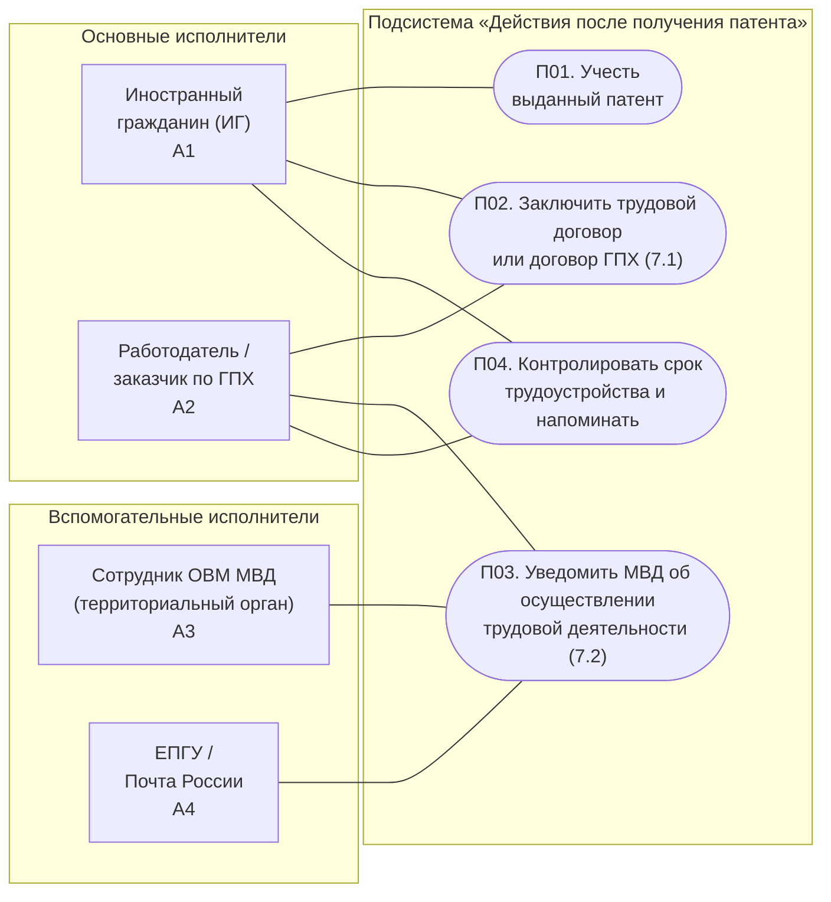

# Лабораторная 1. Определение прецедентов

**Дисциплина:** Функциональное моделирование систем
**Преподаватель:** Ткаченко И. Н., ТюмГУ
**Команда:** Малышева Елена, Макеев Глеб
**Тема (раздел дорожной карты):** **Тема 7. Действия после получения патента**
**Задание:** на основе описания предметной области определить функциональные требования в виде
диаграммы прецедентов со спецификацией (описание, основной исполнитель, основной сценарий,
альтернативные сценарии, при необходимости — предусловия и постусловия).

## Что в этой папке

| Файл | Что внутри |
|---|---|
| `README.md` | этот отчёт: границы подсистемы, перечень прецедентов, трассировка на дорожную карту, решения и открытые вопросы |
| `actors.md` | таблица акторов с типами (основной / вспомогательный) и обоснованием исключений |
| `usecase-diagram.md` | диаграмма прецедентов в Mermaid (рендерится на GitHub) с пояснениями связей |
| `usecase-diagram.puml` | та же диаграмма на PlantUML (+ отрендеренный `usecase-diagram.png`) |
| `usecases/01…04-*.md` | 4 спецификации прецедентов в развёрнутом формате |

## 1. Предметная область и границы подсистемы

### 1.1. Что рассматривается

Рассматривается **подсистема «Действия после получения патента»** — фрагмент информационной
системы сопровождения иностранного гражданина, который начинает работать **в момент выдачи
патента** и завершает работу, когда обязанности по патенту исполнены.

Это прямо соответствует теме 7 «Дорожной карты»: пункты 7.1 (трудоустройство) и 7.2 (уведомление
МВД об осуществлении трудовой деятельности). Тема распределена по командам, поэтому лабораторная
описывает **только свой раздел**, а не всю дорожную карту.

### 1.2. Вход и выход подсистемы

| | Содержание |
|---|---|
| **Вход** | Выданный патент (реквизиты: серия, номер, дата выдачи, срок действия, регион, профессия). Результат п. 6.3 дорожной карты. |
| **Предусловия (вне подсистемы)** | Действующий миграционный учёт (раздел 1); пройденная дактилоскопия и фотографирование (раздел 2); медицинское заключение и полис (раздел 3); выбранный и реализованный маршрут трудоустройства через патент (раздел 4); сертификат по русскому языку, ИНН, фотографии (раздел 5); заявление рассмотрено и патент выдан (раздел 6). Раздел 6 целиком предшествует подсистеме — см. §3.1. |
| **Выход** | Исполненные обязанности: заключённый трудовой договор или договор ГПХ (7.1), направленное в МВД уведомление с копией договора (7.2), а также сохранённые доказательства (договор, квитанция/трек-номер) и актуальный статус сроков. |

### 1.3. Границы системы

**Входит в подсистему:** учёт выданного патента и его реквизитов; расчёт срока
«2 месяца с даты выдачи патента»; ведение контрольных точек и напоминаний; регистрация трудового
договора или договора ГПХ и проверка его соответствия патенту; формирование комплекта уведомления
МВД (уведомление и копия договора); регистрация факта отправки и доказательств (квитанция ЕПГУ,
опись и трек-номер), которые вводит исполнитель; хранение доказательств; фиксация нарушения срока.

**Не входит** (делегируется внешним исполнителям или относится к другим разделам дорожной карты):
выдача патента и принятие решений о его аннулировании (МВД, раздел 6); миграционный учёт (раздел 1);
дактилоскопия (раздел 2); медицинское освидетельствование (раздел 3); экзамен по русскому языку
(раздел 5); программа переселения (разделы 8–9); РВП и ВНЖ (разделы 10–11). Последние три
раздела — темы других команд.

**Границы жёсткие.** Система **не создаёт обращений, не регистрирует иностранного гражданина
в МВД, не подаёт заявок и не отслеживает статусы** рассмотрения: она ведёт учёт, показывает
исполнителю состояние сроков, напоминает и сохраняет доказательства. С внешними системами
подсистема не интегрируется по API — уведомление отправляет исполнитель (работодатель) через ЕПГУ
или почтой вне подсистемы, а факт отправки и возврата фиксируется в системе. Поэтому во всех сценариях есть только действия
«зарегистрировать, показать, напомнить, зафиксировать», и нет ни одного шага, которого система
не выполняет.

Именно это разделение задаёт типы акторов: МВД — **адресат** уведомления, ЕПГУ и Почта России —
**канал** отправки; оба вспомогательные, а не основные.

### 1.4. Нормативные сроки темы 7 (дословно из дорожной карты)

| Пункт | Что нужно сделать | Срок | Для кого |
|---|---|---|---|
| 7.1 | Трудовой договор или договор гражданско-правового характера | **в течение 2 месяцев с даты выдачи патента** | иностранные граждане, получившие патент и не заключившие договор |
| 7.2 | Уведомление МВД об осуществлении трудовой деятельности (копия договора через Госуслуги или по почте) | **после заключения договора, но не позднее 2 месяцев с даты выдачи патента** | иностранные граждане, получившие патент и заключившие договор |

**Главная особенность темы:** оба срока отсчитываются не от действия ИГ (въезда, заключения
договора), а **от даты выдачи патента**. Поэтому ключевая дата подсистемы — именно она, и она
не меняется, даже если ИГ внёс патент в систему с опозданием.

## 2. Акторы

Типы и обоснование — в [`actors.md`](actors.md). Кратко — **4 актора**:

| Тип | Акторы |
|---|---|
| Основные | A1 Иностранный гражданин (основной для 7.1), A2 Работодатель / заказчик по ГПХ (основной для 7.2) |
| Вспомогательные | A3 Сотрудник ОВМ МВД (адресат уведомления), A4 ЕПГУ / Почта России (канал отправки) |

Ключевая особенность типизации: **у темы 7 два основных исполнителя с разными обязанностями.**
П. 7.1 адресован ИГ («трудоустроиться»), а п. 7.2 — работодателю (уведомить МВД). Поэтому
основной исполнитель меняется от прецедента к прецеденту, а «усреднённого» актора нет.

Закулисные роли в модели не выделяются: у каждого оставшегося участника есть действие в системе
или канал, через который он обслуживает прецедент. Намеренно **исключены** медицинские
и образовательные организации (их результаты — предусловия темы), а также ФГУП «ПВС», МФЦ,
страховая компания, профсоюз и СОУТ — обоснование в `actors.md`.

## 3. Прецеденты

| ID | Прецедент | Основной исполнитель | Уровень | Операции | Файл |
|---|---|---|---|---|---|
| П01 | Учесть выданный патент | Иностранный гражданин | задача пользователя | `зарегистрироватьПатент`, `пометитьПатентАрхивным` | [`usecases/01-…`](usecases/01-uchet-vydannogo-patenta.md) |
| П02 | Заключить трудовой договор или договор ГПХ (7.1) | Иностранный гражданин | задача пользователя | `получитьСведенияОпатенте`, `заключитьДоговор`, `отменитьДоговор` | [`usecases/02-…`](usecases/02-trudovoy-dogovor.md) |
| П03 | Уведомить МВД об осуществлении трудовой деятельности (7.2) | Работодатель / заказчик по ГПХ | задача пользователя | `направитьУведомлениеМВД`, `зафиксироватьВозвратУведомления` | [`usecases/03-…`](usecases/03-uvedomlenie-mvd.md) |
| П04 | Контролировать срок трудоустройства и напоминать | Иностранный гражданин | вспомогательная функция | `пересчитатьСрокиПатента`, `настроитьНапоминания`, `зафиксироватьНарушениеСрока` | [`usecases/04-…`](usecases/04-kontrol-sroka-trudoustroystva.md) |

Итого **4 прецедента и 10 системных операций**, каждый прецедент — в развёрнутом формате:
название, рамки, уровень, основной исполнитель, заинтересованные лица и их интересы, предусловия,
постусловия, основной успешный сценарий (две колонки: действия исполнителя / отклик системы),
альтернативные сценарии с нумерацией `Nа` и сквозными `*а`, специальные требования, частота
использования, открытые вопросы.

Прецеденты **не смешиваются**: учёт патента не содержит контроля сроков, контроль сроков не
содержит заключения договора, уведомление не содержит регистрации договора.

### 3.1. Почему 4 прецедента, а не больше

Правило задания — «не глубина, а полнота»: лучше 4 полных прецедента, чем 7 недоделанных.
Поэтому в модель вошло ровно то, что следует из пп. 7.1 и 7.2, плюс один вход подсистемы:

| Что | Почему в модели / почему нет |
|---|---|
| **П01 Учесть патент** | Формально это предусловие темы (патент выдан в разделе 6), но без него нельзя посчитать ни один из сроков: оба отсчитываются от даты выдачи. Поэтому П01 — единственный прецедент-вход, а не «расширение». |
| **П02 Договор (7.1)** | Прямо п. 7.1. Отдельный устойчивый результат — заключённый договор. |
| **П03 Уведомление МВД (7.2)** | Прямо п. 7.2. Другой результат (направленное уведомление) и другой основной исполнитель (работодатель). |
| **П04 Контроль сроков** | Обслуживает оба пункта: следит за сроком 7.1 и сроком 7.2, напоминает и фиксирует нарушение. Это самостоятельный результат (актуальный статус сроков и доказательство нарушения), а не шаг П02/П03. |
| ~~Оплата НДФЛ~~ | Это **п. 6.1 дорожной карты**: авансовый платёж вносится до подачи заявления на патент, то есть **до** выдачи патента. Для темы 7 это предусловие, а не действие после получения патента. Прецедент не создаётся. |
| ~~Реестры и отчёты~~ | В разделе 7 дорожной карты такого требования нет; сводная отчётность — служебная функция, которой в постановке не существует. |
| ~~Прекращение договора и смена работодателя~~ | В разделе 7 не описаны: ни оснований, ни сроков, ни обязательного уведомления. Придумывать требование, которого нет в дорожной карте, нельзя — иначе в модели появится операция, которой нет в системе (нарушение правила «всё, что обещаем — должны сделать»). |

Дробить эти четыре дальше («сфотографировать патент», «проверить данные», «выбрать канал») нельзя:
по критерию размера это шаги одного сценария, а не отдельные прецеденты.

### 3.2. Трассировка: дорожная карта → прецеденты → сроки

| Пункт ДК | Требование | Прецеденты, реализующие требование | Проверяемый срок |
|---|---|---|---|
| **7.1** | Трудоустроиться: заключить трудовой договор или договор ГПХ | **П02** (основной), **П01** (вход: учёт патента и расчёт срока), **П04** (контроль срока и напоминания) | договор — не позднее **2 месяцев с даты выдачи патента** |
| **7.2** | Направить в МВД уведомление с копией договора через Госуслуги или по почте | **П03** (основной), **П02** (предусловие: договор), **П04** (контроль срока) | после заключения договора и не позднее **2 месяцев с даты выдачи патента** |

Оба срока в таблице привязаны к одной и той же дате — **дате выдачи патента**, что делает П01 и
П04 обязательными участниками обоих пунктов.

## 4. Диаграмма прецедентов

Mermaid не умеет UML use case, поэтому использован `flowchart`: акторы — прямоугольники в
группах по типу, прецеденты — узлы-эллипсы `([ ])` внутри границы системы, сплошная линия —
ассоциация «актор — прецедент».

**Отношений `include` и `extend` на диаграмме нет намеренно:** четыре прецедента независимы.
Связь между ними — только через **предусловия**: П01 — вход (патент учтён), П02 требует учтённого
патента, П03 требует заключённого договора, П04 контролирует сроки, появившиеся в П01. Это
внешние зависимости «результат одного прецедента — условие другого», а не обязательное включение
шагов: у каждого прецедента своя цель, свой исполнитель и свой результат. Подробные пояснения —
в [`usecase-diagram.md`](usecase-diagram.md).

Проверка: PlantUML-версия отрендерена локально (`plantuml -checkonly` + `-tpng`, PNG 673 × 490).
Mermaid-версия повторяет ту же структуру один-в-один (4 актора, 4 прецедента, 8 ассоциаций,
отношений `include`/`extend` нет), поэтому расхождений между двумя версиями диаграммы быть не может.

## 5. Решения по моделированию

1. **Рамки — подсистема, а не вся дорожная карта.** Тема 7 распределена на команду, поэтому
   в лабораторную не вошли разделы 1–6 (предусловия) и 8–11 (другие команды). Это главное
   отличие от первоначального черновика по всей дорожной карте (черновик сохранён вне репозитория).
2. **4 прецедента, а не 2.** Пункты 7.1 и 7.2 сформулированы как две обязанности, но устойчивых
   результатов и исполнителей в них больше: учёт патента, заключение договора, уведомление,
   контроль сроков. Обоснование границ — §3.1.
3. **Основной исполнитель меняется: ИГ (7.1) → работодатель (7.2).** Это следует из текста
   дорожной карты и отражено в спецификациях, а не «усреднено» до одного актора.
4. **Срок считается от даты выдачи патента, а не от даты его ввода в систему.** Иначе переход
   на «просроченный» патент давал бы ИГ фиктивные 2 месяца. Явно зафиксировано как специальное
   требование П01 и П04.
5. **«Госуслуги» и «Почта» — два канала одного вспомогательного актора.** Прецедент П03 работает
   с любым каналом из одного набора данных; альтернативный сценарий — переход на почту
   при недоступности ЕПГУ.
6. **Никаких `include`/`extend`.** Все четыре прецедента независимы, а их последовательность
   задаётся предусловиями. `include` заставил бы рисовать П02 «внутри» П01 и дублировать шаги;
   `extend` потребовал бы необязательных прецедентов, которых в теме 7 нет.
7. **В сценариях нет шагов вне границ системы.** Система регистрирует, показывает, напоминает
   и фиксирует; она не создаёт обращений, не регистрирует ИГ в МВД, не подаёт заявок и не
   отслеживает статусы. Возврат письма и просрочка — тоже фиксация факта, а не обработка
   ведомственного ответа.
8. **Базовый стиль и «чёрный ящик».** В сценариях нет элементов интерфейса и SQL: только
   намерения исполнителя и обязанности системы.

## 6. Что осталось за рамками лаб. 1

- Не детализированы структуры данных (патент, договор, уведомление, контрольная точка) —
  это лабораторная 2 (модель предметной области).
- Нет системных диаграмм последовательностей и спецификаций операций — лаб. 3.
- Нет диаграмм коммуникаций и классов проектирования — лаб. 4–5.
- Не выбраны технология и архитектура — лаб. 6.

## 7. Неоднозначности и открытые вопросы

1. **Что считать «действием после получения патента»?** В дорожной карте это ровно два пункта —
   7.1 и 7.2. П01 добавлен как вход подсистемы (без него не считается срок), П04 — как общий
   контроль обоих сроков. Требуется подтверждение преподавателя, что такой вход допустим.
2. **«2 месяца» — календарных или 60 дней?** В модели принят календарный месяц (срок истекает
   в соответствующее число), но в документе это не раскрыто; тот же вопрос касается нерабочих дней.
3. **Кто уведомляет МВД при договоре ГПХ?** В тексте п. 7.2 обязанность не разграничена между
   работодателем и заказчиком. В модели она закреплена за работодателем/заказчиком (A2) как за
   стороной, заключающей договор.
4. **Смена работодателя и расторжение договора в дорожной карте не описаны** — поэтому
   прецедента нет. При этом без учёта этих событий нельзя проверить инвариант «один действующий
   договор на патент» (лаб. 2); как его поддерживать — открытый вопрос.
5. **Срок действия патента (12 месяцев)** в теме 7 не указан — взято из общего знания о патенте
   и помечено как требующее подтверждения (контрольная точка «истекает срок действия патента»).
6. **Документ — это чек-лист, а не описание системы.** «Дорожная карта» задаёт требования к ИГ,
   но не описывает функций информационной системы. Все границы, акторы и каналы — результат
   анализа предметной области, а не вычитка требований. Это главный риск расхождения ожиданий
   по масштабу системы.
7. **Не указано, требуется ли автоматическая проверка подлинности патента** (запрос сведений
   в МВД) или достаточно данных, введённых ИГ, и скана. Вынесено в открытые вопросы П01.
8. **Региональная специфика.** Перечень допустимых профессий и регион действия зависят от
   субъекта РФ; в дорожной карте это не раскрыто, в модели вынесено в справочники и открытые
   вопросы.
