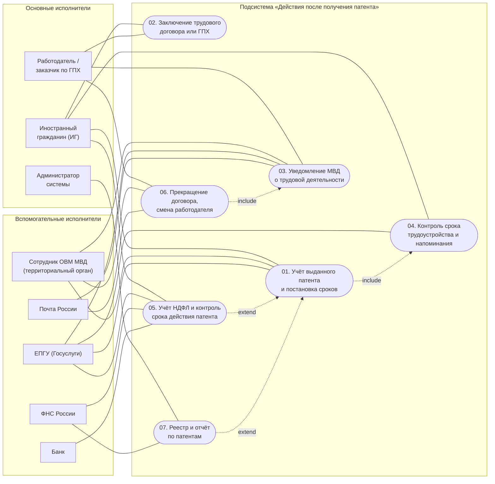

# Лабораторная 1. Определение прецедентов

**Дисциплина:** Функциональное моделирование систем
**Преподаватель:** Ткаченко И. Н., ТюмГУ
**Команда:** Малышева Елена, Макеев Глеб, Мальгин Олег
**Тема (раздел дорожной карты):** **Тема 7. Действия после получения патента**
**Задание:** на основе описания предметной области определить функциональные требования в виде
диаграммы прецедентов со спецификацией (описание, основной исполнитель, основной сценарий,
альтернативные сценарии, при необходимости — предусловия и постусловия).

## Что в этой папке

| Файл | Что внутри |
|---|---|
| `README.md` | этот отчёт: границы подсистемы, перечень прецедентов, трассировка на дорожную карту, решения и открытые вопросы |
| `actors.md` | таблица акторов с типами (основной / вспомогательный / закулисный) и обоснованием исключений |
| `usecase-diagram.md` | диаграмма прецедентов в Mermaid (рендерится на GitHub) с пояснениями связей |
| `usecase-diagram.puml` | та же диаграмма на PlantUML (+ отрендеренный `usecase-diagram.png`) |
| `usecases/01…07-*.md` | 7 спецификаций прецедентов в развёрнутом формате |

## 1. Предметная область и границы подсистемы

### 1.1. Что рассматривается

Рассматривается **подсистема «Действия после получения патента»** — фрагмент информационной
системы сопровождения иностранного гражданина, который начинает работать **в момент выдачи
патента** и завершает работу, когда обязанности по патенту исполнены (либо патент прекращён).

Это прямо соответствует теме 7 «Дорожной карты»: пункты 7.1 (трудоустройство) и 7.2 (уведомление
МВД об осуществлении трудовой деятельности). Тема распределена по командам, поэтому лабораторная
описывает **только свой раздел**, а не всю дорожную карту.

### 1.2. Вход и выход подсистемы

| | Содержание |
|---|---|
| **Вход** | Выданный патент (реквизиты: серия, номер, дата выдачи, срок действия, регион, профессия). Результат п. 6.3 дорожной карты. |
| **Предусловия (вне подсистемы)** | Действующий миграционный учёт (раздел 1); пройденная дактилоскопия и фотографирование (раздел 2); медицинское заключение и полис (раздел 3); выбранный и реализованный маршрут трудоустройства через патент (раздел 4); сертификат по русскому языку, ИНН, фотографии (раздел 5); поданное заявление и уплаченный первый авансовый платёж НДФЛ (раздел 6). |
| **Выход** | Исполненные обязанности: заключённый трудовой договор или договор ГПХ (7.1), направленное в МВД уведомление с копией договора (7.2), а также сохранённые доказательства (договор, квитанция/трек-номер) и актуальный статус патента. |

### 1.3. Границы системы

**Входит в подсистему:** учёт выданного патента и его реквизитов; расчёт срока
«2 месяца с даты выдачи патента»; ведение контрольных точек и напоминаний; регистрация трудового
договора или договора ГПХ и проверка его соответствия патенту; подготовка и направление
уведомления МВД через ЕПГУ или почтой; хранение квитанций и подтверждений; учёт авансовых
платежей НДФЛ и сроков действия патента (расширение); учёт прекращения договора и смены
работодателя (расширение); служебный реестр и отчётность (расширение).

**Не входит** (делегируется внешним исполнителям или относится к другим разделам дорожной карты):
выдача патента и принятие решений о его аннулировании (МВД, раздел 6); медицинское освидетельствование
(раздел 3); экзамен по русскому языку (раздел 5); постановка на миграционный учёт (раздел 1);
программа переселения (разделы 8–9); РВП и ВНЖ (разделы 10–11). Последние три раздела — темы
других команд.

Именно это разделение задаёт типы акторов: МВД, ЕПГУ, Почта России, ФНС, банк —
**вспомогательные** (обслуживают подсистему), а не основные.

### 1.4. Нормативные сроки темы 7 (дословно из дорожной карты)

| Пункт | Что нужно сделать | Срок | Для кого |
|---|---|---|---|
| 7.1 | Трудовой договор или договор гражданско-правового характера | **в течение 2 месяцев с даты выдачи патента** | иностранные граждане, получившие патент и не заключившие договор |
| 7.2 | Уведомление МВД об осуществлении трудовой деятельности (копия договора через Госуслуги или по почте) | **после заключения договора, но не позднее 2 месяцев с даты выдачи патента** | иностранные граждане, получившие патент и заключившие договор |

**Главная особенность темы:** оба срока отсчитываются не от действия ИГ (въезда, заключения
договора), а **от даты выдачи патента**. Поэтому ключевая дата подсистемы — именно она, и она
не меняется, даже если ИГ внёс патент в систему с опозданием.

## 2. Акторы

Типы и обоснование — в [`actors.md`](actors.md). Кратко:

| Тип | Акторы |
|---|---|
| Основные | A1 Иностранный гражданин (сквозной), A2 Работодатель / заказчик по ГПХ, A8 Администратор системы (только в П07) |
| Вспомогательные | A3 Сотрудник ОВМ МВД, A4 ЕПГУ (Госуслуги), A5 Почта России, A6 ФНС (в П05), A7 Банк |
| Закулисные | A2 и A6 в «не своих» прецедентах; регион, руководитель организации (интересы учтены в постусловиях) |

Ключевая особенность типизации: **у темы 7 два основных исполнителя с разными обязанностями.**
П. 7.1 адресован ИГ («трудоустроиться»), а п. 7.2 — работодателю (уведомить МВД). Поэтому
основной исполнитель меняется от прецедента к прецеденту.

Намеренно **исключены** медицинские и образовательные организации (их результаты — предусловия
темы), а также ФГУП «ПВС», МФЦ, страховая компания, профсоюз и СОУТ — обоснование в `actors.md`.

## 3. Прецеденты

| ID | Прецедент | Основной исполнитель | Уровень | Файл |
|---|---|---|---|---|
| П01 | Учёт выданного патента и постановка сроков под контроль | Иностранный гражданин | задача пользователя | [`usecases/01-…`](usecases/01-uchet-vydannogo-patenta.md) |
| П02 | Трудоустройство: заключение трудового договора или договора ГПХ | Иностранный гражданин | задача пользователя | [`usecases/02-…`](usecases/02-trudovoy-dogovor.md) |
| П03 | Уведомление МВД об осуществлении трудовой деятельности | Работодатель | задача пользователя | [`usecases/03-…`](usecases/03-uvedomlenie-mvd.md) |
| П04 | Контроль срока трудоустройства и напоминания | Иностранный гражданин | вспомогательная функция | [`usecases/04-…`](usecases/04-kontrol-sroka-trudoustroystva.md) |
| П05 | Учёт авансовых платежей НДФЛ и контроль срока действия патента *(расширение)* | Иностранный гражданин | вспомогательная функция | [`usecases/05-…`](usecases/05-ndfl-i-prodlenie-patenta.md) |
| П06 | Прекращение договора, смена работодателя и повторное уведомление МВД *(расширение)* | Работодатель | задача пользователя | [`usecases/06-…`](usecases/06-prekrashchenie-dogovora.md) |
| П07 | Формирование реестра и отчёта по патентам и договорам *(расширение)* | Администратор системы | вспомогательная функция | [`usecases/07-…`](usecases/07-reestr-i-otchety.md) |

Итого **7 прецедентов**, каждый — в развёрнутом формате: название, рамки, уровень, основной
исполнитель, заинтересованные лица и их интересы, предусловия, постусловия, основной успешный
сценарий (две колонки: действия исполнителя / отклик системы), альтернативные сценарии с
нумерацией `Nа` и сквозными `*а`, специальные требования, частота использования, открытые вопросы.

**П01–П04 — ядро темы 7** (прямо следуют из пп. 7.1 и 7.2).
**П05–П07 помечены как «расширение, требует подтверждения преподавателем»**: в дорожной карте
таких пунктов нет, они добавлены для целостности подсистемы (без них патент «живёт» только
до первого уведомления, а нарушения никак не выявляются). Если преподаватель сочтёт их
выходящими за тему — прецеденты удаляются без перестройки ядра.

### 3.1. Трассировка: дорожная карта → прецеденты → сроки

| Пункт ДК | Требование | Прецеденты, реализующие требование | Проверяемый срок |
|---|---|---|---|
| **7.1** | Трудоустроиться: заключить трудовой договор или договор ГПХ | **П02** (основной), **П01** (вход: учёт патента и расчёт срока), **П04** (контроль срока и напоминания) | договор — не позднее **2 месяцев с даты выдачи патента** |
| **7.2** | Направить в МВД уведомление с копией договора через Госуслуги или по почте | **П03** (основной), **П04** (контроль срока), **П06** (расширение: повторное уведомление при смене работодателя) | после заключения договора и не позднее **2 месяцев с даты выдачи патента** |
| — (расширение) | Сохранять действие патента: платить НДФЛ и вовремя продлевать | **П05** | ежемесячно; срок действия патента — 12 месяцев (требует подтверждения) |
| — (расширение) | Выявлять нарушения сроков и вести сводный учёт | **П07** | по регламенту (например, ежемесячно) |

Оба срока в таблице привязаны к одной и той же дате — **дате выдачи патента**, что делает П01 и
П04 обязательными участниками обоих пунктов.

## 4. Диаграмма прецедентов

Mermaid не умеет UML use case, поэтому использован `flowchart`: акторы — прямоугольники в
группах по типу, прецеденты — узлы-эллипсы `([ ])` внутри границы системы, сплошная линия —
ассоциация, пунктир с подписью `include` / `extend` — обязательное включение / необязательное
расширение. Пояснения к каждой связи (включая то, почему П02 и П03 связаны предусловием, а не
`include`) — в [`usecase-diagram.md`](usecase-diagram.md).

Проверка: PlantUML-версия отрендерена локально (`plantuml -checkonly` + `-tpng`, PNG 1309 × 818);
Mermaid-версия **проверена рендерингом** (`@mermaid-js/mermaid-cli` → PNG, ошибок синтаксиса нет).

## 5. Решения по моделированию

1. **Рамки — подсистема, а не вся дорожная карта.** Тема 7 распределена на команду, поэтому
   в лабораторную не вошли разделы 1–6 (предусловия) и 8–11 (другие команды). Это главное
   отличие от первоначального черновика по всей дорожной карте (черновик сохранён вне репозитория).
2. **7 прецедентов, а не 2.** Пункты 7.1 и 7.2 сформулированы как две обязанности, но
   устойчивых результатов и исполнителей в них больше: учёт патента, контроль срока, заключение
   договора, уведомление, прекращение договора. Дробить дальше («сфотографировать патент»,
   «проверить данные») нельзя: по критерию размера это шаги одного сценария.
3. **Основной исполнитель меняется: ИГ (7.1) → работодатель (7.2).** Это следует из текста
   дорожной карты и отражено в спецификациях, а не «усреднено» до одного актора.
4. **Срок считается от даты выдачи патента, а не от даты его ввода в систему.** Иначе переход
   на «просроченный» патент давал бы ИГ фиктивные 2 месяца. Явно зафиксировано как специальное
   требование П01 и П04.
5. **«Госуслуги» и «Почта» — два равноправных канала, оба вспомогательные акторы.** Прецедент П03
   работает с любым каналом из одного набора данных; альтернативный сценарий — переход на почту
   при недоступности ЕПГУ.
6. **`include` только там, где включение обязательно.** `П01 include П04` (нельзя учесть патент,
   не рассчитав сроки) и `П06 include П03` (смена работодателя всегда требует нового уведомления).
   Зависимость «договор → уведомление» — предусловие, а не `include`: договор существует и сам
   по себе, а уведомление может относиться к ранее учтённому договору.
7. **`extend` для платежей НДФЛ и отчётности.** Эти прецеденты необязательны для основного
   сценария темы 7 и явно помечены как расширения.
8. **Базовый стиль и «чёрный ящик».** В сценариях нет элементов интерфейса и SQL: только
   намерения исполнителя и обязанности системы.

## 6. Что осталось за рамками лаб. 1

- Не детализированы структуры данных (патент, договор, уведомление, платёж, контрольная точка) —
  это лабораторная 2 (модель предметной области).
- Нет системных диаграмм последовательностей и спецификаций операций — лаб. 3.
- Нет диаграмм коммуникаций и классов проектирования — лаб. 4–5.
- Не выбраны технология и архитектура — лаб. 6.

## 7. Неоднозначности и открытые вопросы

1. **Что считать «действием после получения патента»?** В дорожной карте это ровно два пункта —
   7.1 и 7.2. Остальные прецеденты (П05–П07) добавлены по здравому смыслу и помечены как
   расширения. Требуется подтверждение преподавателя: включать ли их.
2. **Учёт НДФЛ: тема 7 или тема 6?** В разделе 6.1 упомянут только *первый* авансовый платёж
   («до подачи заявления на патент»), а обязанность платить НДФЛ в течение срока действия патента
   в дорожной карте отдельным пунктом не описана. Прецедент П05 включён как расширение.
3. **«2 месяца» — календарных или 60 дней?** В модели принят календарный месяц (срок истекает
   в соответствующее число), но в документе это не раскрыто; тот же вопрос касается нерабочих дней.
4. **Кто уведомляет МВД при договоре ГПХ?** В тексте п. 7.2 обязанность не разграничена между
   работодателем и заказчиком. В модели она закреплена за работодателем/заказчиком (A2) как за
   стороной, заключающей договор.
5. **Смена работодателя и расторжение договора в дорожной карте не описаны** (П06) — при этом без
   их учёта нельзя проверить, что «не более одного действующего договора на патент». Расширение.
6. **Срок действия патента (12 месяцев) и порядок продления** в теме 7 не указаны — взяты из
   общего знания о патенте и помечены как требующие подтверждения (П05, инварианты лаб. 2).
7. **Документ — это чек-лист, а не описание системы.** «Дорожная карта» задаёт требования к ИГ,
   но не описывает функций информационной системы. Все границы, акторы и интеграции — результат
   анализа предметной области, а не вычитка требований. Это главный риск расхождения ожиданий
   по масштабу системы.
8. **Не указано, требуется ли автоматическая проверка подлинности патента** (запрос в реестр МВД)
   или достаточно данных, введённых ИГ, и скана. Вынесено в открытые вопросы П01.
9. **Региональная специфика.** Стоимость патента и перечень допустимых профессий зависят от
   субъекта РФ; в дорожной карте это не раскрыто, в модели вынесено в справочники и открытые вопросы.

## 8. Чек-лист сдачи лаб. 1

- [x] Диаграмма прецедентов (Mermaid + PlantUML + PNG)
- [x] Акторы с типами: основной / вспомогательный / закулисный, с обоснованием исключений
- [x] Спецификация на каждый прецедент в развёрнутом формате
- [x] Основной исполнитель указан в каждом прецеденте
- [x] Основной успешный сценарий по шагам, в двух колонках (исполнитель / система)
- [x] Альтернативные сценарии с нумерацией `Nа` и сквозными `*а`
- [x] Предусловия и постусловия в каждом прецеденте
- [x] Границы подсистемы: вход (патент), выход (исполненные обязанности), что вне границ
- [x] Трассировка пунктов 7.1 / 7.2 на прецеденты и сроки
- [x] Раздел «Неоднозначности и открытые вопросы»
- [ ] Проверить с преподавателем: включать ли расширения (П05–П07) и как считать «2 месяца»
