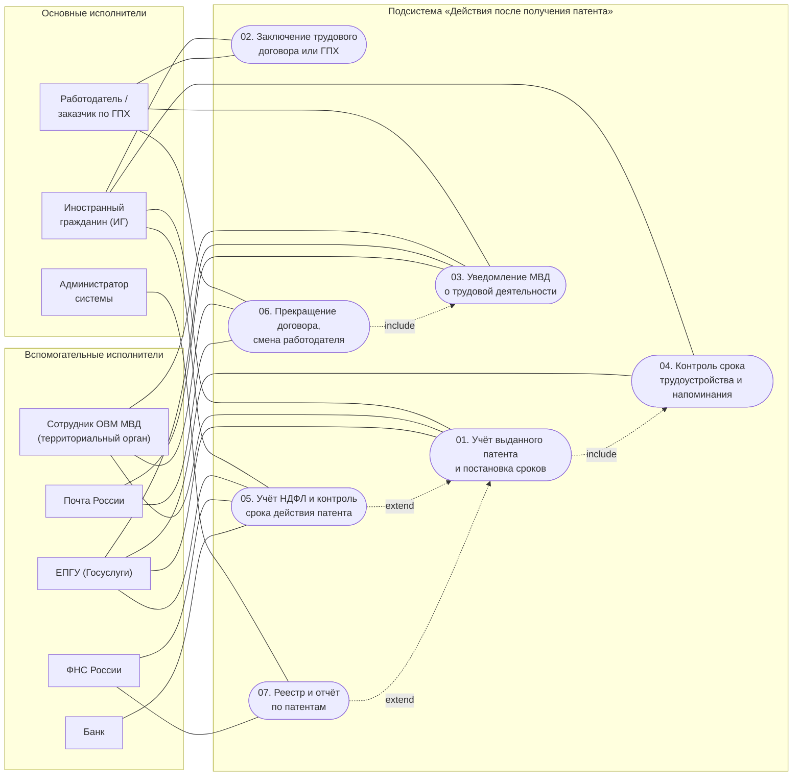

# Диаграмма прецедентов подсистемы «Действия после получения патента»

Mermaid не поддерживает нативный UML use case, поэтому диаграмма построена как направленный граф:
акторы — прямоугольные узлы в группах по типу, прецеденты — узлы-«эллипсы» (`([ ])`) внутри
границы системы. Сплошная линия без стрелки — ассоциация «актор — прецедент», пунктир со
стрелкой — отношение `include` (обязательное включение) или `extend` (необязательное расширение).

PlantUML-версия той же диаграммы: [`usecase-diagram.puml`](usecase-diagram.puml)
(+ отрендеренный [`usecase-diagram.png`](usecase-diagram.png)).

## Пояснения к связям

- **`UC01 include UC04` — расчёт сроков обязателен.** Невозможно «поставить патент под контроль»,
  не рассчитав контрольные точки. Это ядро подсистемы: срок 2 месяца с даты выдачи патента —
  главный срок темы 7, и он должен появиться в системе ровно в момент учёта патента.
- **`UC06 include UC03` — при смене работодателя уведомление обязательно.** Уведомление МВД
  (п. 7.2) направляется заново при каждом новом договоре, поэтому сценарий смены работодателя
  всегда включает сценарий уведомления, а не повторяет его текст.
- **`UC05 extend UC01` — учёт платежей НДФЛ расширяет контроль патента.** Платежи ведутся только
  пока патент действует, и прецедент помечен как расширение темы (см. `usecases/05-…`): если
  преподаватель отнесёт его к разделу 6, стрелка просто удаляется.
- **`UC07 extend UC01` — отчётность расширяет учёт патентов.** Служебная функция администратора,
  необязательная с точки зрения основного сценария.
- **`П03` и `П02` связаны предусловием, а не `include`.** Уведомление МВД невозможно без
  заключённого договора, но договор — отдельный устойчивый результат (он существует и без
  уведомления, а уведомление может относиться к договору, уже учтённому ранее). Поэтому
  зависимость зафиксирована в предусловиях П03, а не в структуре диаграммы. Такой же приём
  использован в черновике лаб. 1 по всей дорожной карте (связь «патент → трудоустройство»).
- **`П01` — вход подсистемы.** Патент выдаётся в разделе 6 дорожной карты (вне границ темы 7),
  и П01 лишь регистрирует уже выданный патент. Отношения `include`/`extend` с разделами 1–6
  не проводятся: это другой предмет рассмотрения.
- **Обобщений между акторами нет намеренно.** «Работодатель» и «заказчик по ГПХ» — разные
  правовые роли с одинаковым интерфейсом; они объединены в один актор `EMP` с признаком вида
  договора, но без UML-обобщения, чтобы не потерять различие обязанностей.
- **Сотрудник ОВМ МВД ассоциирован с П01.** Он не выполняет функцию системы, но является
  источником сведений о выдаче/аннулировании патента (участник П01 и П06).
