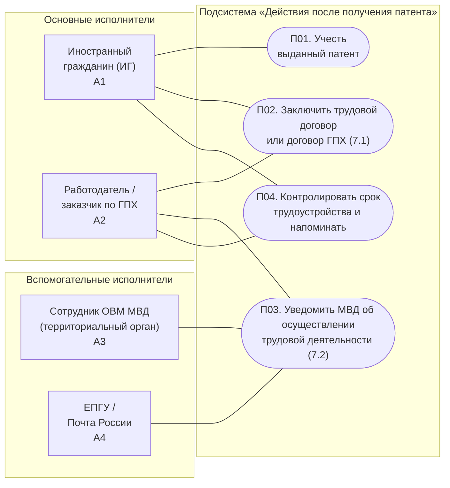

# Диаграмма прецедентов подсистемы «Действия после получения патента»

Mermaid не поддерживает нативный UML use case, поэтому диаграмма построена как направленный граф:
акторы — прямоугольные узлы в группах по типу, прецеденты — узлы-«эллипсы» (`([ ])`) внутри
границы системы. Сплошная линия — ассоциация «актор — прецедент». **Пунктирных стрелок
`include`/`extend` на диаграмме нет:** четыре прецедента независимы, а связь между ними выражена
через предусловия (пояснения ниже).

PlantUML-версия той же диаграммы: [`usecase-diagram.puml`](usecase-diagram.puml)
(+ отрендеренный [`usecase-diagram.png`](usecase-diagram.png)).

## Пояснения к связям

- **Ассоциации — только «кто инициирует / кого обслуживает прецедент».** A1 связан с П01, П02 и П04:
  он вносит патент (П01), трудоустраивается (7.1 → П02) и получает напоминания о сроке (П04).
  A2 связан с П02 (как вторая сторона договора), с П03 (уведомление МВД по п. 7.2 — его
  обязанность) и с П04: срок уведомления лежит на нём, поэтому он получает те же напоминания,
  что и ИГ. A3 и A4 связаны только с П03: первый — адресат уведомления, второй — канал отправки.
- **Связи между прецедентами — через предусловия, а не через `include`.** П02 выполняется после
  П01 (нельзя заключить договор по неучтённому патенту), П03 — после П02 (уведомление невозможно
  без договора), П04 контролирует сроки, которые появляются в П01. Это внешние зависимости
  «результат одного прецедента — условие другого», а не обязательное включение шагов: каждый
  прецедент имеет собственную цель, собственного исполнителя и самостоятельный результат.
  Поэтому `include` не используется — иначе П02 пришлось бы рисовать «внутри» П01, а сценарии
  стали бы нечитаемыми.
- **`extend` не используется вовсе.** В модели нет необязательных расширений: всё, что делает
  система, прямо следует из пп. 7.1 и 7.2. Альтернативные ветви (отказ работодателя, возврат
  письма, просрочка) — это сценарии внутри прецедента, а не отдельные прецеденты.
- **П01 — вход подсистемы.** Патент выдаётся в разделе 6 дорожной карты (вне границ темы 7),
  и П01 лишь регистрирует уже выданный патент. Отношения с разделами 1–6 не проводятся: это
  другой предмет рассмотрения (предусловия указаны в спецификациях).
- **Обобщений между акторами нет намеренно.** «Работодатель» и «заказчик по ГПХ» — разные
  правовые роли с одинаковым интерфейсом; они объединены в один актор `A2` с признаком вида
  договора, но без UML-обобщения, чтобы не потерять различие обязанностей.
- **A3 не выполняет функцию системы.** Сотрудник ОВМ МВД не «регистрирует» ничего через
  подсистему: он получает уже сформированное уведомление. Поэтому он вспомогательный актор,
  а не основной, и связан только с П03.
