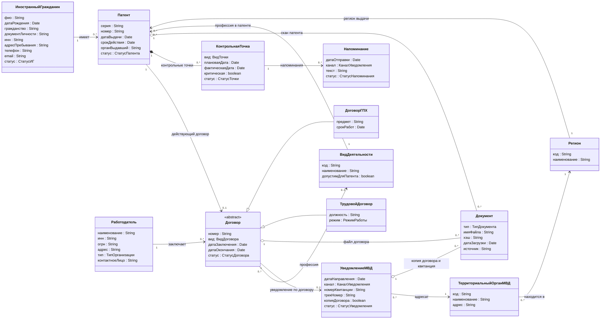

# Диаграмма классов предметной области

**Тема:** «Действия после получения патента» (раздел 7 «Дорожной карты»).
**Задание:** описать модель предметной области в виде диаграммы классов.

Модель описывает **понятия предметной области и связи между ними**, а не классы реализации:
только атрибуты, без методов и без суррогатных ключей. Соглашения:

- атрибуты записаны как `<имя> : <тип>`, без модификаторов видимости (`+`, `-`, `#`);
- кратности связей — в формате UML (`1`, `0..1`, `0..*`);
- ромб `*--` — композиция (часть не существует без целого), `o--` — агрегация,
  `-->` — ассоциация, `<|--` — обобщение;
- «предметные типы» (например, `СтатусПатента`) раскрыты в [README.md](README.md), раздел 5.

PlantUML-версия: [`class-diagram.puml`](class-diagram.puml) (+ [`class-diagram.png`](class-diagram.png)).

## Пояснения к ключевым связям

| Связь | Кратность | Что означает |
|---|---|---|
| `ИностранныйГражданин → Патент` | `1 → 0..*` | у одного ИГ может быть несколько патентов (последовательно, по срокам и регионам), но **действующий — не более одного** (ИНВ-5) |
| `Регион → Патент` | `1 → 0..*` | патент действует только в выдавшем его субъекте РФ; в регионе может не быть ни одного патента |
| `ВидДеятельности → Патент` | `1 → 0..*` | в патенте указывается профессия из справочника видов деятельности |
| `Патент → Договор` | `1 → 0..1` | на патент приходится не более одного **действующего** договора (ИНВ-1) |
| `Работодатель → Договор` | `1 → 0..*` | организация (или ИП) может заключать много договоров; договор без работодателя не существует |
| `Договор → ВидДеятельности` | `0..* → 0..1` | вид деятельности по договору необязателен как отдельная ссылка, но если указан — должен совпадать с профессией в патенте (ИНВ-4) |
| `Договор → УведомлениеМВД` | `1 → 0..1` | по договору направляется не более одного уведомления; пока оно не направлено, связи нет |
| `УведомлениеМВД → ТерриториальныйОрганМВД` | `0..* → 1` | у каждого уведомления ровно один адресат |
| `ТерриториальныйОрганМВД → Регион` | `0..* → 1` | орган находится в одном регионе; в регионе может быть несколько органов |
| `Патент → КонтрольнаяТочка` | `1 → 0..*` | композиция: точки не существуют без патента; набор может быть пустым (ИНВ-6) |
| `КонтрольнаяТочка → Напоминание` | `1 → 0..*` | по точке может быть серия напоминаний |
| `Патент → Документ` | `1 → 0..*` | агрегация: скан патента необязателен, документ может существовать отдельно |
| `Договор → Документ` | `1 → 0..*` | агрегация: файл договора и соглашения; обязательность копии при уведомлении задаётся инвариантом ИНВ-2, а не кратностью |
| `УведомлениеМВД → Документ` | `1 → 0..*` | агрегация: копия договора и доказательства отправки |
| `Договор <|-- …` | — | две правовые формы договора с общими атрибутами |

## Что намеренно не показано

- **Акторы-организации** (ЕПГУ, Почта России, МВД) в модели предметной области не изображены
  как классы: это внешние системы, их роль раскрывается в лаб. 3–5. Исключение —
  территориальный орган МВД: он хранится как **адресат уведомления** и потому является понятием
  предметной области.
- **Справочники статусов** (перечисления) не вынесены отдельными классами, чтобы не загромождать
  диаграмму; их значения перечислены в [README.md](README.md), раздел 5.
- **Суррогатные ключи и методы** не показаны: по правилам преподавателя у класса предметной
  области только атрибуты реального мира.
- **Миграционный учёт, РВП, ВНЖ** — это другие разделы дорожной карты, они не входят в границы
  темы (см. лаб. 1).
