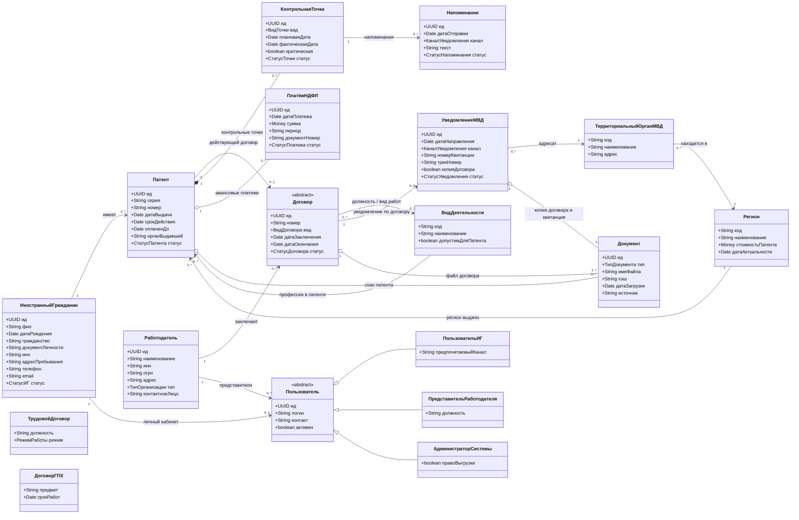

# Диаграмма классов предметной области

**Тема:** «Действия после получения патента» (раздел 7 «Дорожной карты»).
**Задание:** описать модель предметной области в виде диаграммы классов.

Модель описывает **понятия предметной области и связи между ними**, а не классы реализации:
типы атрибутов — предметные (`Date`, `Money`, `СтатусПатента`), методов почти нет. Соглашения:

- атрибуты записаны как `<тип> <имя>`; знак `+` — публичная видимость;
- кратности связей — в формате UML (`1`, `0..1`, `1..*`, `0..*`);
- ромб `*--` — композиция (часть не существует без целого), `o--` — агрегация,
  `-->` — ассоциация, `<|--` — обобщение;
- «предметные типы» (например, `СтатусПатента`) раскрыты в [README.md](README.md), раздел 5.

PlantUML-версия: [`class-diagram.puml`](class-diagram.puml) (+ [`class-diagram.png`](class-diagram.png)).

## Пояснения к ключевым связям

| Связь | Кратность | Что означает |
|---|---|---|
| `ИностранныйГражданин → Патент` | `1 → 0..*` | у одного ИГ может быть несколько патентов (последовательно, по срокам), но **действующий — не более одного** (инвариант ИНВ-6) |
| `Патент → Договор` | `1 → 0..1` | на один патент в каждый момент времени **не более одного действующего договора** (ИНВ-1). Исторические договоры остаются связанными с патентом — ограничение сформулировано как инвариант, а не как кратность «0..1» навсегда |
| `Договор → УведомлениеМВД` | `1 → 0..1` | по каждому договору направляется ровно одно уведомление об осуществлении трудовой деятельности |
| `Работодатель → Договор` | `1 → 0..*` | организация может принять много ИГ по патенту и заключать много договоров |
| `Патент → КонтрольнаяТочка` | `1 → 2..*` | минимум две точки: «заключён договор» и «направлено уведомление МВД»; обычно плюс «уплачен НДФЛ» и «истекает срок патента». Композиция: точки не существуют без патента |
| `КонтрольнаяТочка → Напоминание` | `1 → 0..*` | по каждой точке может быть серия напоминаний (за 30/14/7/3/1 день) |
| `Патент → ПлатёжНДФЛ` | `1 → 0..*` | платежи привязаны к патенту и его календарным периодам |
| `Договор → Документ` | `1 → 1..*` | у договора обязательно есть файл (подписанный документ), а также могут быть соглашения |
| `УведомлениеМВД → Документ` | `1 → 1..*` | копия договора обязательна, квитанция/опись — по каналу |
| `ВидДеятельности → Патент` | `1 → 0..*` | в патенте указывается профессия из справочника допустимых видов деятельности |
| `Пользователь <|-- …` | — | три роли учётной записи с общим набором атрибутов |

## Что намеренно не показано

- **Акторы-организации** (ЕПГУ, Почта России, ФНС, банк) в модели предметной области не
  изображены как классы: это внешние системы, их роль раскрывается в лаб. 3–5. Исключение —
  территориальный орган МВД: он хранится как **адресат уведомления** и потому является понятием
  предметной области.
- **Справочники статусов** (перечисления) не вынесены отдельными классами, чтобы не загромождать
  диаграмму; их значения перечислены в [README.md](README.md), раздел 5.
- **Миграционный учёт, РВП, ВНЖ** — это другие разделы дорожной карты, они не входят в границы
  темы (см. лаб. 1).
