# 01. П01. Учёт выданного патента и постановка сроков под контроль — основной сценарий

**Дисциплина:** Функциональное моделирование систем · **ТюмГУ**, 5 семестр · **Преподаватель:** Ткаченко И. Н.  
**Тема (раздел дорожной карты):** Тема 7. Действия после получения патента · **Команда:** Малышева Елена, Макеев Глеб, Мальгин Олег · **Автор работы:** Макеев Глеб Борисович  
**Дата:** 18.10.2026 · **Репозиторий:** <https://github.com/mflkee/fms-course>

> **Лабораторная 3, системная диаграмма последовательностей (SSD, «чёрный ящик»).** Линии жизни — действующие лица лаб. 1 и **одна** линия жизни подсистемы; сообщения — системные операции. Внутренние объекты подсистемы здесь не показываются — это предмет лаб. 4.

| | |
|---|---|
| **Прецедент** | П01 — [П01. Учёт выданного патента и постановка сроков под контроль](../../lab1-usecases/usecases/01-uchet-vydannogo-patenta.md) |
| **Тип сценария** | основной успешный сценарий |
| **Системные операции** | `зарегистрироватьПатент` |
| **Инварианты лаб. 2** | **ИНВ-6**, **ИНВ-9** |
| **Файлы** | [`01-p01-osnovnoy.puml`](01-p01-osnovnoy.puml) · [`01-p01-osnovnoy.png`](01-p01-osnovnoy.png) |

**Триггер:** Иностранный гражданин (A1) вносит в подсистему реквизиты полученного патента и прикладывает его скан (раздел 6.3 дорожной карты — это вход подсистемы).

## 1. Участники

| Линия жизни | Что это | Тип |
|---|---|---|
| `CIT` | Иностранный гражданин (A1) | действующее лицо (актор лаб. 1) |
| `EPGU` | ЕПГУ / Госуслуги (A4) | внешняя система / канал (вспомогательный актор лаб. 1) |
| `SYS` | Система «Действия после получения патента» | **система** — единственная линия жизни, «чёрный ящик» |

## 2. Диаграмма последовательностей

```mermaid
sequenceDiagram
    actor CIT as Иностранный гражданин (A1)
    participant EPGU as ЕПГУ / Госуслуги (A4)
    participant SYS as Система «Действия после получения патента»
    CIT->>SYS: 1. зарегистрироватьПатент(данныеПатента: ДанныеПатента, сканПатента: Вложение)
    Note over SYS: Шаги 1–4 сценария: проверка отсутствия действующего патента, проверка форматов и обязательных полей по справочникам Регион и ВидДеятельности, расчёт даты «трудоустроиться не позднее» = дата выдачи + 2 месяца и даты окончания срока действия патента. Все эти шаги — внутренняя работа подсистемы, поэтому показаны примечанием, а не сообщениями: в SSD сообщениями показываются только операции, инициируемые актором.
    SYS->>EPGU: 2. запроситьСведенияОпатенте(серия, номер)
    EPGU-->>SYS: 3. сведенияОпатенте(датаВыдачи, срокДействия, регион, видДеятельности, подтверждениеПодлинности)
    SYS-->>CIT: 4. РезультатРегистрацииПатента{идПатента, статус = «действует», датаТрудоустройстваНеПозднее, срокДействия, контрольныеТочки[4], дальнейшиеШаги[]}
    Note over SYS: Шаг 6 сценария (планирование напоминаний) выполняет включённый прецедент П04: система создаёт контрольные точки и планирует по ним напоминания. Ниже, в лаб. 4, это раскрыто как передача управления в МодульКонтроляСроков и СервисНапоминаний.
```

PlantUML-исходник: [`01-p01-osnovnoy.puml`](01-p01-osnovnoy.puml); растровый рендер: [`01-p01-osnovnoy.png`](01-p01-osnovnoy.png).

## 3. Описание сообщений

| № | Сообщение | От | Кому | Что происходит | Трассировка на лаб. 1 |
|---|---|---|---|---|---|
| **1** | `зарегистрироватьПатент(данныеПатента: ДанныеПатента, сканПатента: Вложение)` | `CIT` | `SYS` | Единственная системная операция сценария. ИГ передаёт реквизиты патента (серия, номер, дата выдачи, срок действия, регион, профессия) и файл скана; система проверяет, нет ли у ИГ уже учтённого действующего патента, проверяет форматы и обязательность полей, сверяет гражданство и регион со справочником. | шаги 1–4 П01 |
| — | *примечание* | SYS | SYS | Шаги 1–4 сценария: проверка отсутствия действующего патента; проверка форматов и обязательных полей по справочникам `Регион` и `ВидДеятельности`; расчёт даты «трудоустроиться не позднее» = дата выдачи + 2 месяца и даты окончания срока действия патента. Все эти шаги — внутренняя работа подсистемы, поэтому показаны примечанием, а не сообщениями: в SSD сообщениями показываются только операции, инициируемые актором. | — |
| **2** | `запроситьСведенияОпатенте(серия, номер)` | `SYS` | `EPGU` | Сверка реквизитов с внешним источником сведений о выданных патентах (п. 6.3 дорожной карты). В лаб. 1 это открытый вопрос, поэтому запрос показан как необязательный шаг: сценарий работает и без него. | открытый вопрос 1 П01 |
| **3** | `сведенияОпатенте(датаВыдачи, срокДействия, регион, видДеятельности, подтверждениеПодлинности)` | `EPGU` | `SYS` | Ответ внешнего канала: подтверждение реквизитов патента либо ответ «сведений нет». | открытый вопрос 1 П01 |
| **4** | `РезультатРегистрацииПатента{идПатента, статус = «действует», датаТрудоустройстваНеПозднее, срокДействия, контрольныеТочки[4], дальнейшиеШаги[]}` | `SYS` | `CIT` | Карточка патента создана и связана с профилем ИГ, скан приложен к делу; рассчитан срок «не позднее 2 месяцев с даты выдачи патента»; созданы контрольные точки «заключён договор», «направлено уведомление МВД», «уплачен авансовый платёж», «истекает срок действия патента»; ИГ видит остаток времени и дальнейшие шаги (П02, П03, П05). | шаги 5–7 П01 |
| — | *примечание* | SYS | SYS | Шаг 6 сценария (планирование напоминаний) выполняет включённый прецедент П04: система создаёт контрольные точки и планирует по ним напоминания. Ниже, в лаб. 4, это раскрыто как передача управления в `МодульКонтроляСроков` и `СервисНапоминаний`. | — |

## 4. Покрытие сценария лаб. 1

| Шаг сценария лаб. 1 | Сообщения диаграммы |
|---|---|
| шаг 1 — ИГ открывает раздел «Получение патента» и начинает регистрацию; система проверяет, нет ли уже учтённого действующего патента | сообщение 1 + примечание (проверка дублей) |
| шаг 2 — ИГ вводит реквизиты патента; система проверяет формат, обязательность полей и сверяет гражданство и регион | сообщение 1 + примечания; сообщения 2–3 (сверка с ЕПГУ) |
| шаг 3 — ИГ прикладывает скан или фотографию патента | сообщение 1 (параметр `сканПатента`) |
| шаг 4 — система рассчитывает дату «трудоустроиться не позднее» и срок действия патента | примечание к сообщению 1; сообщение 4 |
| шаг 5 — ИГ подтверждает данные; система создаёт карточку патента и помечает его действующим | сообщения 1 и 4 |
| шаг 6 — система создаёт контрольные точки и планирует напоминания (вызов П04) | сообщение 4 (поле `контрольныеТочки`) + примечание о П04 |
| шаг 7 — система показывает оставшееся время и список дальнейших шагов | сообщение 4 (поле `дальнейшиеШаги`) |

## 5. Предусловия и постусловия

**Предусловия**

- Патент получен в подразделении по вопросам миграции МВД (раздел 6.3 дорожной карты) — это вход подсистемы, а не её функция.
- ИГ зарегистрирован в системе, профиль создан, данные документа, удостоверяющего личность, и ИНН заполнены.
- Действует миграционный учёт по месту пребывания (результат разделов 1–6).
- Справочники регионов и видов деятельности (профессий) актуальны.

**Постусловия при успешном завершении**

- Карточка патента создана: серия и номер, дата выдачи, срок действия, регион выдачи, профессия (вид деятельности), орган, выдавший патент.
- Рассчитана и сохранена дата трудоустройства «не позднее» = дата выдачи патента + 2 месяца.
- Создан набор контрольных точек и запланированы напоминания по ним (включение П04).
- Файл скана патента приложен к делу; статус патента — «действует».

**Постусловия при отклонении от основного потока**

- При наличии учтённого действующего патента карточка не создаётся до явного решения ИГ (см. альтернативу 1а).
- При ошибках в реквизитах карточка не создаётся, введённые данные сохраняются как черновик (см. альтернативу 2а).
- Если ИГ отменяет регистрацию, состояние подсистемы не изменяется.

## 6. Решения и примечания

- Диаграмма построена как SSD: только акторы и одна линия жизни подсистемы. Внутренние объекты (карточка патента, справочники, планировщик) намеренно не показаны — их взаимодействие описано диаграммой коммуникаций операции `зарегистрироватьПатент` (лаб. 4).
- Обращение к ЕПГУ показано как опциональный шаг: в лаб. 1 автоматическая проверка подлинности патента вынесена в открытые вопросы П01, поэтому сценарий не должен зависеть от доступности ведомственного реестра.
- Срок считается от даты выдачи патента, а не от даты регистрации в системе (специальное требование П01); в диаграмме это видно по параметру `датаВыдачи`, который передаётся в операцию вместе с реквизитами.

Назад: [README лаб. 3](../README.md) · [спецификация операций](../operations.md) · [прецедент](../../lab1-usecases/usecases/01-uchet-vydannogo-patenta.md)
