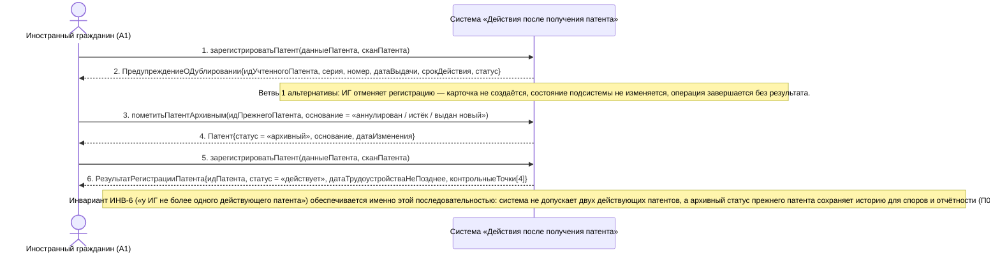

# 02. П01, альтернатива 1а. У ИГ уже учтён действующий патент

**Дисциплина:** Функциональное моделирование систем · **ТюмГУ**, 5 семестр · **Преподаватель:** Ткаченко И. Н.  
**Тема (раздел дорожной карты):** Тема 7. Действия после получения патента · **Команда:** Малышева Елена, Макеев Глеб, Мальгин Олег · **Автор работы:** Макеев Глеб Борисович  
**Дата:** 18.10.2026 · **Репозиторий:** <https://github.com/mflkee/fms-course>

> **Лабораторная 3, системная диаграмма последовательностей (SSD, «чёрный ящик»).** Линии жизни — действующие лица лаб. 1 и **одна** линия жизни подсистемы; сообщения — системные операции. Внутренние объекты подсистемы здесь не показываются — это предмет лаб. 4.

| | |
|---|---|
| **Прецедент** | П01 — [П01. Учёт выданного патента и постановка сроков под контроль](../../lab1-usecases/usecases/01-uchet-vydannogo-patenta.md) |
| **Тип сценария** | альтернативный сценарий 1а («У ИГ уже учтён действующий патент») |
| **Системные операции** | `зарегистрироватьПатент` · `пометитьПатентАрхивным` |
| **Инварианты лаб. 2** | **ИНВ-6**, **ИНВ-9** |
| **Файлы** | [`02-p01-alternativa-dubl.puml`](02-p01-alternativa-dubl.puml) · [`02-p01-alternativa-dubl.png`](02-p01-alternativa-dubl.png) |

**Триггер:** При регистрации нового патента система находит у ИГ карточку патента со статусом «действует».

## 1. Участники

| Линия жизни | Что это | Тип |
|---|---|---|
| `CIT` | Иностранный гражданин (A1) | действующее лицо (актор лаб. 1) |
| `SYS` | Система «Действия после получения патента» | **система** — единственная линия жизни, «чёрный ящик» |

## 2. Диаграмма последовательностей

PlantUML-исходник: [`02-p01-alternativa-dubl.puml`](02-p01-alternativa-dubl.puml); растровый рендер: [`02-p01-alternativa-dubl.png`](02-p01-alternativa-dubl.png).

## 3. Описание сообщений

| № | Сообщение | От | Кому | Что происходит | Трассировка на лаб. 1 |
|---|---|---|---|---|---|
| **1** | `зарегистрироватьПатент(данныеПатента, сканПатента)` | `CIT` | `SYS` | ИГ начинает регистрацию нового патента (например, полученного после истечения срока предыдущего). | шаг 1 П01 |
| **2** | `ПредупреждениеОДублировании{идУчтенногоПатента, серия, номер, датаВыдачи, срокДействия, статус}` | `SYS` | `CIT` | Система не создаёт карточку молча: она предупреждает о возможном дубле и показывает реквизиты ранее учтённого патента, чтобы ИГ принял осознанное решение. | шаг 1 альтернативы 1а П01 |
| — | *примечание* | SYS | SYS | Ветвь 1 альтернативы: ИГ отменяет регистрацию — карточка не создаётся, состояние подсистемы не изменяется, операция завершается без результата. | — |
| **3** | `пометитьПатентАрхивным(идПрежнегоПатента, основание = «аннулирован / истёк / выдан новый»)` | `CIT` | `SYS` | Ветвь 2 альтернативы: ИГ подтверждает, что прежний патент утратил силу. Система не удаляет карточку (данные нужны как доказательства), а переводит её в архивный статус. | шаг 2 альтернативы 1а П01 |
| **4** | `Патент{статус = «архивный», основание, датаИзменения}` | `SYS` | `CIT` | Прежний патент помечен архивным; открытые контрольные точки по нему закрываются, напоминания прекращаются. | шаг 2 альтернативы 1а П01 |
| **5** | `зарегистрироватьПатент(данныеПатента, сканПатента)` | `CIT` | `SYS` | Повторный вызов той же системной операции: теперь проверка дублей проходит успешно. | шаги 1–5 П01 |
| **6** | `РезультатРегистрацииПатента{идПатента, статус = «действует», датаТрудоустройстваНеПозднее, контрольныеТочки[4]}` | `SYS` | `CIT` | Новая карточка создана; инвариант ИНВ-6 восстановлен — у ИГ снова ровно один действующий патент. | шаг 5 П01 |
| — | *примечание* | SYS | SYS | Инвариант ИНВ-6 («у ИГ не более одного действующего патента») обеспечивается именно этой последовательностью: система не допускает двух действующих патентов, а архивный статус прежнего патента сохраняет историю для споров и отчётности (П07). | — |

## 4. Покрытие сценария лаб. 1

| Шаг сценария лаб. 1 | Сообщения диаграммы |
|---|---|
| шаг 1 альтернативы — система предупреждает о возможном дубле и показывает реквизиты ранее учтённого патента | сообщения 1–2 |
| шаг 2 альтернативы — ИГ либо отменяет регистрацию, либо подтверждает, что прежний патент утратил силу | примечание об отмене либо сообщение 3 |
| следствие — прежний патент помечен архивным, новый учтён, инвариант ИНВ-6 соблюдён | сообщения 4–6 |

## 5. Предусловия и постусловия

**Предусловия**

- У ИГ есть учтённый патент со статусом «действует» (учтён по П01).
- ИГ регистрирует новый патент: полученный после истечения срока прежнего или в другом регионе.
- Известно основание утраты силы прежнего патента (аннулирование, истечение срока, выдача нового).

**Постусловия при успешном завершении**

- Прежний патент переведён в статус «архивный» с указанием основания; его контрольные точки закрыты, напоминания прекращены.
- Новый патент учтён и помечен действующим; у ИГ снова ровно один действующий патент (ИНВ-6).

**Постусловия при отклонении от основного потока**

- При отмене регистрации состояние подсистемы не изменяется; прежний патент остаётся действующим.
- Если ИГ не может подтвердить основание утраты силы прежнего патента, регистрация нового патента не завершается — требуется разобраться с прежним патенте.

## 6. Решения и примечания

- Архивирование прежнего патента, а не удаление — прямое следствие требований лаб. 1: скан патента и сведения о нём хранятся бессрочно как доказательство законности пребывания и работы, а по патентам строится отчётность (П07).
- Операция `пометитьПатентАрхивным` выделена в самостоятельную системную операцию, потому что она имеет собственное предусловие (наличие действующего патента), собственный результат (смена статуса и закрытие точек) и может вызываться не только из этой альтернативы (например, при аннулировании патента решением МВД — альтернатива *б П01).

Назад: [README лаб. 3](../README.md) · [спецификация операций](../operations.md) · [прецедент](../../lab1-usecases/usecases/01-uchet-vydannogo-patenta.md)
