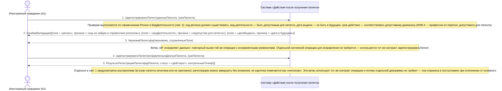

# 03. П01, альтернатива 2а. Реквизиты патента не проходят проверку

**Дисциплина:** Функциональное моделирование систем · **ТюмГУ**, 5 семестр · **Преподаватель:** Ткаченко И. Н.  
**Тема (раздел дорожной карты):** Тема 7. Действия после получения патента · **Команда:** Малышева Елена, Макеев Глеб, Мальгин Олег · **Автор работы:** Макеев Глеб Борисович  
**Дата:** 18.10.2026 · **Репозиторий:** <https://github.com/mflkee/fms-course>

> **Лабораторная 3, системная диаграмма последовательностей (SSD, «чёрный ящик»).** Линии жизни — действующие лица лаб. 1 и **одна** линия жизни подсистемы; сообщения — системные операции. Внутренние объекты подсистемы здесь не показываются — это предмет лаб. 4.

| | |
|---|---|
| **Прецедент** | П01 — [П01. Учёт выданного патента и постановка сроков под контроль](../../lab1-usecases/usecases/01-uchet-vydannogo-patenta.md) |
| **Тип сценария** | альтернативный сценарий 2а («Реквизиты патента не проходят проверку») |
| **Системные операции** | `зарегистрироватьПатент` |
| **Инварианты лаб. 2** | **ИНВ-4**, **ИНВ-6** |
| **Файлы** | [`03-p01-alternativa-oshibki-rekvizitov.puml`](03-p01-alternativa-oshibki-rekvizitov.puml) · [`03-p01-alternativa-oshibki-rekvizitov.png`](03-p01-alternativa-oshibki-rekvizitov.png) |

**Триггер:** ИГ передаёт реквизиты, которые не проходят проверку: несуществующий регион, профессия не из справочника, дата выдачи в будущем, срок меньше положенного.

## 1. Участники

| Линия жизни | Что это | Тип |
|---|---|---|
| `CIT` | Иностранный гражданин (A1) | действующее лицо (актор лаб. 1) |
| `SYS` | Система «Действия после получения патента» | **система** — единственная линия жизни, «чёрный ящик» |

## 2. Диаграмма последовательностей

PlantUML-исходник: [`03-p01-alternativa-oshibki-rekvizitov.puml`](03-p01-alternativa-oshibki-rekvizitov.puml); растровый рендер: [`03-p01-alternativa-oshibki-rekvizitov.png`](03-p01-alternativa-oshibki-rekvizitov.png).

## 3. Описание сообщений

| № | Сообщение | От | Кому | Что происходит | Трассировка на лаб. 1 |
|---|---|---|---|---|---|
| **1** | `зарегистрироватьПатент(данныеПатента, сканПатента)` | `CIT` | `SYS` | Обычный вызов операции; ошибки обнаруживаются системой при проверке. | шаги 1–2 П01 |
| — | *примечание* | SYS | SYS | Проверки выполняются по справочникам `Регион` и `ВидДеятельности` (лаб. 2): код региона должен существовать, вид деятельности — быть допустимым для патента, дата выдачи — не быть в будущем, срок действия — соответствовать допустимому диапазону (ИНВ-4 — профессия из перечня, допустимого для патента). | — |
| **2** | `ОшибкиВалидации[{поле = «регион», причина = «код не найден в справочнике регионов»}, {поле = «видДеятельности», причина = «недопустим для патента»}, {поле = «датаВыдачи», причина = «дата в будущем»}]` | `SYS` | `CIT` | Система возвращает поимённый список ошибок с указанием поля и причины — ИГ должен понимать, что именно исправить. | шаг 1 альтернативы 2а П01 |
| **3** | `ЧерновикПатента{идЧерновика, сохранённыеПоля}` | `SYS` | `CIT` | Карточка патента не создаётся (иначе в учёте появился бы заведомо недостоверный патент), но введённые данные не теряются: они сохраняются как черновик. | шаг 2 альтернативы 2а П01 |
| — | *примечание* | SYS | SYS | Ветвь «ИГ исправляет данные»: повторный вызов той же операции с исправленными реквизитами. Отдельной системной операции для исправления не требуется — используется тот же контракт `зарегистрироватьПатент`. | — |
| **4** | `зарегистрироватьПатент(исправленныеДанныеПатента, сканПатента)` | `CIT` | `SYS` | Исправленные реквизиты проходят проверки. | шаги 4–5 П01 |
| **5** | `РезультатРегистрацииПатента{идПатента, статус = «действует», контрольныеТочки[4]}` | `SYS` | `CIT` | Сценарий завершается успешно: карточка создана, сроки рассчитаны, контрольные точки созданы. | шаги 5–7 П01 |
| — | *примечание* | SYS | SYS | Отдельно в лаб. 1 предусмотрена альтернатива 3а (скан патента нечитаем или не приложен): регистрацию можно завершить без вложения, но карточка помечается как «неполная». Эта ветвь использует тот же контракт операции и потому отдельной диаграммы не требует — она отражена в постусловиях при отклонении от основного потока. | — |

## 4. Покрытие сценария лаб. 1

| Шаг сценария лаб. 1 | Сообщения диаграммы |
|---|---|
| шаг 1 альтернативы — система выделяет поля с ошибкой и объясняет причину | примечание о проверках + сообщение 2 |
| шаг 2 альтернативы — регистрация не завершается, данные сохраняются как черновик | сообщение 3 |
| ветвь «ИГ исправляет данные» — повторная регистрация проходит успешно | сообщения 4–5 |

## 5. Предусловия и постусловия

**Предусловия**

- ИГ зарегистрирован, профиль заполнен; справочники доступны.
- ИГ вводит реквизиты патента вручную (или они получены из внешнего канала с ошибками).

**Постусловия при успешном завершении**

- Введённые данные сохранены как черновик с идентификатором; ИГ видит список ошибок и может продолжить регистрацию без повторного ввода всех полей.
- После исправления данных карточка патента создана, сроки рассчитаны (как в основном сценарии).

**Постусловия при отклонении от основного потока**

- Карточка патента не создаётся, пока реквизиты не пройдут проверку: недостоверный патент не попадает в учёт, по нему не рассчитываются сроки и не создаются контрольные точки.
- Повторные неудачные попытки не создают новых карточек — используется один и тот же черновик.

## 6. Решения и примечания

- Разделение сообщений 2 и 3 сознательное: список ошибок нужен пользователю, а черновик — системе. Обе части — результат одной системной операции, поэтому в спецификации `зарегистрироватьПатент` возвращает два результата (ошибки и идентификатор черновика).
- Проверка вида деятельности в момент учёта патента — предпосылка инварианта ИНВ-4: если профессия в патенте заведомо недопустима, дальнейшее сопоставление с договором (П02) было бы бессмысленным.

Назад: [README лаб. 3](../README.md) · [спецификация операций](../operations.md) · [прецедент](../../lab1-usecases/usecases/01-uchet-vydannogo-patenta.md)
