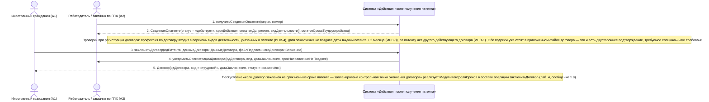

# 04. П02. Трудоустройство: заключение трудового договора или договора ГПХ — основной сценарий

**Дисциплина:** Функциональное моделирование систем · **ТюмГУ**, 5 семестр · **Преподаватель:** Ткаченко И. Н.  
**Тема (раздел дорожной карты):** Тема 7. Действия после получения патента · **Команда:** Малышева Елена, Макеев Глеб, Мальгин Олег · **Автор работы:** Макеев Глеб Борисович  
**Дата:** 18.10.2026 · **Репозиторий:** <https://github.com/mflkee/fms-course>

> **Лабораторная 3, системная диаграмма последовательностей (SSD, «чёрный ящик»).** Линии жизни — действующие лица лаб. 1 и **одна** линия жизни подсистемы; сообщения — системные операции. Внутренние объекты подсистемы здесь не показываются — это предмет лаб. 4.

| | |
|---|---|
| **Прецедент** | П02 — [П02. Трудоустройство: заключение трудового договора или договора ГПХ](../../lab1-usecases/usecases/02-trudovoy-dogovor.md) |
| **Тип сценария** | основной успешный сценарий |
| **Системные операции** | `получитьСведенияОпатенте` · `заключитьДоговор` |
| **Инварианты лаб. 2** | **ИНВ-1**, **ИНВ-3**, **ИНВ-4** |
| **Файлы** | [`04-p02-osnovnoy.puml`](04-p02-osnovnoy.puml) · [`04-p02-osnovnoy.png`](04-p02-osnovnoy.png) |

**Триггер:** Работодатель изучил сведения о патенте кандидата, стороны согласовали условия; ИГ регистрирует подписанный договор в подсистеме.

## 1. Участники

| Линия жизни | Что это | Тип |
|---|---|---|
| `CIT` | Иностранный гражданин (A1) | действующее лицо (актор лаб. 1) |
| `EMP` | Работодатель / заказчик по ГПХ (A2) | действующее лицо (актор лаб. 1) |
| `SYS` | Система «Действия после получения патента» | **система** — единственная линия жизни, «чёрный ящик» |

## 2. Диаграмма последовательностей

PlantUML-исходник: [`04-p02-osnovnoy.puml`](04-p02-osnovnoy.puml); растровый рендер: [`04-p02-osnovnoy.png`](04-p02-osnovnoy.png).

## 3. Описание сообщений

| № | Сообщение | От | Кому | Что происходит | Трассировка на лаб. 1 |
|---|---|---|---|---|---|
| **1** | `получитьСведенияОпатенте(серия, номер)` | `EMP` | `SYS` | Работодатель проверяет право ИГ на работу: тип и срок действия патента, регион, указанную профессию. Это операция-запрос: она ничего не меняет в учёте. | шаг 2 П02 |
| **2** | `СведенияОпатенте{статус = «действует», срокДействия, оплаченДо, регион, видДеятельности[], остатокСрокаТрудоустройства}` | `SYS` | `EMP` | Работодатель видит только сведения о патенте. Суммы платежей НДФЛ и персональные данные ИГ не раскрываются — только факт «оплачен до даты» (ограничение из специальных требований П05). | шаг 2 П02 |
| — | *примечание* | SYS | SYS | Проверки при регистрации договора: профессия по договору входит в перечень видов деятельности, указанных в патенте (ИНВ-4); дата заключения не позднее даты выдачи патента + 2 месяца (ИНВ-3); по патенту нет другого действующего договора (ИНВ-1). Обе подписи уже стоят в приложенном файле договора — это и есть двустороннее подтверждение, требуемое специальными требованиями П02. | — |
| **3** | `заключитьДоговор(идПатента, данныеДоговора: ДанныеДоговора, файлПодписанногоДоговора: Вложение)` | `CIT` | `SYS` | Основная системная операция прецедента. Регистрируется договор (трудовой или ГПХ) со сторонами, датой, сроком, профессией; проверяются три инварианта; файл договора прикладывается к делу ИГ и к делу организации. | шаги 3–6 П02 |
| **4** | `уведомитьОрегистрацииДоговора(идДоговора, вид, датаЗаключения, срокНаправленияНеПозднее)` | `SYS` | `EMP` | Вторая сторона получает уведомление о регистрации договора и о сроке, в который нужно направить уведомление в МВД (п. 7.2). | шаг 8 П02 |
| **5** | `Договор{идДоговора, вид = «трудовой», датаЗаключения, статус = «заключён»}` | `SYS` | `CIT` | Операция завершена: договор зарегистрирован, контрольная точка «направить уведомление МВД» создана, карты ИГ и работодателя дополнены шагами уведомления (П03) и уплаты НДФЛ (П05). | шаги 7–8 П02 |
| — | *примечание* | SYS | SYS | Постусловие «если договор заключён на срок меньше срока патента — запланирована контрольная точка окончания договора» реализует `МодульКонтроляСроков` в составе операции `заключитьДоговор` (лаб. 4, сообщение 1.9). | — |

## 4. Покрытие сценария лаб. 1

| Шаг сценария лаб. 1 | Сообщения диаграммы |
|---|---|
| шаг 1 — ИГ находит вакансию или получает приглашение работодателя | действие вне системы; в подсистеме не отражается (класса `Вакансия` в модели лаб. 2 нет) |
| шаг 2 — работодатель проверяет право ИГ на работу | сообщения 1–2 |
| шаг 3 — стороны согласуют условия и заключают договор; система фиксирует реквизиты | сообщение 3 |
| шаг 4 — система проверяет, что профессия по договору входит в перечень видов деятельности патента | примечание о проверках (ИНВ-4) |
| шаг 5 — система проверяет, что дата заключения не позднее даты выдачи патента + 2 месяца | примечание о проверках (ИНВ-3) |
| шаг 6 — стороны загружают подписанный договор; система сохраняет файл и связывает его с патентом и профилями | сообщение 3 (параметр `файлПодписанногоДоговора`) |
| шаг 7 — система создаёт задачу «направить уведомление МВД» и напоминание о сроке | сообщение 5 + примечание |
| шаг 8 — система перестраивает карты ИГ и работодателя | сообщения 4–5 + примечание |

## 5. Предусловия и постусловия

**Предусловия**

- Патент учтён в подсистеме (П01), статус — «действует».
- Срок трудоустройства не истёк: с даты выдачи патента прошло менее 2 месяцев (п. 7.1).
- Профиль ИГ заполнен: гражданство, документ, удостоверяющий личность, ИНН, регион.
- Профиль работодателя (ИНН, ОГРН, наименование) создан в системе или заполняется в ходе сценария.
- Договор подписан обеими сторонами (файл с подписями или электронная подпись).

**Постусловия при успешном завершении**

- Договор зарегистрирован в деле ИГ и в деле организации: вид (трудовой / ГПХ), стороны, дата заключения, срок, профессия; для ГПХ — предмет договора.
- Проверено соответствие профессии перечню видов деятельности, указанных в патенте (ИНВ-4).
- Создана контрольная точка «направить уведомление МВД» со сроком из П04.
- Файл договора приложен к делу; обе стороны видят статус «договор заключён, ожидается уведомление».

**Постусловия при отклонении от основного потока**

- Если профессия по договору не соответствует патенту, регистрация блокируется (см. альтернативу 4а П02).
- Если срок трудоустройства истёк, договор всё равно регистрируется, но фиксируется просрочка и создаётся критическая запись (см. альтернативу 2а П02).
- Если работодатель отказался от сделки, договор не создаётся (см. альтернативу *а П02).

## 6. Решения и примечания

- В лаб. 1 основной исполнитель прецедента — ИГ (обязанность п. 7.1 адресована ему), поэтому именно ИГ вызывает `заключитьДоговор`, а работодатель участвует проверкой и получает уведомление. Это соответствует открытому вопросу П02 и может быть переиграно, если преподаватель решит иначе: смена «инициатора» не меняет контракт операции.
- Операция `получитьСведенияОпатенте` выделена как отдельная системная функция (запрос), потому что она используется и в других сценариях — проверка патента работодателем, проверка условий при смене работодателя (П06).
- Проверка ИНВ-1 показана внутри операции `заключитьДоговор`, а не отдельным сообщением: это не отдельное действие пользователя, а условие выполнения операции.

Назад: [README лаб. 3](../README.md) · [спецификация операций](../operations.md) · [прецедент](../../lab1-usecases/usecases/02-trudovoy-dogovor.md)
