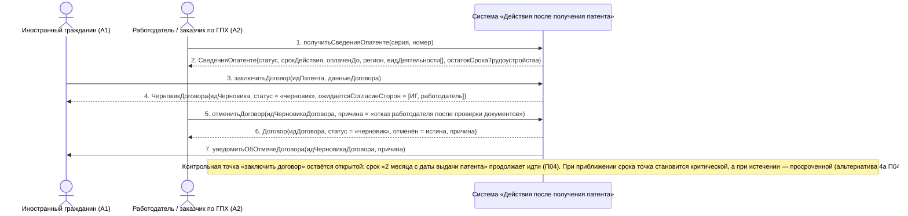

# 05. П02, альтернатива *а. Работодатель отказывается от сделки после проверки документов

**Дисциплина:** Функциональное моделирование систем · **ТюмГУ**, 5 семестр · **Преподаватель:** Ткаченко И. Н.  
**Тема (раздел дорожной карты):** Тема 7. Действия после получения патента · **Команда:** Малышева Елена, Макеев Глеб, Мальгин Олег · **Автор работы:** Макеев Глеб Борисович  
**Дата:** 18.10.2026 · **Репозиторий:** <https://github.com/mflkee/fms-course>

> **Лабораторная 3, системная диаграмма последовательностей (SSD, «чёрный ящик»).** Линии жизни — действующие лица лаб. 1 и **одна** линия жизни подсистемы; сообщения — системные операции. Внутренние объекты подсистемы здесь не показываются — это предмет лаб. 4.

| | |
|---|---|
| **Прецедент** | П02 — [П02. Трудоустройство: заключение трудового договора или договора ГПХ](../../lab1-usecases/usecases/02-trudovoy-dogovor.md) |
| **Тип сценария** | альтернативный сценарий *а («Работодатель отказывается от сделки») |
| **Системные операции** | `получитьСведенияОпатенте` · `заключитьДоговор` · `отменитьДоговор` |
| **Инварианты лаб. 2** | **ИНВ-1**, **ИНВ-3** |
| **Файлы** | [`05-p02-alternativa-otkaz-rabotodatelya.puml`](05-p02-alternativa-otkaz-rabotodatelya.puml) · [`05-p02-alternativa-otkaz-rabotodatelya.png`](05-p02-alternativa-otkaz-rabotodatelya.png) |

**Триггер:** Работодатель изучил сведения о патенте и отказался от сделки до подписания договора.

## 1. Участники

| Линия жизни | Что это | Тип |
|---|---|---|
| `CIT` | Иностранный гражданин (A1) | действующее лицо (актор лаб. 1) |
| `EMP` | Работодатель / заказчик по ГПХ (A2) | действующее лицо (актор лаб. 1) |
| `SYS` | Система «Действия после получения патента» | **система** — единственная линия жизни, «чёрный ящик» |

## 2. Диаграмма последовательностей

PlantUML-исходник: [`05-p02-alternativa-otkaz-rabotodatelya.puml`](05-p02-alternativa-otkaz-rabotodatelya.puml); растровый рендер: [`05-p02-alternativa-otkaz-rabotodatelya.png`](05-p02-alternativa-otkaz-rabotodatelya.png).

## 3. Описание сообщений

| № | Сообщение | От | Кому | Что происходит | Трассировка на лаб. 1 |
|---|---|---|---|---|---|
| **1** | `получитьСведенияОпатенте(серия, номер)` | `EMP` | `SYS` | Работодатель проверяет документы кандидата — тот же запрос, что и в основном сценарии. | шаг 2 П02 |
| **2** | `СведенияОпатенте{статус, срокДействия, оплаченДо, регион, видДеятельности[], остатокСрокаТрудоустройства}` | `SYS` | `EMP` | Полученные условия работодателя не устраивают (остаток срока, регион или профессия) — принимается решение об отказе. | альтернатива *а П02 |
| **3** | `заключитьДоговор(идПатента, данныеДоговора)` | `CIT` | `SYS` | Договор успел дойти до состояния черновика (реквизиты внесены, подписанный файл ещё не загружен). | шаг 3 П02 |
| **4** | `ЧерновикДоговора{идЧерновика, статус = «черновик», ожидаетсяСогласиеСторон = [ИГ, работодатель]}` | `SYS` | `CIT` | Система не создаёт действующий договор до подтверждения обеих сторон — это защита от фиктивных записей (специальное требование П02). | шаг 6 П02 |
| **5** | `отменитьДоговор(идЧерновикаДоговора, причина = «отказ работодателя после проверки документов»)` | `EMP` | `SYS` | Работодатель отменяет регистрацию. Попытка трудоустройства сохраняется как неуспешная — она нужна для истории и для контроля срока. | альтернатива *а П02 |
| **6** | `Договор{идДоговора, статус = «черновик», отменён = истина, причина}` | `SYS` | `EMP` | Черновик отклонён; действующий договор не создан, инвариант ИНВ-1 не нарушен. | альтернатива *а П02 |
| **7** | `уведомитьОбОтменеДоговора(идЧерновикаДоговора, причина)` | `SYS` | `CIT` | ИГ получает уведомление и возвращается к поиску работы. | альтернатива *а П02 |
| — | *примечание* | SYS | SYS | Контрольная точка «заключить договор» остаётся открытой: срок «2 месяца с даты выдачи патента» продолжает идти (П04). При приближении срока точка становится критической, а при истечении — просроченной (альтернатива 4а П04). | — |

## 4. Покрытие сценария лаб. 1

| Шаг сценария лаб. 1 | Сообщения диаграммы |
|---|---|
| шаг 1 альтернативы — система сохраняет попытку как неуспешную, договор не создаётся | сообщения 3–6 |
| шаг 2 альтернативы — ИГ возвращается к поиску работы; срок из П04 продолжает идти | сообщение 7 + примечание о контрольной точке |

## 5. Предусловия и постусловия

**Предусловия**

- Патент учтён и действует; срок трудоустройства не истёк.
- Есть работодатель, рассматривавший кандидатуру, и черновик договора (реквизиты внесены).
- Есть основание отказа (условия, срок, профессия, регион).

**Постусловия при успешном завершении**

- Договор не создан; черновик помечен отменённым с указанием причины.
- Обе стороны уведомлены; неуспешная попытка сохранена в истории.
- Контрольная точка «заключить договор» остаётся открытой, срок по П04 продолжает идти.

**Постусловия при отклонении от основного потока**

- Если работодатель отменяет уже действующий договор, применяется не эта операция, а `прекратитьДоговор` (прецедент П06): у действующего договора другая процедура и другие последствия.
- Если в системе остаётся другой действующий договор по этому патенту, новый договор по нему не может быть создан (ИНВ-1) — сначала нужно закрыть прежний (П06).

## 6. Решения и примечания

- В модели есть две «отменяющие» операции: `отменитьДоговор` (черновик, который не был заключён) и `прекратитьДоговор` (действующий договор, П06). Их разделение повторяет разделение статусов договора в лаб. 2 («черновик» и «прекращён»).
- Отмена черновика возможна со стороны любой из сторон — поэтому параметром операции передаётся причина, а в истории сохраняется, кто инициировал отмену.

Назад: [README лаб. 3](../README.md) · [спецификация операций](../operations.md) · [прецедент](../../lab1-usecases/usecases/02-trudovoy-dogovor.md)
