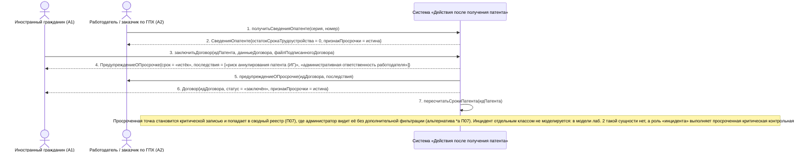

# 06. П02, альтернатива 2а. Срок трудоустройства истёк — договор заключается с просрочкой

**Дисциплина:** Функциональное моделирование систем · **ТюмГУ**, 5 семестр · **Преподаватель:** Ткаченко И. Н.  
**Тема (раздел дорожной карты):** Тема 7. Действия после получения патента · **Команда:** Малышева Елена, Макеев Глеб, Мальгин Олег · **Автор работы:** Макеев Глеб Борисович  
**Дата:** 18.10.2026 · **Репозиторий:** <https://github.com/mflkee/fms-course>

> **Лабораторная 3, системная диаграмма последовательностей (SSD, «чёрный ящик»).** Линии жизни — действующие лица лаб. 1 и **одна** линия жизни подсистемы; сообщения — системные операции. Внутренние объекты подсистемы здесь не показываются — это предмет лаб. 4.

| | |
|---|---|
| **Прецедент** | П02 — [П02. Трудоустройство: заключение трудового договора или договора ГПХ](../../lab1-usecases/usecases/02-trudovoy-dogovor.md) |
| **Тип сценария** | альтернативный сценарий 2а («Срок трудоустройства истёк или истекает сегодня») |
| **Системные операции** | `получитьСведенияОпатенте` · `заключитьДоговор` · `пересчитатьСрокиПатента` |
| **Инварианты лаб. 2** | **ИНВ-3**, **ИНВ-1** |
| **Файлы** | [`06-p02-alternativa-prosrochka-sroka.puml`](06-p02-alternativa-prosrochka-sroka.puml) · [`06-p02-alternativa-prosrochka-sroka.png`](06-p02-alternativa-prosrochka-sroka.png) |

**Триггер:** Договор заключается, когда срок «2 месяца с даты выдачи патента» уже истёк или истекает в текущие сутки.

## 1. Участники

| Линия жизни | Что это | Тип |
|---|---|---|
| `CIT` | Иностранный гражданин (A1) | действующее лицо (актор лаб. 1) |
| `EMP` | Работодатель / заказчик по ГПХ (A2) | действующее лицо (актор лаб. 1) |
| `SYS` | Система «Действия после получения патента» | **система** — единственная линия жизни, «чёрный ящик» |

## 2. Диаграмма последовательностей

PlantUML-исходник: [`06-p02-alternativa-prosrochka-sroka.puml`](06-p02-alternativa-prosrochka-sroka.puml); растровый рендер: [`06-p02-alternativa-prosrochka-sroka.png`](06-p02-alternativa-prosrochka-sroka.png).

## 3. Описание сообщений

| № | Сообщение | От | Кому | Что происходит | Трассировка на лаб. 1 |
|---|---|---|---|---|---|
| **1** | `получитьСведенияОпатенте(серия, номер)` | `EMP` | `SYS` | Проверка патента кандидата. | шаг 2 П02 |
| **2** | `СведенияОпатенте{остатокСрокаТрудоустройства = 0, признакПросрочки = истина}` | `SYS` | `EMP` | Работодатель сразу видит, что срок трудоустройства истёк, — система не скрывает этот факт. | шаг 2 П02 |
| **3** | `заключитьДоговор(идПатента, данныеДоговора, файлПодписанногоДоговора)` | `CIT` | `SYS` | Договор всё же регистрируется: закон не запрещает заключить договор после срока, но просрочка должна быть зафиксирована, а не «тихо» пропущена. | альтернатива 2а П02 |
| **4** | `ПредупреждениеОПросрочке{срок = «истёк», последствия = [«риск аннулирования патента (ИГ)», «административная ответственность работодателя»]}` | `SYS` | `CIT` | Система прямо сообщает обеим сторонам о рисках — это специальное требование П02 «система не должна позволять тихо пропустить срок». | альтернатива 2а П02 |
| **5** | `предупреждениеОПросрочке(идДоговора, последствия)` | `SYS` | `EMP` | Работодатель получает то же предупреждение: ответственность за нарушение срока уведомления лежит и на нём. | альтернатива 2а П02 |
| **6** | `Договор{идДоговора, статус = «заключён», признакПросрочки = истина}` | `SYS` | `CIT` | Операция завершается успешно, но с признаком просрочки: договор создан, контрольная точка «заключить договор» переведена в статус «просрочена». | альтернатива 2а П02 |
| **7** | `пересчитатьСрокиПатента(идПатента)` | `SYS` | `SYS` | Внутреннее обращение к `МодулюКонтроляСроков`: пересчёт оставшихся сроков и расстановка признаков критичности по открытым точкам. | включение П04 |
| — | *примечание* | SYS | SYS | Просроченная точка становится критической записью и попадает в сводный реестр (П07), где администратор видит её без дополнительной фильтрации (альтернатива *а П07). Инцидент отдельным классом не моделируется: в модели лаб. 2 такой сущности нет, а роль «инцидента» выполняет просроченная критическая контрольная точка. | — |

## 4. Покрытие сценария лаб. 1

| Шаг сценария лаб. 1 | Сообщения диаграммы |
|---|---|
| шаг 1 альтернативы — система помечает шаг критическим и прямо сообщает о риске аннулирования патента | сообщения 1–2, 4 |
| шаг 2 альтернативы — договор заключить всё ещё можно, но система фиксирует факт просрочки и предупреждает обе стороны | сообщения 3, 5–6 |
| шаг 3 альтернативы — создаётся запись для администратора | сообщение 7 + примечание о критической записи реестра П07 |

## 5. Предусловия и постусловия

**Предусловия**

- Патент учтён, статус — «действует».
- Договор подписан сторонами, но дата заключения (или дата регистрации) — за пределами срока «не позднее 2 месяцев с даты выдачи патента».

**Постусловия при успешном завершении**

- Договор зарегистрирован и связан с патентом; контрольная точка «заключить договор» переведена в статус «просрочена», признак критичности — истина.
- Обе стороны получили предупреждение о рисках.
- Сроки по патенту пересчитаны (П04); критическая запись доступна в реестре (П07).

**Постусловия при отклонении от основного потока**

- Если договор не может быть зарегистрирован по другой причине (например, профессия не соответствует патенту), применяется соответствующая ветвь — регистрация отклоняется.
- Если стороны после предупреждения отказались от сделки, применяется альтернатива *а П02.

## 6. Решения и примечания

- Регистрация договора после срока сохранена осознанно: система ведёт учёт фактических отношений, а не только «правильных». Отказ в регистрации ухудшил бы достоверность учёта и лишил бы ИГ доказательств работы.
- Дата фактической регистрации и дата заключения в договоре различаются (см. альтернативу 5а П02 «договор задним числом»): срок всё равно считается от даты выдачи патента, поэтому сдвинуть его вводом «правильной» даты нельзя.

Назад: [README лаб. 3](../README.md) · [спецификация операций](../operations.md) · [прецедент](../../lab1-usecases/usecases/02-trudovoy-dogovor.md)
