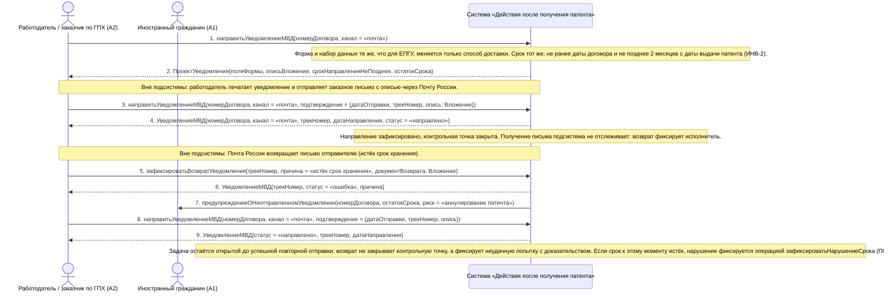

# 06. П03, альтернатива 2а/4а. Уведомление почтой и возврат отправления

**Дисциплина:** Функциональное моделирование систем · **ТюмГУ**, 5 семестр · **Преподаватель:** Ткаченко И. Н.  
**Тема (раздел дорожной карты):** Тема 7. Действия после получения патента · **Команда:** Малышева Елена, Макеев Глеб, Мальгин Олег · **Автор работы:** Макеев Глеб Борисович  
**Дата:** 20.11.2026 · **Репозиторий:** <https://github.com/mflkee/fms-course>

> **Лабораторная 3, системная диаграмма последовательностей (SSD, «чёрный ящик»).** Линии жизни — действующие лица лаб. 1 и **одна** линия жизни подсистемы; сообщения — системные операции. Внутренние объекты подсистемы здесь не показываются — это предмет лаб. 4.

| | |
|---|---|
| **Прецедент** | П03 — [П03. Уведомление МВД об осуществлении трудовой деятельности](../../lab1-usecases/usecases/03-uvedomlenie-mvd.md) |
| **Тип сценария** | альтернативный сценарий 2а («ЕПГУ недоступен, отправка почтой») с продолжением 4а («письмо вернулось») |
| **Системные операции** | `направитьУведомлениеМВД` · `зафиксироватьВозвратУведомления` |
| **Инварианты лаб. 2** | **ИНВ-2**, **ИНВ-7** |
| **Файлы** | [`06-p03-alternativa-pochta.puml`](06-p03-alternativa-pochta.puml) · [`06-p03-alternativa-pochta.png`](06-p03-alternativa-pochta.png) |

**Триггер:** Канал ЕПГУ недоступен (сбой, нет подтверждённой учётной записи), поэтому работодатель отправляет уведомление почтой; затем письмо возвращается отправителю.

## 1. Участники

| Линия жизни | Что это | Тип |
|---|---|---|
| `EMP` | Работодатель / заказчик по ГПХ (A2) | действующее лицо (актор лаб. 1) |
| `CIT` | Иностранный гражданин (A1) | действующее лицо (актор лаб. 1) |
| `SYS` | Система «Действия после получения патента» | **система** — единственная линия жизни, «чёрный ящик» |

Почта России и сотрудник ОВМ МВД на диаграмме не показаны: подсистема с ними не взаимодействует.
Письмо отправляет и возврат получает работодатель вне подсистемы; система регистрирует факты и доказательства.

## 2. Диаграмма последовательностей

PlantUML-исходник: [`06-p03-alternativa-pochta.puml`](06-p03-alternativa-pochta.puml); растровый рендер: [`06-p03-alternativa-pochta.png`](06-p03-alternativa-pochta.png).

## 3. Описание сообщений

| № | Сообщение | От | Кому | Что происходит | Трассировка на лаб. 1 |
|---|---|---|---|---|---|
| **1** | `направитьУведомлениеМВД(номерДоговора, канал = «почта»)` | `EMP` | `SYS` | Работодатель переключает канал на почтовый; система формирует печатную форму уведомления и опись вложения из тех же данных. | альтернатива 2а П03 |
| — | *примечание* | SYS | SYS | Форма уведомления и набор данных не меняются — меняется только способ доставки. Срок тот же: не ранее даты договора и не позднее 2 месяцев с даты выдачи патента (ИНВ-2). | — |
| **2** | `ПроектУведомления{поляФормы, описьВложения, срокНаправленияНеПозднее, остатокСрока}` | `SYS` | `EMP` | Работодатель получает документ для печати и отправки заказным письмом с описью вложения и уведомлением о вручении. | шаг 1 альтернативы 2а П03 |
| — | *примечание* | EMP, SYS | — | Вне подсистемы: работодатель отправляет письмо через Почту России. Подсистема почту не вызывает и не может подтвердить отправку сама — доказательства вносятся работодателем. | — |
| **3** | `направитьУведомлениеМВД(номерДоговора, канал = «почта», подтверждение = {датаОтправки, трекНомер, опись: Вложение})` | `EMP` | `SYS` | Работодатель регистрирует факт отправки: дату, трек-номер и файл описи вложения. | шаг 2 альтернативы 2а П03 |
| **4** | `УведомлениеМВД{номерДоговора, канал = «почта», трекНомер, датаНаправления, статус = «направлено»}` | `SYS` | `EMP` | Уведомление зафиксировано с почтовыми доказательствами; контрольная точка закрыта. | альтернатива 2а П03 |
| — | *примечание* | EMP, SYS | — | Вне подсистемы: Почта России возвращает письмо отправителю. Возврат подсистема сама не получает. | — |
| **5** | `зафиксироватьВозвратУведомления(трекНомер, причина = «истёк срок хранения», документВозврата: Вложение)` | `EMP` | `SYS` | Вторая системная операция: регистрация неудачной попытки. Отдельная операция нужна потому, что возврат наступает позже отправки и регистрируется отдельно. | альтернатива 4а П03 |
| **6** | `УведомлениеМВД{трекНомер, статус = «ошибка», причина}` | `SYS` | `EMP` | Попытка сохранена с причиной; уведомление не становится «направленным», контрольная точка не закрывается. | альтернатива 4а П03 |
| **7** | `предупреждениеОНеотправленномУведомлении(номерДоговора, остатокСрока, риск = «аннулирование патента»)` | `SYS` | `CIT` | ИГ предупреждён: неподача уведомления — основание для аннулирования патента. | альтернатива 4а П03 |
| **8** | `направитьУведомлениеМВД(номерДоговора, канал = «почта», подтверждение = {датаОтправки, трекНомер, опись})` | `EMP` | `SYS` | Повторная отправка — тем же контрактом операции; канал можно сменить. | шаг 2 альтернативы 4а П03 |
| **9** | `УведомлениеМВД{статус = «направлено», трекНомер, датаНаправления}` | `SYS` | `EMP` | После успешной повторной отправки контрольная точка закрывается. | шаг 2 альтернативы 4а П03 |
| — | *примечание* | SYS | SYS | Задача остаётся открытой до успешной повторной отправки: возврат не закрывает контрольную точку, а фиксирует неудачную попытку с доказательством. Если срок к этому моменту истёк, нарушение фиксируется операцией `зафиксироватьНарушениеСрока` (П04). | — |

## 4. Покрытие сценария лаб. 1

| Шаг сценария лаб. 1 | Сообщения диаграммы |
|---|---|
| шаг 1 альтернативы 2а — система предлагает перейти на почтовый канал и формирует печатную форму уведомления | сообщения 1–2 |
| шаг 2 альтернативы 2а — работодатель отправляет письмо, вносит трек-номер и дату отправки; опись вложения сохраняется | примечание вне подсистемы + сообщение 3 |
| шаг 1 альтернативы 4а — работодатель фиксирует возврат; система сохраняет попытку, причину и оставляет задачу открытой | сообщения 5–7 |
| шаг 2 альтернативы 4а — работодатель повторяет отправку; точка закрывается после успеха | сообщения 8–9 |

## 5. Предусловия и постусловия

**Предусловия**

- Договор заключён и зарегистрирован; патент учтён и действует; срок уведомления не истёк.
- Электронный канал ЕПГУ недоступен или не может быть использован.
- У работодателя есть возможность отправить заказное письмо с описью вложения.
- Для возврата: ранее была зарегистрирована отправка, работодатель располагает сведениями о возврате письма.

**Постусловия при успешном завершении**

- Печатная форма уведомления и опись вложения сформированы из того же набора данных, что и для электронного канала.
- Уведомление направлено почтой; сохранены дата отправки, трек-номер и файл описи.
- Контрольная точка «уведомление МВД» закрыта.

**Постусловия при отклонении от основного потока**

- Если письмо вернулось, обязанность не считается исполненной; задача остаётся открытой до повторной отправки.
- При возврате попытка зафиксирована со статусом «ошибка» и доказательством; после успешной повторной отправки точка закрыта.
- Если срок к моменту возврата истёк, факт нарушения фиксируется в П04 (`зафиксироватьНарушениеСрока`).

## 6. Решения и примечания

- Оба канала (ЕПГУ и почта) обслуживает одна системная операция `направитьУведомлениеМВД` — это прямое следствие специального требования П03: канал — параметр, а не отдельная операция.
- Возврат отправления — событие, приходящее извне и с задержкой, поэтому ему соответствует отдельная системная операция `зафиксироватьВозвратУведомления`, а не параметр операции `направитьУведомлениеМВД`.
- Запрос статуса отправления у почты и передача сведений о вручении в МВД на диаграмме не показаны: подсистема не отслеживает статусы и не взаимодействует с ведомствами (DESIGN §0, п. 5). Контроль вручения — только факт, зафиксированный по трек-номеру.

Назад: [README лаб. 3](../README.md) · [спецификация операций](../operations.md) · [прецедент](../../lab1-usecases/usecases/03-uvedomlenie-mvd.md)
