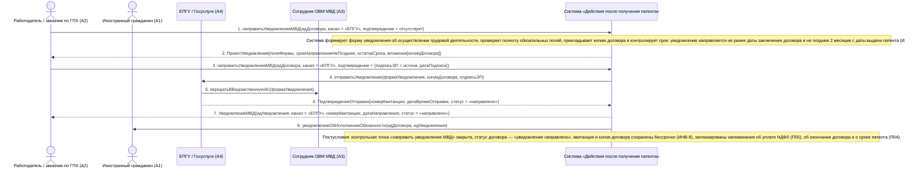

# 07. П03. Уведомление МВД об осуществлении трудовой деятельности — основной сценарий (канал ЕПГУ)

**Дисциплина:** Функциональное моделирование систем · **ТюмГУ**, 5 семестр · **Преподаватель:** Ткаченко И. Н.  
**Тема (раздел дорожной карты):** Тема 7. Действия после получения патента · **Команда:** Малышева Елена, Макеев Глеб, Мальгин Олег · **Автор работы:** Макеев Глеб Борисович  
**Дата:** 18.10.2026 · **Репозиторий:** <https://github.com/mflkee/fms-course>

> **Лабораторная 3, системная диаграмма последовательностей (SSD, «чёрный ящик»).** Линии жизни — действующие лица лаб. 1 и **одна** линия жизни подсистемы; сообщения — системные операции. Внутренние объекты подсистемы здесь не показываются — это предмет лаб. 4.

| | |
|---|---|
| **Прецедент** | П03 — [П03. Уведомление МВД об осуществлении трудовой деятельности](../../lab1-usecases/usecases/03-uvedomlenie-mvd.md) |
| **Тип сценария** | основной успешный сценарий |
| **Системные операции** | `направитьУведомлениеМВД` |
| **Инварианты лаб. 2** | **ИНВ-2**, **ИНВ-8** |
| **Файлы** | [`07-p03-osnovnoy.puml`](07-p03-osnovnoy.puml) · [`07-p03-osnovnoy.png`](07-p03-osnovnoy.png) |

**Триггер:** Работодатель открывает задачу «уведомить МВД» по зарегистрированному договору.

## 1. Участники

| Линия жизни | Что это | Тип |
|---|---|---|
| `EMP` | Работодатель / заказчик по ГПХ (A2) | действующее лицо (актор лаб. 1) |
| `CIT` | Иностранный гражданин (A1) | действующее лицо (актор лаб. 1) |
| `EPGU` | ЕПГУ / Госуслуги (A4) | внешняя система / канал (вспомогательный актор лаб. 1) |
| `MVD` | Сотрудник ОВМ МВД (A3) | внешняя система / канал (вспомогательный актор лаб. 1) |
| `SYS` | Система «Действия после получения патента» | **система** — единственная линия жизни, «чёрный ящик» |

## 2. Диаграмма последовательностей

PlantUML-исходник: [`07-p03-osnovnoy.puml`](07-p03-osnovnoy.puml); растровый рендер: [`07-p03-osnovnoy.png`](07-p03-osnovnoy.png).

## 3. Описание сообщений

| № | Сообщение | От | Кому | Что происходит | Трассировка на лаб. 1 |
|---|---|---|---|---|---|
| **1** | `направитьУведомлениеМВД(идДоговора, канал = «ЕПГУ», подтверждение = отсутствует)` | `EMP` | `SYS` | Первый вызов операции — подготовка проекта уведомления. Система берёт данные из одного набора: профиль ИГ, карточка патента, договор. | шаги 1–2 П03 |
| — | *примечание* | SYS | SYS | Система формирует форму уведомления об осуществлении трудовой деятельности, проверяет полноту обязательных полей, прикладывает копию договора и контролирует срок: уведомление направляется не ранее даты заключения договора и не позднее 2 месяцев с даты выдачи патента (ИНВ-2). | — |
| **2** | `ПроектУведомления{поляФормы, срокНаправленияНеПозднее, остатокСрока, вложения[копияДоговора]}` | `SYS` | `EMP` | Работодатель видит срок «не позднее» и остаток времени; сведения разрешено править до подписания. | шаги 1–3 П03 |
| **3** | `направитьУведомлениеМВД(идДоговора, канал = «ЕПГУ», подтверждение = {подписьЭП = истина, датаПодписи})` | `EMP` | `SYS` | Второй вызов той же операции — уже с подписью и подтверждением данных: работодатель подписывает и отправляет уведомление. | шаг 4 П03 |
| **4** | `отправитьУведомление(формаУведомления, копияДоговора, подписьЭП)` | `SYS` | `EPGU` | Передача уведомления в канал ЕПГУ. | шаг 4 П03 |
| **5** | `передатьВВедомственнуюАС(формаУведомления)` | `EPGU` | `MVD` | ЕПГУ передаёт уведомление в ведомственную автоматизированную систему территориального органа МВД. Приём уведомления — работа ведомства, а не функция подсистемы (граница системы, зафиксированная в лаб. 1). | постусловие П03 |
| **6** | `ПодтверждениеОтправки{номерКвитанции, датаВремяОтправки, статус = «направлено»}` | `EPGU` | `SYS` | Возвращается квитанция — доказательство исполнения обязанности. | шаг 5 П03 |
| **7** | `УведомлениеМВД{идУведомления, канал = «ЕПГУ», номерКвитанции, датаНаправления, статус = «направлено»}` | `SYS` | `EMP` | Уведомление зафиксировано со всеми реквизитами доказательства. | шаг 5 П03 |
| **8** | `уведомлениеОбИсполненииОбязанности(идДоговора, идУведомления)` | `SYS` | `CIT` | ИГ получает подтверждение: неподача уведомления — основание для аннулирования патента, поэтому он должен видеть, что обязанность исполнена. | шаг 6 П03 |
| — | *примечание* | SYS | SYS | Постусловия: контрольная точка «направить уведомление МВД» закрыта; статус договора — «уведомление направлено»; квитанция и копия договора сохранены бессрочно (ИНВ-8); запланированы напоминания об уплате НДФЛ (П05), об окончании договора и о сроке патента (П04). | — |

## 4. Покрытие сценария лаб. 1

| Шаг сценария лаб. 1 | Сообщения диаграммы |
|---|---|
| шаг 1 — работодатель открывает задачу «уведомить МВД» по договору; система показывает срок «не позднее» и остаток времени | сообщения 1–2 |
| шаг 2 — работодатель выбирает канал (ЕПГУ); система подготавливает форму уведомления | сообщения 1–2 |
| шаг 3 — работодатель проверяет и правит сведения; система проверяет полноту полей и прикладывает копию договора | примечание о подготовке + сообщение 2 |
| шаг 4 — работодатель подписывает (ЭП) и направляет уведомление; система передаёт его по выбранному каналу | сообщения 3–5 |
| шаг 5 — система фиксирует дату, время и способ отправки, сохраняет квитанцию | сообщения 6–7 |
| шаг 6 — система закрывает контрольную точку и уведомляет ИГ и работодателя | сообщение 8 + примечание |
| шаг 7 — система планирует напоминания об уплате НДФЛ, об окончании договора и срока патента | примечание о постусловиях |

## 5. Предусловия и постусловия

**Предусловия**

- Договор (трудовой или ГПХ) заключён и зарегистрирован в подсистеме (П02).
- Патент учтён (П01) и действует.
- Срок уведомления не истёк: с даты выдачи патента прошло менее 2 месяцев (п. 7.2).
- У работодателя есть подтверждённая учётная запись на ЕПГУ для электронного канала.

**Постусловия при успешном завершении**

- Уведомление об осуществлении трудовой деятельности сформировано и содержит копию договора.
- Уведомление направлено в территориальный орган МВД через ЕПГУ.
- Сохранены доказательства отправки: номер и дата квитанции (ИНВ-8).
- Контрольная точка «уведомление МВД» закрыта; статус договора — «уведомление направлено».
- Обе стороны уведомлены об исполнении обязанности.

**Постусловия при отклонении от основного потока**

- При недоступности ЕПГУ применяется почтовый канал (альтернатива 2а П03).
- При неудачной отправке или возврате письма уведомление переводится в статус «ошибка», задача остаётся открытой (альтернатива 4а П03).
- При истечении срока уведомление всё равно направляется, но фиксируется нарушение (альтернатива 1б П03).

## 6. Решения и примечания

- Каналы ЕПГУ и почта обслуживаются одной и той же системной операцией `направитьУведомлениеМВД`: так выполняется специальное требование П03 — формирование уведомления из одного и того же набора данных без ручного переписывания сведений.
- Два вызова операции (подготовка и отправка) не выделены в две операции, потому что результат у пользователя один — направленное уведомление; разделение вызовов отражает лишь шаги подписания и подтверждения.
- Прямое сообщение от ЕПГУ к МВД показано, чтобы отразить адресата: в модели лаб. 2 адресат уведомления — `ТерриториальныйОрганМВД`; приём уведомления выходит за границы подсистемы.

Назад: [README лаб. 3](../README.md) · [спецификация операций](../operations.md) · [прецедент](../../lab1-usecases/usecases/03-uvedomlenie-mvd.md)
