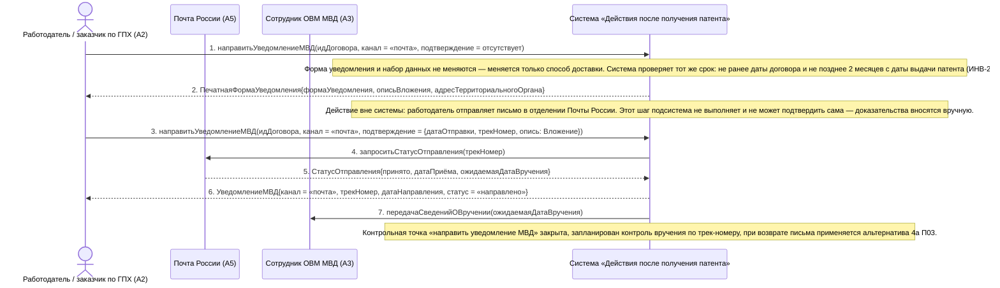

# 08. П03, альтернатива 2а. Электронный канал недоступен — уведомление направляется почтой

**Дисциплина:** Функциональное моделирование систем · **ТюмГУ**, 5 семестр · **Преподаватель:** Ткаченко И. Н.  
**Тема (раздел дорожной карты):** Тема 7. Действия после получения патента · **Команда:** Малышева Елена, Макеев Глеб, Мальгин Олег · **Автор работы:** Макеев Глеб Борисович  
**Дата:** 18.10.2026 · **Репозиторий:** <https://github.com/mflkee/fms-course>

> **Лабораторная 3, системная диаграмма последовательностей (SSD, «чёрный ящик»).** Линии жизни — действующие лица лаб. 1 и **одна** линия жизни подсистемы; сообщения — системные операции. Внутренние объекты подсистемы здесь не показываются — это предмет лаб. 4.

| | |
|---|---|
| **Прецедент** | П03 — [П03. Уведомление МВД об осуществлении трудовой деятельности](../../lab1-usecases/usecases/03-uvedomlenie-mvd.md) |
| **Тип сценария** | альтернативный сценарий 2а («Электронный канал ЕПГУ недоступен») |
| **Системные операции** | `направитьУведомлениеМВД` |
| **Инварианты лаб. 2** | **ИНВ-2**, **ИНВ-8** |
| **Файлы** | [`08-p03-alternativa-pochta.puml`](08-p03-alternativa-pochta.puml) · [`08-p03-alternativa-pochta.png`](08-p03-alternativa-pochta.png) |

**Триггер:** Канал ЕПГУ недоступен: технический сбой СМЭВ, отсутствие подтверждённой учётной записи или ошибка канала при отправке.

## 1. Участники

| Линия жизни | Что это | Тип |
|---|---|---|
| `EMP` | Работодатель / заказчик по ГПХ (A2) | действующее лицо (актор лаб. 1) |
| `POST` | Почта России (A5) | внешняя система / канал (вспомогательный актор лаб. 1) |
| `MVD` | Сотрудник ОВМ МВД (A3) | внешняя система / канал (вспомогательный актор лаб. 1) |
| `SYS` | Система «Действия после получения патента» | **система** — единственная линия жизни, «чёрный ящик» |

## 2. Диаграмма последовательностей

PlantUML-исходник: [`08-p03-alternativa-pochta.puml`](08-p03-alternativa-pochta.puml); растровый рендер: [`08-p03-alternativa-pochta.png`](08-p03-alternativa-pochta.png).

## 3. Описание сообщений

| № | Сообщение | От | Кому | Что происходит | Трассировка на лаб. 1 |
|---|---|---|---|---|---|
| **1** | `направитьУведомлениеМВД(идДоговора, канал = «почта», подтверждение = отсутствует)` | `EMP` | `SYS` | Работодатель переключает канал на почтовый; система формирует печатную форму уведомления и опись вложения из тех же данных. | альтернатива 2а П03 |
| — | *примечание* | SYS | SYS | Форма уведомления и набор данных не меняются — меняется только способ доставки. Система проверяет тот же срок: не ранее даты договора и не позднее 2 месяцев с даты выдачи патента (ИНВ-2). | — |
| **2** | `ПечатнаяФормаУведомления{формаУведомления, описьВложения, адресТерриториальногоОргана}` | `SYS` | `EMP` | Работодатель получает документ для печати и отправки заказным письмом с описью вложения и уведомлением о вручении. | шаг 1 альтернативы 2а П03 |
| — | *примечание* | SYS | SYS | Действие вне системы: работодатель отправляет письмо в отделении Почты России. Этот шаг подсистема не выполняет и не может подтвердить сама — доказательства вносятся вручную. | — |
| **3** | `направитьУведомлениеМВД(идДоговора, канал = «почта», подтверждение = {датаОтправки, трекНомер, опись: Вложение})` | `EMP` | `SYS` | Работодатель регистрирует факт отправки: дату, трек-номер и файл описи вложения. | шаг 2 альтернативы 2а П03 |
| **4** | `запроситьСтатусОтправления(трекНомер)` | `SYS` | `POST` | Подсистема начинает контролировать получение письма по трек-номеру — это постусловие почтовой ветви («если канал — почта, запланирован контроль получения»). | шаг 2 альтернативы 2а П03 |
| **5** | `СтатусОтправления{принято, датаПриёма, ожидаемаяДатаВручения}` | `POST` | `SYS` | Ответ отделения связи: отправление принято. | альтернатива 2а П03 |
| **6** | `УведомлениеМВД{канал = «почта», трекНомер, датаНаправления, статус = «направлено»}` | `SYS` | `EMP` | Уведомление зафиксировано с почтовыми доказательствами; их хранение — бессрочное (ИНВ-8). | альтернатива 2а П03 |
| **7** | `передачаСведенийОВручении(ожидаемаяДатаВручения)` | `SYS` | `MVD` | Контроль вручения адресату: письмо адресовано территориальному органу МВД (A3). | постусловие П03 |
| — | *примечание* | SYS | SYS | Контрольная точка «направить уведомление МВД» закрыта; запланирован контроль вручения по трек-номеру; при возврате письма применяется альтернатива 4а П03. | — |

## 4. Покрытие сценария лаб. 1

| Шаг сценария лаб. 1 | Сообщения диаграммы |
|---|---|
| шаг 1 альтернативы — система предлагает перейти на почтовый канал и формирует печатную форму уведомления | сообщения 1–2 |
| шаг 2 альтернативы — работодатель отправляет письмо, вносит трек-номер и дату отправки; вложение описи сохраняется | сообщение 3 + примечание о действии вне системы |
| контроль получения по трек-номеру | сообщения 4–5, 7 |

## 5. Предусловия и постусловия

**Предусловия**

- Договор заключён и зарегистрирован; патент учтён и действует; срок уведомления не истёк.
- Электронный канал ЕПГУ недоступен или не может быть использован (нет подтверждённой учётной записи, сбой СМЭВ).
- У работодателя есть возможность отправить заказное письмо с описью вложения.

**Постусловия при успешном завершении**

- Печатная форма уведомления и опись вложения сформированы из того же набора данных, что и для электронного канала.
- Уведомление направлено почтой; сохранены дата отправки, трек-номер и файл описи (ИНВ-8).
- Контрольная точка «уведомление МВД» закрыта; запланирован контроль вручения по трек-номеру.

**Постусловия при отклонении от основного потока**

- Если письмо вернулось или вручение не подтверждено, применяется альтернатива 4а П03: уведомление переводится в статус «ошибка», задача остаётся открытой.
- Если дата отправки выходит за срок «2 месяца с даты выдачи патента», фиксируется нарушение (альтернатива 1б П03).

## 6. Решения и примечания

- Оба канала (ЕПГУ и почта) обслуживает одна системная операция — это прямое следствие специального требования П03 и того, что в лаб. 1 ЕПГУ и Почта России объявлены равноправными вспомогательными акторами.
- Сообщение 7 («передача сведений о вручении») показывает интерес МВД как заинтересованного лица, но не подменяет приём уведомления ведомством: граница подсистемы — до момента передачи.

Назад: [README лаб. 3](../README.md) · [спецификация операций](../operations.md) · [прецедент](../../lab1-usecases/usecases/03-uvedomlenie-mvd.md)
