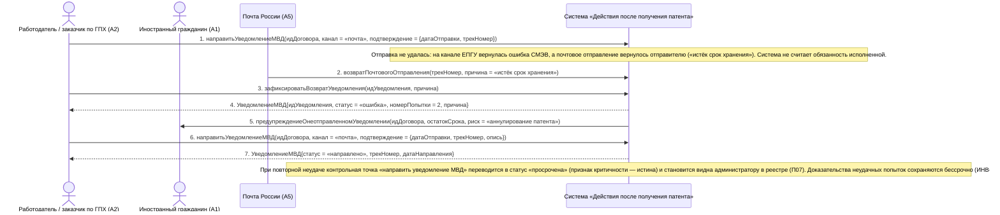

# 09. П03, альтернатива 4а. Отправка не удалась или письмо вернулось

**Дисциплина:** Функциональное моделирование систем · **ТюмГУ**, 5 семестр · **Преподаватель:** Ткаченко И. Н.  
**Тема (раздел дорожной карты):** Тема 7. Действия после получения патента · **Команда:** Малышева Елена, Макеев Глеб, Мальгин Олег · **Автор работы:** Макеев Глеб Борисович  
**Дата:** 18.10.2026 · **Репозиторий:** <https://github.com/mflkee/fms-course>

> **Лабораторная 3, системная диаграмма последовательностей (SSD, «чёрный ящик»).** Линии жизни — действующие лица лаб. 1 и **одна** линия жизни подсистемы; сообщения — системные операции. Внутренние объекты подсистемы здесь не показываются — это предмет лаб. 4.

| | |
|---|---|
| **Прецедент** | П03 — [П03. Уведомление МВД об осуществлении трудовой деятельности](../../lab1-usecases/usecases/03-uvedomlenie-mvd.md) |
| **Тип сценария** | альтернативный сценарий 4а («Отправка не удалась или письмо вернулось») |
| **Системные операции** | `направитьУведомлениеМВД` · `зафиксироватьВозвратУведомления` |
| **Инварианты лаб. 2** | **ИНВ-2**, **ИНВ-8** |
| **Файлы** | [`09-p03-alternativa-vozvrat-otpravleniya.puml`](09-p03-alternativa-vozvrat-otpravleniya.puml) · [`09-p03-alternativa-vozvrat-otpravleniya.png`](09-p03-alternativa-vozvrat-otpravleniya.png) |

**Триггер:** Канал вернул ошибку отправки либо почтовое отправление вернулось отправителю.

## 1. Участники

| Линия жизни | Что это | Тип |
|---|---|---|
| `EMP` | Работодатель / заказчик по ГПХ (A2) | действующее лицо (актор лаб. 1) |
| `CIT` | Иностранный гражданин (A1) | действующее лицо (актор лаб. 1) |
| `POST` | Почта России (A5) | внешняя система / канал (вспомогательный актор лаб. 1) |
| `SYS` | Система «Действия после получения патента» | **система** — единственная линия жизни, «чёрный ящик» |

## 2. Диаграмма последовательностей

PlantUML-исходник: [`09-p03-alternativa-vozvrat-otpravleniya.puml`](09-p03-alternativa-vozvrat-otpravleniya.puml); растровый рендер: [`09-p03-alternativa-vozvrat-otpravleniya.png`](09-p03-alternativa-vozvrat-otpravleniya.png).

## 3. Описание сообщений

| № | Сообщение | От | Кому | Что происходит | Трассировка на лаб. 1 |
|---|---|---|---|---|---|
| **1** | `направитьУведомлениеМВД(идДоговора, канал = «почта», подтверждение = {датаОтправки, трекНомер})` | `EMP` | `SYS` | Работодатель зарегистрировал отправку почтой. | альтернатива 2а П03 |
| — | *примечание* | SYS | SYS | Отправка не удалась: на канале ЕПГУ вернулась ошибка СМЭВ, а почтовое отправление вернулось отправителю («истёк срок хранения»). Система не считает обязанность исполненной. | — |
| **2** | `возвратПочтовогоОтправления(трекНомер, причина = «истёк срок хранения»)` | `POST` | `SYS` | Источник сведений о возврате — Почта России (A5). | альтернатива 4а П03 |
| **3** | `зафиксироватьВозвратУведомления(идУведомления, причина)` | `EMP` | `SYS` | Вторая системная операция прецедента: регистрация неудачной попытки. Отдельная операция нужна потому, что событие возврата наступает позже отправки и инициируется отдельно. | альтернатива 4а П03 |
| **4** | `УведомлениеМВД{идУведомления, статус = «ошибка», номерПопытки = 2, причина}` | `SYS` | `EMP` | Попытка сохранена с причиной; уведомление не становится «направленным», контрольная точка не закрывается. | альтернатива 4а П03 |
| **5** | `предупреждениеОнеотправленномУведомлении(идДоговора, остатокСрока, риск = «аннулирование патента»)` | `SYS` | `CIT` | ИГ предупреждён: неподача уведомления — основание для аннулирования патента. | альтернатива 4а П03 |
| **6** | `направитьУведомлениеМВД(идДоговора, канал = «почта», подтверждение = {датаОтправки, трекНомер, опись})` | `EMP` | `SYS` | Повторная отправка — тем же контрактом операции; канал можно сменить. | шаг 2 альтернативы 4а П03 |
| **7** | `УведомлениеМВД{статус = «направлено», трекНомер, датаНаправления}` | `SYS` | `EMP` | После успешной повторной отправки контрольная точка закрывается. | шаг 2 альтернативы 4а П03 |
| — | *примечание* | SYS | SYS | При повторной неудаче контрольная точка «направить уведомление МВД» переводится в статус «просрочена» (признак критичности — истина) и становится видна администратору в реестре (П07). Доказательства неудачных попыток сохраняются бессрочно (ИНВ-8). | — |

## 4. Покрытие сценария лаб. 1

| Шаг сценария лаб. 1 | Сообщения диаграммы |
|---|---|
| шаг 1 альтернативы — система сохраняет попытку, причину и оставляет задачу открытой | сообщения 1–4 |
| шаг 2 альтернативы — работодатель повторяет отправку; при повторной неудаче создаётся запись для администратора | сообщения 6–7 + примечание о критической записи |

## 5. Предусловия и постусловия

**Предусловия**

- Договор заключён; патент действует; срок уведомления не истёк (или ещё не истёк на момент повторной отправки).
- Ранее была зарегистрирована хотя бы одна попытка отправки уведомления.
- Получены сведения о неудаче: ошибка канала либо возврат почтового отправления.

**Постусловия при успешном завершении**

- Неудачная попытка зафиксирована: причина, номер попытки, файл-доказательство (если есть).
- Уведомление имеет статус «ошибка», задача остаётся открытой; после успешной повторной отправки — статус «направлено», контрольная точка закрыта.

**Постусловия при отклонении от основного потока**

- Если повторная отправка не удалась, контрольная точка переводится в статус «просрочена» с признаком критичности; запись попадает в критические записи реестра (П07).
- ИГ получает предупреждение о риске аннулирования патента независимо от действий работодателя.

## 6. Решения и примечания

- Возврат отправления — событие, приходящее извне и с задержкой, поэтому ему соответствует отдельная системная операция `зафиксироватьВозвратУведомления`, а не параметр операции `направитьУведомлениеМВД`.
- Информация о возврате может прийти и от работодателя, и от Почты России; в диаграмме показан почтовый источник (A5) как наиболее достоверный, а операцию инициирует работодатель, отвечающий за уведомление.

Назад: [README лаб. 3](../README.md) · [спецификация операций](../operations.md) · [прецедент](../../lab1-usecases/usecases/03-uvedomlenie-mvd.md)
