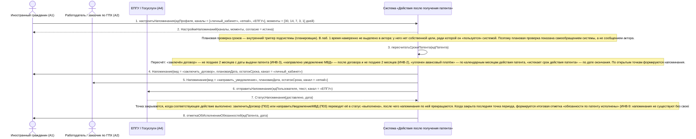

# 10. П04. Контроль срока трудоустройства и напоминания — основной сценарий

**Дисциплина:** Функциональное моделирование систем · **ТюмГУ**, 5 семестр · **Преподаватель:** Ткаченко И. Н.  
**Тема (раздел дорожной карты):** Тема 7. Действия после получения патента · **Команда:** Малышева Елена, Макеев Глеб, Мальгин Олег · **Автор работы:** Макеев Глеб Борисович  
**Дата:** 18.10.2026 · **Репозиторий:** <https://github.com/mflkee/fms-course>

> **Лабораторная 3, системная диаграмма последовательностей (SSD, «чёрный ящик»).** Линии жизни — действующие лица лаб. 1 и **одна** линия жизни подсистемы; сообщения — системные операции. Внутренние объекты подсистемы здесь не показываются — это предмет лаб. 4.

| | |
|---|---|
| **Прецедент** | П04 — [П04. Контроль срока трудоустройства и напоминания](../../lab1-usecases/usecases/04-kontrol-sroka-trudoustroystva.md) |
| **Тип сценария** | основной успешный сценарий |
| **Системные операции** | `настроитьНапоминания` · `пересчитатьСрокиПатента` |
| **Инварианты лаб. 2** | **ИНВ-2**, **ИНВ-3**, **ИНВ-9** |
| **Файлы** | [`10-p04-osnovnoy.puml`](10-p04-osnovnoy.puml) · [`10-p04-osnovnoy.png`](10-p04-osnovnoy.png) |

**Триггер:** ИГ подтверждает согласие на напоминания и выбирает каналы; далее контроль выполняется планово (внутренний триггер) в течение всего срока «2 месяца с даты выдачи патента».

## 1. Участники

| Линия жизни | Что это | Тип |
|---|---|---|
| `CIT` | Иностранный гражданин (A1) | действующее лицо (актор лаб. 1) |
| `EMP` | Работодатель / заказчик по ГПХ (A2) | действующее лицо (актор лаб. 1) |
| `EPGU` | ЕПГУ / Госуслуги (A4) | внешняя система / канал (вспомогательный актор лаб. 1) |
| `SYS` | Система «Действия после получения патента» | **система** — единственная линия жизни, «чёрный ящик» |

## 2. Диаграмма последовательностей

PlantUML-исходник: [`10-p04-osnovnoy.puml`](10-p04-osnovnoy.puml); растровый рендер: [`10-p04-osnovnoy.png`](10-p04-osnovnoy.png).

## 3. Описание сообщений

| № | Сообщение | От | Кому | Что происходит | Трассировка на лаб. 1 |
|---|---|---|---|---|---|
| **1** | `настроитьНапоминания(идПрофиля, каналы = [«личный_кабинет», «email», «ЕПГУ»], моменты = [30, 14, 7, 3, 1] дней)` | `CIT` | `SYS` | ИГ соглашается получать напоминания и выбирает каналы — без этого контроль сроков был бы бесполезен: предупреждение должно дойти до исполнителя. | шаг 1 П04 |
| **2** | `НастройкиНапоминаний{каналы, моменты, согласие = истина}` | `SYS` | `CIT` | Настройки сохранены в профиле; они применяются ко всем открытым контрольным точкам ИГ. | шаг 1 П04 |
| — | *примечание* | SYS | SYS | Плановая проверка сроков — внутренний триггер подсистемы (планировщик). В лаб. 1 время намеренно не выделено в актора: у него нет собственной цели, ради которой он «пользуется» системой. Поэтому плановая проверка показана самообращением системы, а не сообщением актора. | — |
| **3** | `пересчитатьСрокиПатента(идПатента)` | `SYS` | `SYS` | Внутренняя системная операция контроля сроков: пересчёт дедлайнов от даты выдачи патента и выявление открытых точек. | включение П04 в П01 |
| — | *примечание* | SYS | SYS | Пересчёт: «заключён договор» — не позднее 2 месяцев с даты выдачи патента (ИНВ-3); «направлено уведомление МВД» — после договора и не позднее 2 месяцев (ИНВ-2); «уплачен авансовый платёж» — по календарным месяцам действия патента; «истекает срок действия патента» — по дате окончания. По открытым точкам формируются напоминания. | — |
| **4** | `Напоминание{вид = «заключить_договор», плановаяДата, остатокСрока, канал = «личный_кабинет»}` | `SYS` | `CIT` | ИГ получает предупреждение о приближении срока трудоустройства (p. 7.1). | шаги 3–4 П04 |
| **5** | `Напоминание{вид = «направить_уведомление», плановаяДата, остатокСрока, канал = «email»}` | `SYS` | `EMP` | Работодатель получает предупреждение о сроке уведомления МВД (p. 7.2): обязанность лежит на нём. | шаги 3–4 П04 |
| **6** | `отправитьНапоминание(идПользователя, текст, канал = «ЕПГУ»)` | `SYS` | `EPGU` | ЕПГУ используется как один из каналов доставки напоминаний (это предусмотрено предусловиями П04). | шаг 4 П04 |
| **7** | `СтатусНапоминания{доставлено, дата}` | `EPGU` | `SYS` | История напоминаний и статусы доставки сохраняются — это постусловие П04. | шаг 4 П04 |
| — | *примечание* | SYS | SYS | Точка закрывается, когда соответствующее действие выполнено: `заключитьДоговор` (П02) или `направитьУведомлениеМВД` (П03) переводят её в статус «выполнена», после чего напоминания по ней прекращаются. Когда закрыта последняя точка периода, формируется итоговая отметка «обязанности по патенту исполнены» (ИНВ-9: напоминания не существуют без своей точки). | — |
| **8** | `отметкаОбИсполненииОбязанностей(идПатента, дата)` | `SYS` | `CIT` | Итог периода: все контрольные точки закрыты, обязанности по патенту исполнены. | шаг 7 П04 |

## 4. Покрытие сценария лаб. 1

| Шаг сценария лаб. 1 | Сообщения диаграммы |
|---|---|
| шаг 1 — ИГ подтверждает согласие на напоминания и выбирает каналы | сообщения 1–2 |
| шаг 2 — система рассчитывает дедлайны от даты выдачи патента (2 месяца на договор и на уведомление) | сообщение 3 + примечание о пересчёте |
| шаг 3 — система сравнивает дедлайны с текущей датой и определяет открытые точки | сообщение 3 + примечание |
| шаг 4 — в назначенные моменты система формирует и отправляет напоминание исполнителю точки | сообщения 4–7 |
| шаг 5 — исполнитель выполняет действие (заключает договор, отправляет уведомление); система закрывает точку | выполняется операциями П02 и П03 (в состав П04 не входит) |
| шаг 6 — система пересчитывает оставшиеся точки и продолжает контроль | повторный вызов `пересчитатьСрокиПатента` |
| шаг 7 — при закрытии последней точки периода формируется отметка «обязанности по патенту исполнены» | сообщение 8 |

## 5. Предусловия и постусловия

**Предусловия**

- Патент учтён в подсистеме (П01); известна дата выдачи патента.
- Задан справочник сроков и правила расчёта (2 месяца с даты выдачи патента, календарные месяцы).
- ИГ согласился получать напоминания и указал каналы связи (личный кабинет, e-mail, телефон, ЕПГУ).

**Постусловия при успешном завершении**

- Для патента рассчитаны контрольные точки со сроками; по каждой точке в заданные моменты отправлены напоминания.
- При приближении срока задача помечена критической; при просрочке зафиксировано нарушение (альтернатива 4а П04).
- История напоминаний и реакции на них сохранена (дата, канал, статус доставки).
- После закрытия всех точек сформирована отметка «обязанности по патенту исполнены».

**Постусловия при отклонении от основного потока**

- При отсутствии согласия ИГ на напоминания контроль всё равно ведётся, но напоминания не доставляются — этот случай в лаб. 1 не описан и в модели не выделен.
- Если напоминание доставлено не было (ошибка канала), статус напоминания сохраняется как «ошибка», а контрольная точка не закрывается.

## 6. Решения и примечания

- Контроль сроков — вспомогательная функция: она не имеет собственного результата для исполнителя, а обеспечивает достижение результатов П02 и П03. Это отражено в уровне прецедента в лаб. 1.
- Плановая проверка показана самообращением системы (`SYS -> SYS`) — единственный корректный способ изобразить внутренний триггер в SSD, не вводя «время» как актора.
- Операция `настроитьНапоминания` отделена от `пересчитатьСрокиПатента`: первая инициируется человеком (ИГ) и меняет профиль, вторая — планировщиком и меняет контрольные точки. Это разные причины изменения и разные права доступа.

Назад: [README лаб. 3](../README.md) · [спецификация операций](../operations.md) · [прецедент](../../lab1-usecases/usecases/04-kontrol-sroka-trudoustroystva.md)
