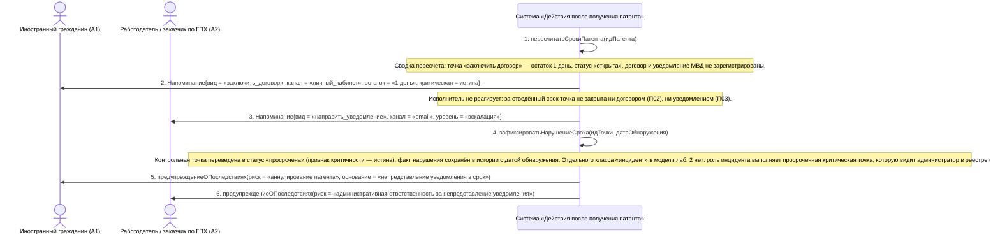

# 11. П04, альтернатива 4а. Исполнитель не реагирует на напоминания: просрочка и эскалация

**Дисциплина:** Функциональное моделирование систем · **ТюмГУ**, 5 семестр · **Преподаватель:** Ткаченко И. Н.  
**Тема (раздел дорожной карты):** Тема 7. Действия после получения патента · **Команда:** Малышева Елена, Макеев Глеб, Мальгин Олег · **Автор работы:** Макеев Глеб Борисович  
**Дата:** 18.10.2026 · **Репозиторий:** <https://github.com/mflkee/fms-course>

> **Лабораторная 3, системная диаграмма последовательностей (SSD, «чёрный ящик»).** Линии жизни — действующие лица лаб. 1 и **одна** линия жизни подсистемы; сообщения — системные операции. Внутренние объекты подсистемы здесь не показываются — это предмет лаб. 4.

| | |
|---|---|
| **Прецедент** | П04 — [П04. Контроль срока трудоустройства и напоминания](../../lab1-usecases/usecases/04-kontrol-sroka-trudoustroystva.md) |
| **Тип сценария** | альтернативный сценарий 4а («Исполнитель не реагирует на напоминания») |
| **Системные операции** | `пересчитатьСрокиПатента` · `зафиксироватьНарушениеСрока` |
| **Инварианты лаб. 2** | **ИНВ-2**, **ИНВ-3**, **ИНВ-9** |
| **Файлы** | [`11-p04-alternativa-prosrochka-napominanie.puml`](11-p04-alternativa-prosrochka-napominanie.puml) · [`11-p04-alternativa-prosrochka-napominanie.png`](11-p04-alternativa-prosrochka-napominanie.png) |

**Триггер:** Срок контрольной точки истёк, а действие не выполнено: ни договор, ни уведомление МВД не зарегистрированы.

## 1. Участники

| Линия жизни | Что это | Тип |
|---|---|---|
| `CIT` | Иностранный гражданин (A1) | действующее лицо (актор лаб. 1) |
| `EMP` | Работодатель / заказчик по ГПХ (A2) | действующее лицо (актор лаб. 1) |
| `SYS` | Система «Действия после получения патента» | **система** — единственная линия жизни, «чёрный ящик» |

## 2. Диаграмма последовательностей

PlantUML-исходник: [`11-p04-alternativa-prosrochka-napominanie.puml`](11-p04-alternativa-prosrochka-napominanie.puml); растровый рендер: [`11-p04-alternativa-prosrochka-napominanie.png`](11-p04-alternativa-prosrochka-napominanie.png).

## 3. Описание сообщений

| № | Сообщение | От | Кому | Что происходит | Трассировка на лаб. 1 |
|---|---|---|---|---|---|
| **1** | `пересчитатьСрокиПатента(идПатента)` | `SYS` | `SYS` | Плановая проверка: система видит, что точка «заключить договор» не закрыта, а срок истекает. | включение П04 |
| — | *примечание* | SYS | SYS | Сводка пересчёта: точка «заключить договор» — остаток 1 день, статус «открыта»; договор и уведомление МВД не зарегистрированы. | — |
| **2** | `Напоминание{вид = «заключить_договор», канал = «личный_кабинет», остаток = «1 день», критическая = истина}` | `SYS` | `CIT` | Напоминание с повышенным уровнем критичности — последнее предупреждение перед нарушением. | шаги 3–4 П04 |
| — | *примечание* | SYS | SYS | Исполнитель не реагирует: за отведённый срок точка не закрыта ни договором (П02), ни уведомлением (П03). | — |
| **3** | `Напоминание{вид = «направить_уведомление», канал = «email», уровень = «эскалация»}` | `SYS` | `EMP` | Система повторяет напоминание по другому каналу и повышает уровень критичности — этого требует шаг 1 альтернативы 4а. | шаг 1 альтернативы 4а П04 |
| **4** | `зафиксироватьНарушениеСрока(идТочки, датаОбнаружения)` | `SYS` | `SYS` | Отдельная системная операция: срок точки истёк, и это надо зафиксировать как нарушение, а не просто «перестать напоминать». Инициатор — планировщик (внутренний триггер). | шаг 2 альтернативы 4а П04 |
| — | *примечание* | SYS | SYS | Контрольная точка переведена в статус «просрочена» (признак критичности — истина), факт нарушения сохранён в истории с датой обнаружения. Отдельного класса «инцидент» в модели лаб. 2 нет: роль инцидента выполняет просроченная критическая точка, которую видит администратор в реестре (П07). | — |
| **5** | `предупреждениеОПоследствиях(риск = «аннулирование патента», основание = «непредставление уведомления в срок»)` | `SYS` | `CIT` | ИГ уведомляется о риске потери патента. | шаг 2 альтернативы 4а П04 |
| **6** | `предупреждениеОПоследствиях(риск = «административная ответственность за непредставление уведомления»)` | `SYS` | `EMP` | Работодатель уведомляется о своей ответственности; при просрочке работодатель обязан действовать немедленно. | шаг 2 альтернативы 4а П04 |

## 4. Покрытие сценария лаб. 1

| Шаг сценария лаб. 1 | Сообщения диаграммы |
|---|---|
| шаг 1 альтернативы — система повторяет напоминание по другому каналу и повышает уровень критичности | сообщения 2–3 |
| шаг 2 альтернативы — по истечении срока система фиксирует нарушение и эскалирует его администратору | сообщение 4 + примечания; запись становится видна в реестре (П07) |

## 5. Предусловия и постусловия

**Предусловия**

- Патент учтён; по нему есть открытая контрольная точка с истёкшим или истекающим сроком.
- Соответствующее действие не выполнено: договор не зарегистрирован (П02) или уведомление не направлено (П03).

**Постусловия при успешном завершении**

- Контрольная точка переведена в статус «просрочена»; признак критичности — истина; в истории сохранены дата обнаружения нарушения и предпринятые напоминания.
- Обе стороны получили предупреждения о последствиях: ИГ — о риске аннулирования патента, работодатель — об административной ответственности.
- Запись доступна администратору как критическая (П07).

**Постусловия при отклонении от основного потока**

- Если действие всё же выполнено после фиксации нарушения, точка закрывается, но отметка о просрочке сохраняется: факт нарушения не стирается.
- Если патент аннулирован (в том числе за непредставление уведомления), все точки закрываются с основанием «аннулирование патента» (альтернатива *а П04).

## 6. Решения и примечания

- Разделение «напоминания» и «фиксации нарушения» на две операции — намеренное: напоминание может остаться без последствий (исполнитель отреагировал), а факт нарушения — юридически значимое событие, которое хранится в истории и попадает в отчётность.
- Эскалация администратору в этой диаграмме показана не сообщением, а примечанием: администратор не является участником П04 (в лаб. 1 он заявлен как закулисный интерес), а видит нарушение через реестр П07.

Назад: [README лаб. 3](../README.md) · [спецификация операций](../operations.md) · [прецедент](../../lab1-usecases/usecases/04-kontrol-sroka-trudoustroystva.md)
