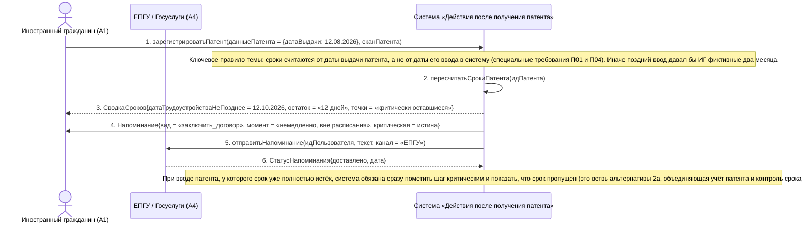

# 12. П04, альтернатива 2а. Дата выдачи патента введена с опозданием

**Дисциплина:** Функциональное моделирование систем · **ТюмГУ**, 5 семестр · **Преподаватель:** Ткаченко И. Н.  
**Тема (раздел дорожной карты):** Тема 7. Действия после получения патента · **Команда:** Малышева Елена, Макеев Глеб, Мальгин Олег · **Автор работы:** Макеев Глеб Борисович  
**Дата:** 18.10.2026 · **Репозиторий:** <https://github.com/mflkee/fms-course>

> **Лабораторная 3, системная диаграмма последовательностей (SSD, «чёрный ящик»).** Линии жизни — действующие лица лаб. 1 и **одна** линия жизни подсистемы; сообщения — системные операции. Внутренние объекты подсистемы здесь не показываются — это предмет лаб. 4.

| | |
|---|---|
| **Прецедент** | П04 — [П04. Контроль срока трудоустройства и напоминания](../../lab1-usecases/usecases/04-kontrol-sroka-trudoustroystva.md) |
| **Тип сценария** | альтернативный сценарий 2а («Дата выдачи патента введена с опозданием») |
| **Системные операции** | `зарегистрироватьПатент` · `пересчитатьСрокиПатента` |
| **Инварианты лаб. 2** | **ИНВ-3**, **ИНВ-6** |
| **Файлы** | [`12-p04-alternativa-zaderzhka-vvoda.puml`](12-p04-alternativa-zaderzhka-vvoda.puml) · [`12-p04-alternativa-zaderzhka-vvoda.png`](12-p04-alternativa-zaderzhka-vvoda.png) |

**Триггер:** ИГ регистрирует патент, у которого дата выдачи в прошлом: часть срока (а иногда и весь срок) уже прошла.

## 1. Участники

| Линия жизни | Что это | Тип |
|---|---|---|
| `CIT` | Иностранный гражданин (A1) | действующее лицо (актор лаб. 1) |
| `EPGU` | ЕПГУ / Госуслуги (A4) | внешняя система / канал (вспомогательный актор лаб. 1) |
| `SYS` | Система «Действия после получения патента» | **система** — единственная линия жизни, «чёрный ящик» |

## 2. Диаграмма последовательностей

PlantUML-исходник: [`12-p04-alternativa-zaderzhka-vvoda.puml`](12-p04-alternativa-zaderzhka-vvoda.puml); растровый рендер: [`12-p04-alternativa-zaderzhka-vvoda.png`](12-p04-alternativa-zaderzhka-vvoda.png).

## 3. Описание сообщений

| № | Сообщение | От | Кому | Что происходит | Трассировка на лаб. 1 |
|---|---|---|---|---|---|
| **1** | `зарегистрироватьПатент(данныеПатента = {датаВыдачи: 12.08.2026}, сканПатента)` | `CIT` | `SYS` | Патент учтён с опозданием: до ввода в систему осталось меньше двух месяцев с даты выдачи. | шаг 1 П01 |
| — | *примечание* | SYS | SYS | Ключевое правило темы: сроки считаются от даты выдачи патента, а не от даты его ввода в систему (специальные требования П01 и П04). Иначе поздний ввод давал бы ИГ фиктивные два месяца. | — |
| **2** | `пересчитатьСрокиПатента(идПатента)` | `SYS` | `SYS` | Сразу после учёта система пересчитывает сроки от фактической даты выдачи и помечает оставшиеся точки как критически оставшиеся. | включение П04 |
| **3** | `СводкаСроков{датаТрудоустройстваНеПозднее = 12.10.2026, остаток = «12 дней», точки = «критически оставшиеся»}` | `SYS` | `CIT` | ИГ видит фактический остаток срока, а не «полные 2 месяца» от даты ввода — это прямое требование П04. | шаг 2 альтернативы 2а П04 |
| **4** | `Напоминание{вид = «заключить_договор», момент = «немедленно, вне расписания», критическая = истина}` | `SYS` | `CIT` | Напоминание отправляется немедленно, независимо от расписания: до истечения срока осталось меньше контрольного окна. | шаг 1 альтернативы 2а П04 |
| **5** | `отправитьНапоминание(идПользователя, текст, канал = «ЕПГУ»)` | `SYS` | `EPGU` | Немедленное напоминание дублируется по каналу ЕПГУ, чтобы гарантированно дойти до ИГ. | шаг 1 альтернативы 2а П04 |
| **6** | `СтатусНапоминания{доставлено, дата}` | `EPGU` | `SYS` | Факт и время доставки сохранены в истории напоминаний. | шаг 1 альтернативы 2а П04 |
| — | *примечание* | SYS | SYS | При вводе патента, у которого срок уже полностью истёк, система обязана сразу пометить шаг критическим и показать, что срок пропущен (это ветвь альтернативы 2а, объединяющая учёт патента и контроль срока). | — |

## 4. Покрытие сценария лаб. 1

| Шаг сценария лаб. 1 | Сообщения диаграммы |
|---|---|
| шаг 1 альтернативы — система сразу помечает точки как критически оставшиеся и отправляет немедленное уведомление | сообщения 1–6 |
| шаг 2 альтернативы — ИГ видит фактический остаток срока, а не «полные 2 месяца» с даты ввода | сообщение 3 |

## 5. Предусловия и постусловия

**Предусловия**

- Патент получен ранее, но в подсистему вводится с опозданием.
- ИГ согласился получать напоминания и указал каналы связи.
- Дата выдачи патента подтверждена документом (сканом).

**Постусловия при успешном завершении**

- Сроки рассчитаны от фактической даты выдачи патента; оставшиеся контрольные точки помечены критическими.
- Немедленное напоминание отправлено и его доставка зафиксирована (ИНВ-6 — учтён один действующий патент).

**Постусловия при отклонении от основного потока**

- Если на момент ввода срок уже истёк, регистрация не блокируется, но шаг помечается критическим, а следующая проверка (альтернатива 4а П04) зафиксирует нарушение.
- Если ИГ не реагирует на немедленное напоминание, применяется альтернатива 4а П04.

## 6. Решения и примечания

- Эта диаграмма показывает связь двух прецедентов: учёт патента (П01) немедленно запускает контроль срока (П04). Именно поэтому в лаб. 1 заявлено отношение «П01 включает П04».
- Немедленная отправка напоминания — прямое следствие специального требования П04: «если срок истекает до конца текущих суток, напоминание отправляется немедленно, независимо от расписания».

Назад: [README лаб. 3](../README.md) · [спецификация операций](../operations.md) · [прецедент](../../lab1-usecases/usecases/04-kontrol-sroka-trudoustroystva.md)
