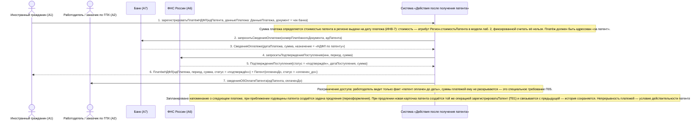

# 13. П05. Учёт авансовых платежей НДФЛ и контроль срока действия патента — основной сценарий

**Дисциплина:** Функциональное моделирование систем · **ТюмГУ**, 5 семестр · **Преподаватель:** Ткаченко И. Н.  
**Тема (раздел дорожной карты):** Тема 7. Действия после получения патента · **Команда:** Малышева Елена, Макеев Глеб, Мальгин Олег · **Автор работы:** Макеев Глеб Борисович  
**Дата:** 18.10.2026 · **Репозиторий:** <https://github.com/mflkee/fms-course>

> **Лабораторная 3, системная диаграмма последовательностей (SSD, «чёрный ящик»).** Линии жизни — действующие лица лаб. 1 и **одна** линия жизни подсистемы; сообщения — системные операции. Внутренние объекты подсистемы здесь не показываются — это предмет лаб. 4.

| | |
|---|---|
| **Прецедент** | П05 — [П05. Учёт авансовых платежей НДФЛ и контроль срока действия патента](../../lab1-usecases/usecases/05-ndfl-i-prodlenie-patenta.md) |
| **Тип сценария** | основной успешный сценарий |
| **Системные операции** | `зарегистрироватьПлатёжНДФЛ` |
| **Инварианты лаб. 2** | **ИНВ-5**, **ИНВ-7** |
| **Файлы** | [`13-p05-osnovnoy.puml`](13-p05-osnovnoy.puml) · [`13-p05-osnovnoy.png`](13-p05-osnovnoy.png) |

**Триггер:** ИГ вносит платёжный документ по очередному авансовому платежу НДФЛ либо система напоминает о сроке платежа.

## 1. Участники

| Линия жизни | Что это | Тип |
|---|---|---|
| `CIT` | Иностранный гражданин (A1) | действующее лицо (актор лаб. 1) |
| `EMP` | Работодатель / заказчик по ГПХ (A2) | действующее лицо (актор лаб. 1) |
| `BANK` | Банк (A7) | внешняя система / канал (вспомогательный актор лаб. 1) |
| `FNS` | ФНС России (A6) | внешняя система / канал (вспомогательный актор лаб. 1) |
| `SYS` | Система «Действия после получения патента» | **система** — единственная линия жизни, «чёрный ящик» |

## 2. Диаграмма последовательностей

PlantUML-исходник: [`13-p05-osnovnoy.puml`](13-p05-osnovnoy.puml); растровый рендер: [`13-p05-osnovnoy.png`](13-p05-osnovnoy.png).

## 3. Описание сообщений

| № | Сообщение | От | Кому | Что происходит | Трассировка на лаб. 1 |
|---|---|---|---|---|---|
| **1** | `зарегистрироватьПлатёжНДФЛ(идПатента, данныеПлатежа: ДанныеПлатежа, документ = чек банка)` | `CIT` | `SYS` | Основная системная операция прецедента: регистрация авансового платежа за календарный период действия патента. | шаги 1–3 П05 |
| — | *примечание* | SYS | SYS | Сумма платежа определяется стоимостью патента в регионе выдачи на дату платежа (ИНВ-7): стоимость — атрибут `Регион.стоимостьПатента` в модели лаб. 2, фиксированной считать её нельзя. Платёж должен быть адресован «за патент». | — |
| **2** | `запроситьСведенияОплатеже(номерПлатёжногоДокумента, идПатента)` | `SYS` | `BANK` | Проверка платёжного документа по данным банка: дата, сумма, назначение платежа. | шаг 2 П05 |
| **3** | `СведенияОплатеже{датаПлатежа, сумма, назначение = «НДФЛ по патенту»}` | `BANK` | `SYS` | Ответ банка подтверждает, что платёж действительно сделан за этот патент. | шаг 2 П05 |
| **4** | `запроситьПодтверждениеПоступления(инн, период, сумма)` | `SYS` | `FNS` | Обращение к ФНС (через СМЭВ / ГИС ГМП) за подтверждением поступления платежа: банк подтверждает платёж, а администрирует НДФЛ ФНС. | шаг 2 П05 |
| **5** | `ПодтверждениеПоступления{статус = «подтверждён», датаПоступления, сумма}` | `FNS` | `SYS` | Платёж подтверждён и может быть признан покрывающим период. | шаг 3 П05 |
| **6** | `ПлатёжНДФЛ{идПлатежа, период, сумма, статус = «подтверждён»} + Патент{оплаченДо, статус = «оплачен_до»}` | `SYS` | `CIT` | Оплаченный период обновлён; статус патента показывает, до какой даты он оплачен (это поле используется и в других прецедентах — например, при проверке патента работодателем П02). | шаг 4 П05 |
| **7** | `сведенияОбОплатеПатента(идПатента, оплаченДо)` | `SYS` | `EMP` | Работодатель получает подтверждение, что патент оплачен на актуальный период. | шаг 6 П05 |
| — | *примечание* | SYS | SYS | Разграничение доступа: работодатель видит только факт «патент оплачен до даты», суммы платежей ему не раскрываются — это специальное требование П05. | — |
| — | *примечание* | SYS | SYS | Запланировано напоминание о следующем платеже; при приближении годовщины патента создаётся задача продления (переоформления). При продлении новая карточка патента создаётся той же операцией `зарегистрироватьПатент` (П01) и связывается с предыдущей — история сохраняется. Непрерывность платежей — условие действительности патента (ИНВ-5). | — |

## 4. Покрытие сценария лаб. 1

| Шаг сценария лаб. 1 | Сообщения диаграммы |
|---|---|
| шаг 1 — ИГ открывает раздел «Платежи по патенту»; система показывает оплаченный период, следующий платёж и сумму по региону | сообщения 1–2 + примечание о стоимости по региону |
| шаг 2 — ИГ оплачивает авансовый платёж в банке или через ЕПГУ; система передаёт реквизиты и контролирует, что платёж адресован за патент | сообщения 2–3 |
| шаг 3 — ИГ вносит платёжный документ; система сохраняет документ и привязывает платёж к патенту и периоду | сообщения 1, 4–5 |
| шаг 4 — система обновляет оплаченный период и статус патента («оплачен до даты») | сообщение 6 |
| шаг 5 — система планирует напоминание о следующем платеже и задачу продления при приближении годовщины | примечание о планировании |
| шаг 6 — система подтверждает ИГ и работодателю, что патент оплачен на актуальный период | сообщения 6–7 |

## 5. Предусловия и постусловия

**Предусловия**

- Патент учтён в подсистеме (П01), статус — «действует».
- Известны регион выдачи патента и установленная для региона стоимость авансового платежа.
- Известен ИНН ИГ и реквизиты платежа.
- Первый авансовый платёж уплачен до подачи заявления на патент (раздел 6.1, вне темы 7).

**Постусловия при успешном завершении**

- Авансовый платёж занесён по календарному периоду действия патента: дата, сумма, период, платёжный документ, статус «подтверждён» (ИНВ-7 — сумма соответствует стоимости патента в регионе).
- Определён статус оплаты: «оплачено до <дата>».
- Документ приложен к платежу; работодатель видит только факт оплаты, без сумм.
- Запланированы напоминание о следующем платеже и (при приближении годовщины) задача продления.

**Постусловия при отклонении от основного потока**

- Если платёж не найден в системе ФНС или ошибочно зачислен, оплаченный период не обновляется (альтернатива 3а П05).
- Если сумма меньше установленной для региона, период не признаётся оплаченным (альтернатива 3б П05).
- Если оплата отсутствует, действие патента прекращается (альтернатива 4а П05).

## 6. Решения и примечания

- Операция одна на платёж и на подтверждение: для ИГ результат один — «период оплачен». Промежуточные обращения к банку и ФНС — это части одного контракта, поэтому отдельных системных операций для них не вводится.
- Подтверждение платежа приходит от двух внешних участников (банк и ФНС), что соответствует ролям A6 и A7 в лаб. 1: банк принимает платёж, ФНС администрирует НДФЛ.
- Продление патента не является отдельной системной операцией: при продлении создаётся новая карточка патента операцией `зарегистрироватьПатент` (П01), что согласуется с частотой использования П01 в лаб. 1 («повторно при каждом продлении»).

Назад: [README лаб. 3](../README.md) · [спецификация операций](../operations.md) · [прецедент](../../lab1-usecases/usecases/05-ndfl-i-prodlenie-patenta.md)
