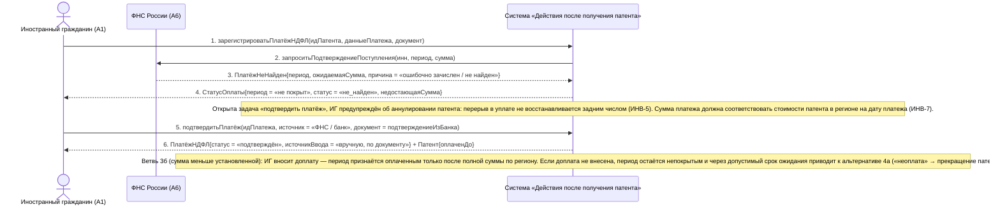

# 14. П05, альтернативы 3а и 3б. Платёж не найден в системе ФНС или сумма меньше установленной

**Дисциплина:** Функциональное моделирование систем · **ТюмГУ**, 5 семестр · **Преподаватель:** Ткаченко И. Н.  
**Тема (раздел дорожной карты):** Тема 7. Действия после получения патента · **Команда:** Малышева Елена, Макеев Глеб, Мальгин Олег · **Автор работы:** Макеев Глеб Борисович  
**Дата:** 18.10.2026 · **Репозиторий:** <https://github.com/mflkee/fms-course>

> **Лабораторная 3, системная диаграмма последовательностей (SSD, «чёрный ящик»).** Линии жизни — действующие лица лаб. 1 и **одна** линия жизни подсистемы; сообщения — системные операции. Внутренние объекты подсистемы здесь не показываются — это предмет лаб. 4.

| | |
|---|---|
| **Прецедент** | П05 — [П05. Учёт авансовых платежей НДФЛ и контроль срока действия патента](../../lab1-usecases/usecases/05-ndfl-i-prodlenie-patenta.md) |
| **Тип сценария** | альтернативные сценарии 3а и 3б («Платёж не найден / сумма меньше установленной») |
| **Системные операции** | `зарегистрироватьПлатёжНДФЛ` · `подтвердитьПлатёж` |
| **Инварианты лаб. 2** | **ИНВ-5**, **ИНВ-7** |
| **Файлы** | [`14-p05-alternativa-platezh-ne-najden.puml`](14-p05-alternativa-platezh-ne-najden.puml) · [`14-p05-alternativa-platezh-ne-najden.png`](14-p05-alternativa-platezh-ne-najden.png) |

**Триггер:** ФНС не подтверждает поступление платежа либо сумма платежа меньше установленной для региона стоимости патента.

## 1. Участники

| Линия жизни | Что это | Тип |
|---|---|---|
| `CIT` | Иностранный гражданин (A1) | действующее лицо (актор лаб. 1) |
| `FNS` | ФНС России (A6) | внешняя система / канал (вспомогательный актор лаб. 1) |
| `SYS` | Система «Действия после получения патента» | **система** — единственная линия жизни, «чёрный ящик» |

## 2. Диаграмма последовательностей

PlantUML-исходник: [`14-p05-alternativa-platezh-ne-najden.puml`](14-p05-alternativa-platezh-ne-najden.puml); растровый рендер: [`14-p05-alternativa-platezh-ne-najden.png`](14-p05-alternativa-platezh-ne-najden.png).

## 3. Описание сообщений

| № | Сообщение | От | Кому | Что происходит | Трассировка на лаб. 1 |
|---|---|---|---|---|---|
| **1** | `зарегистрироватьПлатёжНДФЛ(идПатента, данныеПлатежа, документ)` | `CIT` | `SYS` | Обычная регистрация платежа; проблема выявляется при сверке. | шаги 1–3 П05 |
| **2** | `запроситьПодтверждениеПоступления(инн, период, сумма)` | `SYS` | `FNS` | Сверка с ФНС. | шаг 2 П05 |
| **3** | `ПлатёжНеНайден{период, ожидаемаяСумма, причина = «ошибочно зачислен / не найден»}` | `FNS` | `SYS` | Ответ ФНС: платежа за этот период нет (либо сумма меньше установленной стоимости патента в регионе — ветвь 3б). | шаг 1 альтернативы 3а П05 |
| **4** | `СтатусОплаты{период = «не покрыт», статус = «не_найден», недостающаяСумма}` | `SYS` | `CIT` | Система не признаёт период оплаченным и показывает, сколько не хватает. Оплаченный период не обновляется. | шаг 1 альтернативы 3а П05 |
| — | *примечание* | SYS | SYS | Открыта задача «подтвердить платёж»; ИГ предупреждён об аннулировании патента: перерыв в уплате не восстанавливается задним числом (ИНВ-5). Сумма платежа должна соответствовать стоимости патента в регионе на дату платежа (ИНВ-7). | — |
| **5** | `подтвердитьПлатёж(идПлатежа, источник = «ФНС / банк», документ = подтверждениеИзБанка)` | `CIT` | `SYS` | Вторая системная операция прецедента: ручное подтверждение платежа по документу из банка или ФНС — шаг 2 альтернативы 3а («после подтверждения платёж заносится вручную с отметкой об источнике»). | шаг 2 альтернативы 3а П05 |
| **6** | `ПлатёжНДФЛ{статус = «подтверждён», источникВвода = «вручную, по документу»} + Патент{оплаченДо}` | `SYS` | `CIT` | Период признан оплаченным; в платеже сохранена отметка о ручном вводе и источнике — это важно для доказательств. | шаг 2 альтернативы 3а П05 |
| — | *примечание* | SYS | SYS | Ветвь 3б (сумма меньше установленной): ИГ вносит доплату — период признаётся оплаченным только после полной суммы по региону. Если доплата не внесена, период остаётся непокрытым и через допустимый срок ожидания приводит к альтернативе 4а («неоплата» → прекращение патента). | — |

## 4. Покрытие сценария лаб. 1

| Шаг сценария лаб. 1 | Сообщения диаграммы |
|---|---|
| шаг 1 альтернативы 3а — система не обновляет оплаченный период и открывает задачу «подтвердить платёж» | сообщения 1–4 |
| шаг 2 альтернативы 3а — ИГ обращается в ФНС или банк; после подтверждения платёж заносится вручную с отметкой об источнике | сообщения 5–6 |
| альтернатива 3б — система показывает недостающую сумму; ИГ вносит доплату, иначе период остаётся непокрытым | сообщение 4 (поле `недостающаяСумма`) + примечание о доплате |

## 5. Предусловия и постусловия

**Предусловия**

- Патент учтён и действует; известны регион и стоимость платежа.
- ИГ внёс платёж, но он не найден в системе ФНС, зачислен ошибочно или его сумма меньше установленной.
- У ИГ есть возможность получить подтверждение платежа из банка или ФНС.

**Постусловия при успешном завершении**

- Платёж зарегистрирован со статусом «подтверждён» и отметкой источника (ручной ввод по документу); оплаченный период обновлён.
- Документ-подтверждение приложен к платежу.

**Постусловия при отклонении от основного потока**

- Период остаётся непокрытым; задача «подтвердить платёж» открыта; ИГ предупреждён о риске прекращения действия патента (ИНВ-5).
- При отсутствии доплаты период не признаётся оплаченным и передаётся в ветвь 4а П05.

## 6. Решения и примечания

- Операция `подтвердитьПлатёж` выделена отдельно от `зарегистрироватьПлатёжНДФЛ`, потому что у неё другой инициатор событий (внешнее подтверждение из банка или ФНС) и другая правовая природа (восстановление учёта по документу).
- Обе ветви (3а и 3б) показаны на одной диаграмме: у них один и тот же результат — «платёж не подтверждён», и один и тот же выход — ручное подтверждение либо доплата. Различие фиксируется в параметрах ответа ФНС.
- Комментарий для лаб. 5–6: ручное подтверждение — место повышенного риска (фальсификация документа), поэтому в проектировании потребуется журнал аудита и, возможно, отдельные права на ручной ввод.

Назад: [README лаб. 3](../README.md) · [спецификация операций](../operations.md) · [прецедент](../../lab1-usecases/usecases/05-ndfl-i-prodlenie-patenta.md)
