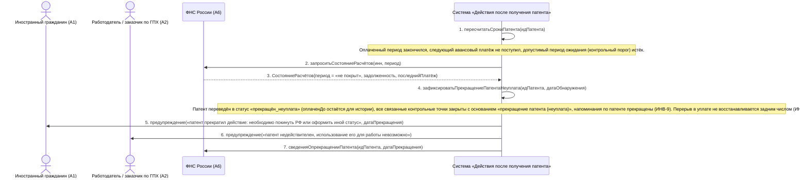

# 15. П05, альтернатива 4а. Оплата отсутствует — действие патента прекращается

**Дисциплина:** Функциональное моделирование систем · **ТюмГУ**, 5 семестр · **Преподаватель:** Ткаченко И. Н.  
**Тема (раздел дорожной карты):** Тема 7. Действия после получения патента · **Команда:** Малышева Елена, Макеев Глеб, Мальгин Олег · **Автор работы:** Макеев Глеб Борисович  
**Дата:** 18.10.2026 · **Репозиторий:** <https://github.com/mflkee/fms-course>

> **Лабораторная 3, системная диаграмма последовательностей (SSD, «чёрный ящик»).** Линии жизни — действующие лица лаб. 1 и **одна** линия жизни подсистемы; сообщения — системные операции. Внутренние объекты подсистемы здесь не показываются — это предмет лаб. 4.

| | |
|---|---|
| **Прецедент** | П05 — [П05. Учёт авансовых платежей НДФЛ и контроль срока действия патента](../../lab1-usecases/usecases/05-ndfl-i-prodlenie-patenta.md) |
| **Тип сценария** | альтернативный сценарий 4а («Оплата отсутствует — патент прекращает действие») |
| **Системные операции** | `зафиксироватьПрекращениеПатентаНеуплата` |
| **Инварианты лаб. 2** | **ИНВ-5**, **ИНВ-9** |
| **Файлы** | [`15-p05-alternativa-neoplata.puml`](15-p05-alternativa-neoplata.puml) · [`15-p05-alternativa-neoplata.png`](15-p05-alternativa-neoplata.png) |

**Триггер:** Оплаченный период закончился, очередной авансовый платёж не поступил, допустимый период ожидания истёк.

## 1. Участники

| Линия жизни | Что это | Тип |
|---|---|---|
| `CIT` | Иностранный гражданин (A1) | действующее лицо (актор лаб. 1) |
| `EMP` | Работодатель / заказчик по ГПХ (A2) | действующее лицо (актор лаб. 1) |
| `FNS` | ФНС России (A6) | внешняя система / канал (вспомогательный актор лаб. 1) |
| `SYS` | Система «Действия после получения патента» | **система** — единственная линия жизни, «чёрный ящик» |

## 2. Диаграмма последовательностей

PlantUML-исходник: [`15-p05-alternativa-neoplata.puml`](15-p05-alternativa-neoplata.puml); растровый рендер: [`15-p05-alternativa-neoplata.png`](15-p05-alternativa-neoplata.png).

## 3. Описание сообщений

| № | Сообщение | От | Кому | Что происходит | Трассировка на лаб. 1 |
|---|---|---|---|---|---|
| **1** | `пересчитатьСрокиПатента(идПатента)` | `SYS` | `SYS` | Плановая проверка контрольных точек: оплаченный период закончился, следующая точка «уплатить_НДФЛ» не закрыта. | включение П04 |
| — | *примечание* | SYS | SYS | Оплаченный период закончился, следующий авансовый платёж не поступил; допустимый период ожидания (контрольный порог) истёк. | — |
| **2** | `запроситьСостояниеРасчётов(инн, период)` | `SYS` | `FNS` | Перед тем как объявить патент прекращённым, система обязана убедиться, что платежа нет именно с точки зрения администрирующего органа. | шаг 4 альтернативы 4а П05 |
| **3** | `СостояниеРасчётов{период = «не покрыт», задолженность, последнийПлатёж}` | `FNS` | `SYS` | Платёж отсутствует: состояние расчётов подтверждает непокрытый период. | альтернатива 4а П05 |
| **4** | `зафиксироватьПрекращениеПатентаНеуплата(идПатента, датаОбнаружения)` | `SYS` | `SYS` | Системная операция, фиксирующая прекращение действия патента. Инициатор — планировщик (внутренний триггер). | шаг 1 альтернативы 4а П05 |
| — | *примечание* | SYS | SYS | Патент переведён в статус «прекращён_неуплата» (оплаченДо остаётся для истории); все связанные контрольные точки закрыты с основанием «прекращение патента (неуплата)»; напоминания по патенте прекращены (ИНВ-9). Перерыв в уплате не восстанавливается задним числом (ИНВ-5). | — |
| **5** | `предупреждение(«патент прекратил действие: необходимо покинуть РФ или оформить иной статус», датаПрекращения)` | `SYS` | `CIT` | ИГ получает предупреждение о последствиях — это предусмотрено сценарием 4а в лаб. 1. | шаг 2 альтернативы 4а П05 |
| **6** | `предупреждение(«патент недействителен, использование его для работы невозможно»)` | `SYS` | `EMP` | Работодатель уведомляется: работа по такому патенту невозможна, договор требует пересмотра. | шаг 2 альтернативы 4а П05 |
| **7** | `сведенияОпрекращенииПатента(идПатента, датаПрекращения)` | `SYS` | `FNS` | Сведения о прекращении патента передаются администрирующему органу — ФНС ведёт учёт платежей по патенту. | закулисный интерес A6 |

## 4. Покрытие сценария лаб. 1

| Шаг сценария лаб. 1 | Сообщения диаграммы |
|---|---|
| шаг 1 альтернативы — система переводит патент в статус «действие прекращено (неуплата)» | сообщения 1–4 |
| шаг 2 альтернативы — все связанные контрольные точки закрываются, ИГ получает предупреждение о необходимости покинуть РФ или оформить иной статус, работодатель — о невозможности использовать патент | сообщения 5–6 + примечание о точках |

## 5. Предусловия и постусловия

**Предусловия**

- Патент учтён и ранее был оплачен (есть непустой оплаченный период).
- Очередной авансовый платёж за следующий календарный период не поступил.
- Обращение к ФНС подтверждает отсутствие платежа (не «не нашли платёж», а «платежа нет»).

**Постусловия при успешном завершении**

- Патент имеет статус «прекращён_неуплата»; известна дата прекращения.
- Все контрольные точки закрыты с основанием «прекращение патента (неуплата)»; напоминания прекращены.
- Обе стороны уведомлены; сведения переданы в ФНС; запись видна в реестре (П07) как критическая.

**Постусловия при отклонении от основного потока**

- Если платёж находится с опозданием (внесён до принятия решения), применяется альтернатива 3а П05 (ручное подтверждение) — статус патента пересматривается.
- Если патент был аннулирован решением МВД, а не из-за неуплаты, применяется другая ветвь (альтернатива *б П01), хотя последствия для учёта аналогичны.

## 6. Решения и примечания

- Операция `зафиксироватьПрекращениеПатентаНеуплата` — единственная в модели, которая переводит патент в «прекращён_неуплата». Значение статуса взято из перечня `СтатусПатента` в лаб. 2.
- Обращение к ФНС (сообщения 2–3) принципиально: прекращение действия патента — юридически значимое решение, и оно не может быть принято на основании только отсутствия отметки в подсистеме.
- Блокировка договора и его пересмотр после прекращения патента в этой диаграмме не детализированы: это уже задача прецедента П06 (прекращение договора), куда подсистема передаёт управление предупреждением (сообщение 6).

Назад: [README лаб. 3](../README.md) · [спецификация операций](../operations.md) · [прецедент](../../lab1-usecases/usecases/05-ndfl-i-prodlenie-patenta.md)
