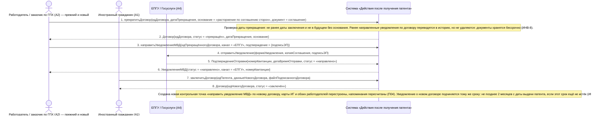

# 16. П06. Прекращение договора, смена работодателя и повторное уведомление МВД — основной сценарий

**Дисциплина:** Функциональное моделирование систем · **ТюмГУ**, 5 семестр · **Преподаватель:** Ткаченко И. Н.  
**Тема (раздел дорожной карты):** Тема 7. Действия после получения патента · **Команда:** Малышева Елена, Макеев Глеб, Мальгин Олег · **Автор работы:** Макеев Глеб Борисович  
**Дата:** 18.10.2026 · **Репозиторий:** <https://github.com/mflkee/fms-course>

> **Лабораторная 3, системная диаграмма последовательностей (SSD, «чёрный ящик»).** Линии жизни — действующие лица лаб. 1 и **одна** линия жизни подсистемы; сообщения — системные операции. Внутренние объекты подсистемы здесь не показываются — это предмет лаб. 4.

| | |
|---|---|
| **Прецедент** | П06 — [П06. Прекращение договора, смена работодателя и повторное уведомление МВД](../../lab1-usecases/usecases/06-prekrashchenie-dogovora.md) |
| **Тип сценария** | основной успешный сценарий (расширение темы) |
| **Системные операции** | `прекратитьДоговор` · `направитьУведомлениеМВД` · `заключитьДоговор` |
| **Инварианты лаб. 2** | **ИНВ-1**, **ИНВ-2**, **ИНВ-8** |
| **Файлы** | [`16-p06-osnovnoy.puml`](16-p06-osnovnoy.puml) · [`16-p06-osnovnoy.png`](16-p06-osnovnoy.png) |

**Триггер:** Работодатель или ИГ инициирует прекращение действующего договора; далее заключается договор с новым работодателем.

## 1. Участники

| Линия жизни | Что это | Тип |
|---|---|---|
| `EMP` | Работодатель / заказчик по ГПХ (A2) — прежний и новый | действующее лицо (актор лаб. 1) |
| `CIT` | Иностранный гражданин (A1) | действующее лицо (актор лаб. 1) |
| `EPGU` | ЕПГУ / Госуслуги (A4) | внешняя система / канал (вспомогательный актор лаб. 1) |
| `SYS` | Система «Действия после получения патента» | **система** — единственная линия жизни, «чёрный ящик» |

## 2. Диаграмма последовательностей

PlantUML-исходник: [`16-p06-osnovnoy.puml`](16-p06-osnovnoy.puml); растровый рендер: [`16-p06-osnovnoy.png`](16-p06-osnovnoy.png).

## 3. Описание сообщений

| № | Сообщение | От | Кому | Что происходит | Трассировка на лаб. 1 |
|---|---|---|---|---|---|
| **1** | `прекратитьДоговор(идДоговора, датаПрекращения, основание = «расторжение по соглашению сторон», документ = соглашение)` | `EMP` | `SYS` | Основная системная операция прецедента: закрытие прежнего договора. | шаги 1–2 П06 |
| — | *примечание* | SYS | SYS | Проверка даты прекращения: не ранее даты заключения и не в будущем без основания. Ранее направленные уведомления по договору переводятся в историю, но не удаляются: документы хранятся бессрочно (ИНВ-8). | — |
| **2** | `Договор{идДоговора, статус = «прекращён», датаПрекращения, основание}` | `SYS` | `EMP` | Инвариант ИНВ-1 восстановлен: по патенту снова нет действующего договора, поэтому может быть заключён новый. | шаги 3–4 П06 |
| **3** | `направитьУведомлениеМВД(идПрекращённогоДоговора, канал = «ЕПГУ», подтверждение = {подписьЭП})` | `EMP` | `SYS` | Уведомление в МВД о прекращении отношений или о новом договоре — заимствованная системная операция прецедента П03 (в лаб. 1 зафиксировано: П06 включает П03). | шаги 4–5 П06 |
| **4** | `отправитьУведомление(формаУведомления, копияСоглашения, подписьЭП)` | `SYS` | `EPGU` | Уведомление направляется тем же каналом, что и первое уведомление; при недоступности ЕПГУ используется почта (альтернатива 2а П03). | шаг 4 альтернативы 2а П03 |
| **5** | `ПодтверждениеОтправки{номерКвитанции, датаВремяОтправки, статус = «направлено»}` | `EPGU` | `SYS` | Квитанция сохранена как доказательство исполнения обязанности (ИНВ-8). | шаг 5 П06 |
| **6** | `УведомлениеМВД{статус = «направлено», канал = «ЕПГУ», номерКвитанции}` | `SYS` | `EMP` | Прежний работодатель получает подтверждение: обязанность уведомления исполнена. | шаг 5 П06 |
| **7** | `заключитьДоговор(идПатента, данныеНовогоДоговора, файлПодписанногоДоговора)` | `CIT` | `SYS` | ИГ регистрирует договор с новым работодателем — та же системная операция, что и в П02; проверяются профессия (ИНВ-4) и срок (ИНВ-3). | шаг 6 П06 |
| **8** | `Договор{идНовогоДоговора, статус = «заключён»}` | `SYS` | `CIT` | Новый договор зарегистрирован. | шаг 6 П06 |
| — | *примечание* | SYS | SYS | Создана новая контрольная точка «направить уведомление МВД» по новому договору; карты ИГ и обоих работодателей перестроены; напоминания пересчитаны (П04). Уведомление о новом договоре подчиняется тому же сроку: не позднее 2 месяцев с даты выдачи патента, если этот срок ещё не истёк (ИНВ-2). | — |

## 4. Покрытие сценария лаб. 1

| Шаг сценария лаб. 1 | Сообщения диаграммы |
|---|---|
| шаг 1 — работодатель или ИГ инициирует прекращение договора; система запрашивает основание и дату | сообщение 1 |
| шаг 2 — исполнитель заполняет основание и дату; система проверяет корректность даты | сообщение 1 + примечание о проверке даты |
| шаг 3 — система закрывает договор: статус «прекращён», уведомление переводится в историю | сообщение 2 |
| шаг 4 — работодатель формирует уведомление МВД о прекращении или о новом договоре; система подготавливает уведомление и прикладывает копию | сообщение 3 |
| шаг 5 — работодатель отправляет уведомление через ЕПГУ или почтой; система фиксирует дату, канал и подтверждение | сообщения 4–6 |
| шаг 6 — ИГ регистрирует новый договор с новым работодателем; система проверяет профессию по патенту и срок | сообщения 7–8 |
| шаг 7 — система создаёт новую контрольную точку «уведомление МВД» по новому договору | примечание к сообщению 8 |
| шаг 8 — система перестраивает карты ИГ и обоих работодателей, напоминания пересчитываются | примечание + операция `пересчитатьСрокиПатента` (П04) |

## 5. Предусловия и постусловия

**Предусловия**

- Существует действующий договор, зарегистрированный в подсистеме (П02), по которому, возможно, уже направлено уведомление (П03).
- Патент учтён (П01) и действует; его профессия допускает работу у нового работодателя.
- Есть основание прекращения: расторжение по соглашению сторон, увольнение, истечение срока ГПХ, отказ от договора.

**Постусловия при успешном завершении**

- Прежний договор закрыт: зафиксированы дата и основание прекращения, договор помечен как «прекращён» и больше не считается действующим (ИНВ-1).
- Сформировано и направлено в МВД уведомление о прекращении отношений или о новом договоре; доказательства отправки сохранены (ИНВ-8).
- При наличии нового договора создана новая контрольная точка «уведомление МВД»; карты ИГ и работодателей перестроены, напоминания пересчитаны.

**Постусловия при отклонении от основного потока**

- Если прежний договор не закрыт, регистрация нового договора блокируется — ИНВ-1 запрещает двух действующих договоров по одному патенту.
- Если новый работодатель не найден, применяется альтернатива 4а П06; если уведомление не отправлено — альтернатива 5а П06.

## 6. Решения и примечания

- Прецедент помечен в лаб. 1 и лаб. 2 как расширение темы: в дорожной карте смена работодателя не описана, но без неё нельзя обеспечить инвариант ИНВ-1 и корректность учёта уведомлений.
- В этой диаграмме видно заимствование операций: `направитьУведомлениеМВД` (П03) и `заключитьДоговор` (П02) не переопределяются, а используются с другими данными. Это соответствует отношению «П06 включает П03» из диаграммы прецедентов.

Назад: [README лаб. 3](../README.md) · [спецификация операций](../operations.md) · [прецедент](../../lab1-usecases/usecases/06-prekrashchenie-dogovora.md)
