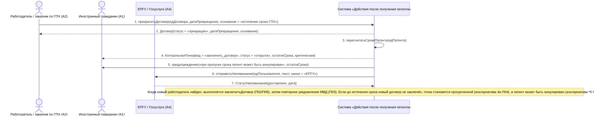

# 17. П06, альтернатива 4а. Смена работодателя: новый работодатель не найден

**Дисциплина:** Функциональное моделирование систем · **ТюмГУ**, 5 семестр · **Преподаватель:** Ткаченко И. Н.  
**Тема (раздел дорожной карты):** Тема 7. Действия после получения патента · **Команда:** Малышева Елена, Макеев Глеб, Мальгин Олег · **Автор работы:** Макеев Глеб Борисович  
**Дата:** 18.10.2026 · **Репозиторий:** <https://github.com/mflkee/fms-course>

> **Лабораторная 3, системная диаграмма последовательностей (SSD, «чёрный ящик»).** Линии жизни — действующие лица лаб. 1 и **одна** линия жизни подсистемы; сообщения — системные операции. Внутренние объекты подсистемы здесь не показываются — это предмет лаб. 4.

| | |
|---|---|
| **Прецедент** | П06 — [П06. Прекращение договора, смена работодателя и повторное уведомление МВД](../../lab1-usecases/usecases/06-prekrashchenie-dogovora.md) |
| **Тип сценария** | альтернативный сценарий 4а («Новый работодатель не найден») — смена работодателя |
| **Системные операции** | `прекратитьДоговор` · `пересчитатьСрокиПатента` |
| **Инварианты лаб. 2** | **ИНВ-1**, **ИНВ-3** |
| **Файлы** | [`17-p06-alternativa-smena-rabotodatelya.puml`](17-p06-alternativa-smena-rabotodatelya.puml) · [`17-p06-alternativa-smena-rabotodatelya.png`](17-p06-alternativa-smena-rabotodatelya.png) |

**Триггер:** Договор с прежним работодателем прекращён, а новый договор не заключён: ИГ остался без работы.

## 1. Участники

| Линия жизни | Что это | Тип |
|---|---|---|
| `EMP` | Работодатель / заказчик по ГПХ (A2) | действующее лицо (актор лаб. 1) |
| `CIT` | Иностранный гражданин (A1) | действующее лицо (актор лаб. 1) |
| `EPGU` | ЕПГУ / Госуслуги (A4) | внешняя система / канал (вспомогательный актор лаб. 1) |
| `SYS` | Система «Действия после получения патента» | **система** — единственная линия жизни, «чёрный ящик» |

## 2. Диаграмма последовательностей

PlantUML-исходник: [`17-p06-alternativa-smena-rabotodatelya.puml`](17-p06-alternativa-smena-rabotodatelya.puml); растровый рендер: [`17-p06-alternativa-smena-rabotodatelya.png`](17-p06-alternativa-smena-rabotodatelya.png).

## 3. Описание сообщений

| № | Сообщение | От | Кому | Что происходит | Трассировка на лаб. 1 |
|---|---|---|---|---|---|
| **1** | `прекратитьДоговор(идДоговора, датаПрекращения, основание = «истечение срока ГПХ»)` | `EMP` | `SYS` | Прекращение предыдущего договора — та же операция, что и в основном сценарии. | шаги 1–3 П06 |
| **2** | `Договор{статус = «прекращён», датаПрекращения, основание}` | `SYS` | `EMP` | Договор закрыт; ИНВ-1 соблюдён — действующих договоров по патенту нет. | шаг 3 П06 |
| **3** | `пересчитатьСрокиПатента(идПатента)` | `SYS` | `SYS` | Система пересчитывает сроки и открывает задачу «трудоустроиться» с фактическим остатком срока (П04). | включение П04 |
| **4** | `КонтрольнаяТочка{вид = «заключить_договор», статус = «открыта», остатокСрока, критическая}` | `SYS` | `CIT` | ИГ видит открытую точку и остаток срока: трудоустройство снова стало обязательной задачей. | шаг 1 альтернативы 4а П06 |
| **5** | `предупреждение(«при пропуске срока патент может быть аннулирован», остатокСрока)` | `SYS` | `CIT` | Явное предупреждение о риске: сохранение легальности зависит от нового трудоустройства в срок «2 месяца с даты выдачи патента» (ИНВ-3). | шаг 2 альтернативы 4а П06 |
| **6** | `отправитьНапоминание(идПользователя, текст, канал = «ЕПГУ»)` | `SYS` | `EPGU` | Напоминания продолжают идти по выбранным каналам, пока точка не закрыта (П04). | шаг 2 альтернативы 4а П06 |
| **7** | `СтатусНапоминания{доставлено, дата}` | `EPGU` | `SYS` | Доставка напоминания фиксируется в истории. | альтернатива 4а П06 |
| — | *примечание* | SYS | SYS | Когда новый работодатель найден, выполняется `заключитьДоговор` (П02/П06), затем повторное уведомление МВД (П03). Если до истечения срока новый договор не заключён, точка становится просроченной (альтернатива 4а П04), а патент может быть аннулирован (альтернатива *б П06). | — |

## 4. Покрытие сценария лаб. 1

| Шаг сценария лаб. 1 | Сообщения диаграммы |
|---|---|
| прощание с прежним работодателем и закрытие договора | сообщения 1–2 |
| шаг 1 альтернативы 4а — система открывает и выделяет задачу «трудоустроиться» с оставшимся сроком | сообщения 3–4 |
| шаг 2 альтернативы — ИГ получает предупреждение о риске аннулирования патента при пропуске срока | сообщения 5–7 |

## 5. Предусловия и постусловия

**Предусловия**

- Прежний договор действовал и зарегистрирован в подсистеме.
- Есть основание прекращения (истечение срока, расторжение, увольнение).
- Патент действует; срок «2 месяца с даты выдачи патента» ещё не истёк (иначе ветвь сразу переходит в просрочку).

**Постусловия при успешном завершении**

- Прежний договор прекращён (ИНВ-1); задача «трудоустроиться» открыта с фактическим остатком срока.
- ИГ получает предупреждения и напоминания; контроль сроков продолжается (П04).

**Постусловия при отклонении от основного потока**

- Если срок истёк, точка становится просроченной, а факт нарушения фиксируется (альтернатива 4а П04).
- Если патент аннулирован из-за отсутствия уведомления или неуплаты, все задачи по трудоустройству закрываются (альтернативы *б П01 и 4а П05).

## 6. Решения и примечания

- Смена работодателя как процесс состоит из трёх частей: закрытие прежнего договора (`прекратитьДоговор`), поиск и заключение нового (`заключитьДоговор`) и повторное уведомление МВД (`направитьУведомлениеМВД`). Основной сценарий П06 показывает все три; эта альтернатива — ситуацию, когда вторая часть затягивается, а срок продолжает идти.
- В диаграмме нет сообщения о «поиске работы»: подсистема не ведёт вакансии (в модели лаб. 2 нет класса `Вакансия`), она только контролирует срок и предупреждает ИГ.

Назад: [README лаб. 3](../README.md) · [спецификация операций](../operations.md) · [прецедент](../../lab1-usecases/usecases/06-prekrashchenie-dogovora.md)
