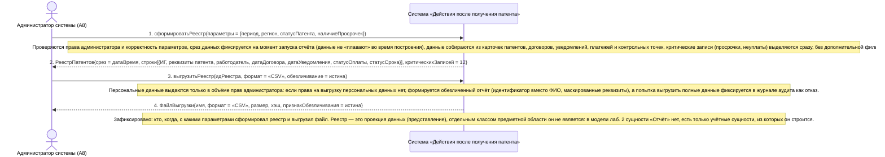

# 18. П07. Формирование реестра и отчёта по патентам и договорам — основной сценарий

**Дисциплина:** Функциональное моделирование систем · **ТюмГУ**, 5 семестр · **Преподаватель:** Ткаченко И. Н.  
**Тема (раздел дорожной карты):** Тема 7. Действия после получения патента · **Команда:** Малышева Елена, Макеев Глеб, Мальгин Олег · **Автор работы:** Макеев Глеб Борисович  
**Дата:** 18.10.2026 · **Репозиторий:** <https://github.com/mflkee/fms-course>

> **Лабораторная 3, системная диаграмма последовательностей (SSD, «чёрный ящик»).** Линии жизни — действующие лица лаб. 1 и **одна** линия жизни подсистемы; сообщения — системные операции. Внутренние объекты подсистемы здесь не показываются — это предмет лаб. 4.

| | |
|---|---|
| **Прецедент** | П07 — [П07. Формирование реестра и отчёта по патентам и договорам](../../lab1-usecases/usecases/07-reestr-i-otchety.md) |
| **Тип сценария** | основной успешный сценарий (расширение темы, служебный прецедент) |
| **Системные операции** | `сформироватьРеестр` · `выгрузитьРеестр` |
| **Инварианты лаб. 2** | **ИНВ-2**, **ИНВ-3**, **ИНВ-8** |
| **Файлы** | [`18-p07-osnovnoy.puml`](18-p07-osnovnoy.puml) · [`18-p07-osnovnoy.png`](18-p07-osnovnoy.png) |

**Триггер:** Администратор системы открывает раздел «Отчёты», выбирает вид отчёта и задаёт параметры.

## 1. Участники

| Линия жизни | Что это | Тип |
|---|---|---|
| `ADMIN` | Администратор системы (A8) | действующее лицо (актор лаб. 1) |
| `SYS` | Система «Действия после получения патента» | **система** — единственная линия жизни, «чёрный ящик» |

## 2. Диаграмма последовательностей

PlantUML-исходник: [`18-p07-osnovnoy.puml`](18-p07-osnovnoy.puml); растровый рендер: [`18-p07-osnovnoy.png`](18-p07-osnovnoy.png).

## 3. Описание сообщений

| № | Сообщение | От | Кому | Что происходит | Трассировка на лаб. 1 |
|---|---|---|---|---|---|
| **1** | `сформироватьРеестр(параметры = {период, регион, статусПатента, наличиеПросрочек})` | `ADMIN` | `SYS` | Первая системная операция прецедента: построение сводного реестра по заданным параметрам. | шаги 1–2 П07 |
| — | *примечание* | SYS | SYS | Проверяются права администратора и корректность параметров; срез данных фиксируется на момент запуска отчёта (данные не «плавают» во время построения); данные собираются из карточек патентов, договоров, уведомлений, платежей и контрольных точек; критические записи (просрочки, неуплаты) выделяются сразу, без дополнительной фильтрации. | — |
| **2** | `РеестрПатентов{срез = датаВремя, строки[{ИГ, реквизиты патента, работодатель, датаДоговора, датаУведомления, статусОплаты, статусСрока}], критическихЗаписей = 12}` | `SYS` | `ADMIN` | Администратор получает таблицу и видит критические записи; персональные данные выданы в объёме его прав. | шаги 3–5 П07 |
| **3** | `выгрузитьРеестр(идРеестра, формат = «CSV», обезличивание = истина)` | `ADMIN` | `SYS` | Вторая системная операция: выгрузка реестра в файл. | шаг 6 П07 |
| — | *примечание* | SYS | SYS | Персональные данные выдаются только в объёме прав администратора: если права на выгрузку персональных данных нет, формируется обезличенный отчёт (идентификатор вместо ФИО, маскированные реквизиты), а попытка выгрузить полные данные фиксируется в журнале аудита как отказ. | — |
| **4** | `ФайлВыгрузки{имя, формат = «CSV», размер, хэш, признакОбезличивания = истина}` | `SYS` | `ADMIN` | Администратор получает файл; хэш позволяет доказать, что файл не изменялся после выгрузки. | шаг 6 П07 |
| — | *примечание* | SYS | SYS | Зафиксировано: кто, когда, с какими параметрами сформировал реестр и выгрузил файл. Реестр — это проекция данных (представление), отдельным классом предметной области он не является: в модели лаб. 2 сущности «Отчёт» нет, есть только учётные сущности, из которых он строится. | — |

## 4. Покрытие сценария лаб. 1

| Шаг сценария лаб. 1 | Сообщения диаграммы |
|---|---|
| шаг 1 — администратор открывает раздел «Отчёты» и выбирает вид отчёта; система показывает доступные виды и права | сообщения 1–2 + примечание о правах |
| шаг 2 — администратор задаёт параметры (период, регион, статус патента, тип просрочек); система проверяет корректность параметров и оценивает объём выборки | сообщение 1 |
| шаг 3 — система собирает данные из карточек патентов, договоров, уведомлений и платежей | примечание о сборе данных |
| шаг 4 — система формирует таблицу и подсвечивает критические записи | сообщение 2 (поле `критическихЗаписей`) |
| шаг 5 — администратор просматривает отчёт и уточняет параметры; система пересчитывает отчёт | повторный вызов `сформироватьРеестр` |
| шаг 6 — администратор выгружает отчёт в файл; система формирует файл, обезличивая данные при необходимости | сообщения 3–4 |
| шаг 7 — система фиксирует факт выгрузки в журнале аудита | примечание об аудите |

## 5. Предусловия и постусловия

**Предусловия**

- В подсистеме накоплены данные: учтённые патенты (П01), договоры (П02), уведомления (П03), платежи (П05), события прекращения (П06).
- У администратора есть права на формирование отчётов и выгрузку данных.
- Заданы параметры отчёта: период, регион, статус патента, наличие просрочек.

**Постусловия при успешном завершении**

- Сформирован отчёт (реестр) с колонками: ИГ (обезличенно или по реквизитам — в зависимости от прав), реквизиты патента, работодатель, дата договора, дата уведомления, статус оплаты, статус срока.
- Отчёт доступен для просмотра в системе и выгрузки в файл (CSV/PDF).
- Зафиксирован факт формирования и выгрузки: кто, когда, с какими параметрами.
- Персональные данные выданы в объёме, соответствующем правам администратора.

**Постусловия при отклонении от основного потока**

- При отсутствии данных по параметрам пустой отчёт не формируется (альтернатива 2а П07).
- При слишком большом объёме выборки формируется агрегированная сводка (альтернатива 2б П07).
- Без прав на персональные данные формируется обезличенный отчёт (альтернатива 6а П07).

## 6. Решения и примечания

- Прецедент служебный и помечен в лаб. 1 как расширение: в дорожной карте отчётность не описана, но без сводного контроля нарушения по срокам выявляются только при обращении исполнителя.
- Отчёт работает на чтение: он не меняет учётные сущности. Единственное, что он изменяет, — журнал аудита. Поэтому в модели нет отдельного класса «Отчёт»: результат — проекция.
- Формирование и выгрузка разделены на две операции: у них разные параметры, разные права и разные последствия (выгрузка персональных данных — событие аудита).

Назад: [README лаб. 3](../README.md) · [спецификация операций](../operations.md) · [прецедент](../../lab1-usecases/usecases/07-reestr-i-otchety.md)
