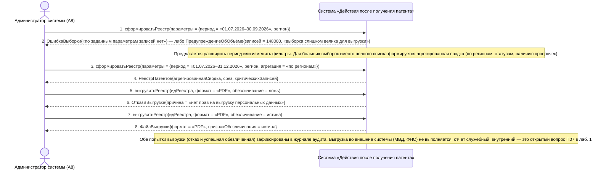

# 19. П07, альтернативы 2а, 2б и 6а. Выгрузка реестра за период: пустая выборка, большой объём, нет прав на персональные данные

**Дисциплина:** Функциональное моделирование систем · **ТюмГУ**, 5 семестр · **Преподаватель:** Ткаченко И. Н.  
**Тема (раздел дорожной карты):** Тема 7. Действия после получения патента · **Команда:** Малышева Елена, Макеев Глеб, Мальгин Олег · **Автор работы:** Макеев Глеб Борисович  
**Дата:** 18.10.2026 · **Репозиторий:** <https://github.com/mflkee/fms-course>

> **Лабораторная 3, системная диаграмма последовательностей (SSD, «чёрный ящик»).** Линии жизни — действующие лица лаб. 1 и **одна** линия жизни подсистемы; сообщения — системные операции. Внутренние объекты подсистемы здесь не показываются — это предмет лаб. 4.

| | |
|---|---|
| **Прецедент** | П07 — [П07. Формирование реестра и отчёта по патентам и договорам](../../lab1-usecases/usecases/07-reestr-i-otchety.md) |
| **Тип сценария** | альтернативные сценарии 2а, 2б и 6а («Выгрузка реестра за период») |
| **Системные операции** | `сформироватьРеестр` · `выгрузитьРеестр` |
| **Инварианты лаб. 2** | **ИНВ-8** |
| **Файлы** | [`19-p07-alternativa-vygruzka-za-period.puml`](19-p07-alternativa-vygruzka-za-period.puml) · [`19-p07-alternativa-vygruzka-za-period.png`](19-p07-alternativa-vygruzka-za-period.png) |

**Триггер:** Администратор задаёт отчёт за конкретный период; выборка оказывается пустой или слишком большой, а прав на выгрузку персональных данных может не быть.

## 1. Участники

| Линия жизни | Что это | Тип |
|---|---|---|
| `ADMIN` | Администратор системы (A8) | действующее лицо (актор лаб. 1) |
| `SYS` | Система «Действия после получения патента» | **система** — единственная линия жизни, «чёрный ящик» |

## 2. Диаграмма последовательностей

PlantUML-исходник: [`19-p07-alternativa-vygruzka-za-period.puml`](19-p07-alternativa-vygruzka-za-period.puml); растровый рендер: [`19-p07-alternativa-vygruzka-za-period.png`](19-p07-alternativa-vygruzka-za-period.png).

## 3. Описание сообщений

| № | Сообщение | От | Кому | Что происходит | Трассировка на лаб. 1 |
|---|---|---|---|---|---|
| **1** | `сформироватьРеестр(параметры = {период = «01.07.2026–30.09.2026», регион})` | `ADMIN` | `SYS` | Администратор запрашивает отчёт за квартал. | шаг 2 П07 |
| **2** | `ОшибкаВыборки{«по заданным параметрам записей нет»} — либо ПредупреждениеОбОбъёме{записей = 148000, «выборка слишком велика для выгрузки»}` | `SYS` | `ADMIN` | Ветви 2а и 2б: пустой отчёт не формируется, а слишком большой объём нельзя выгрузить целиком. | шаг 1 альтернативы 2а П07 |
| — | *примечание* | SYS | SYS | Предлагается расширить период или изменить фильтры. Для больших выборок вместо полного списка формируется агрегированная сводка (по регионам, статусам, наличию просрочек). | — |
| **3** | `сформироватьРеестр(параметры = {период = «01.07.2026–31.12.2026», регион, агрегация = «по регионам»})` | `ADMIN` | `SYS` | Параметры уточнены: период расширен, включена агрегация. | шаг 2 альтернативы 2а П07 |
| **4** | `РеестрПатентов{агрегированнаяСводка, срез, критическихЗаписей}` | `SYS` | `ADMIN` | Реестр сформирован в агрегированном виде. | шаг 2 альтернативы 2б П07 |
| **5** | `выгрузитьРеестр(идРеестра, формат = «PDF», обезличивание = ложь)` | `ADMIN` | `SYS` | Администратор пытается выгрузить полные данные (альтернатива 6а). | шаг 6 П07 |
| **6** | `ОтказВВыгрузке{причина = «нет прав на выгрузку персональных данных»}` | `SYS` | `ADMIN` | Система отказывает в выгрузке персональных данных и фиксирует попытку в журнале аудита. | шаг 1 альтернативы 6а П07 |
| **7** | `выгрузитьРеестр(идРеестра, формат = «PDF», обезличивание = истина)` | `ADMIN` | `SYS` | Повторная выгрузка в допустимом режиме — с обезличиванием. | шаг 1 альтернативы 6а П07 |
| **8** | `ФайлВыгрузки{формат = «PDF», признакОбезличивания = истина}` | `SYS` | `ADMIN` | Файл сформирован в обезличенном виде: идентификатор вместо ФИО, маскированные реквизиты. | шаг 2 альтернативы 6а П07 |
| — | *примечание* | SYS | SYS | Обе попытки выгрузки (отказ и успешная обезличенная) зафиксированы в журнале аудита. Выгрузка во внешние системы (МВД, ФНС) не выполняется: отчёт служебный, внутренний — это открытый вопрос П07 в лаб. 1. | — |

## 4. Покрытие сценария лаб. 1

| Шаг сценария лаб. 1 | Сообщения диаграммы |
|---|---|
| шаг 1 альтернативы 2а — система сообщает об отсутствии записей и предлагает расширить период или изменить фильтры; пустой отчёт не формируется | сообщения 1–3 |
| шаг 2 альтернативы 2б — система предупреждает о размере и предлагает сузить период; формируется агрегированная сводка | сообщения 2, 4 |
| шаг 6а — без прав на персональные данные система формирует обезличенный отчёт, а попытка выгрузить полные данные фиксируется как отказ | сообщения 5–8 |

## 5. Предусловия и постусловия

**Предусловия**

- Данные в подсистеме накоплены; администратор имеет доступ к разделу «Отчёты».
- Задан период; права администратора могут не включать выгрузку персональных данных.

**Постусловия при успешном завершении**

- Реестр сформирован в агрегированном виде; при необходимости параметры уточнены.
- Файл выгружен в обезличенном виде; признак обезличивания зафиксирован.
- Все попытки выгрузки (включая отказ) записаны в журнал аудита.

**Постусловия при отклонении от основного потока**

- Пустой отчёт не формируется вовсе: отсутствие данных — не отчёт.
- Полные персональные данные не выдаются, если у администратора нет соответствующего права.

## 6. Решения и примечания

- Три ветви собраны в одну диаграмму, потому что все они — про одну задачную ситуацию: «выгрузка реестра за период с ограничениями». Разводить их по отдельным диаграммам означало бы трижды повторять одну и ту же операцию `сформироватьРеестр`.
- Объём «148 000 записей» — условный пример: в лаб. 1 нет конкретной границы, поэтому порог считается настройкой подсистемы и должен уточняться при проектировании (лаб. 5).

Назад: [README лаб. 3](../README.md) · [спецификация операций](../operations.md) · [прецедент](../../lab1-usecases/usecases/07-reestr-i-otchety.md)
