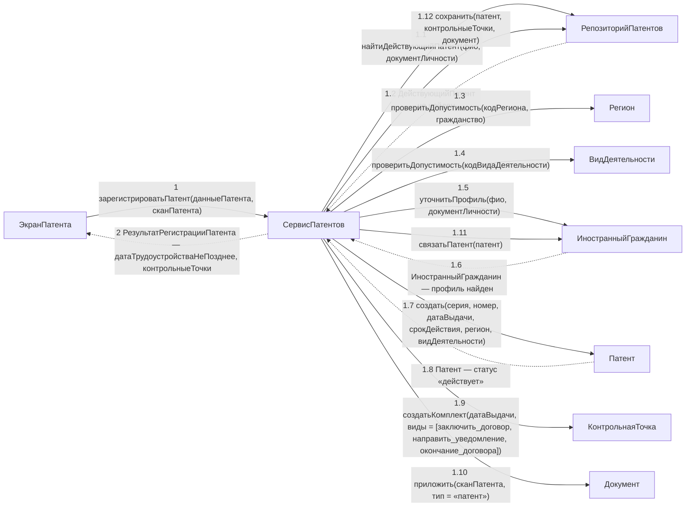

# Операция `зарегистрироватьПатент`

**Дисциплина:** Функциональное моделирование систем · **ТюмГУ**, 5 семестр · **Преподаватель:** Ткаченко И. Н.  
**Тема (раздел дорожной карты):** Тема 7. Действия после получения патента · **Команда:** Малышева Елена, Макеев Глеб, Мальгин Олег · **Автор работы:** Макеев Глеб Борисович  
**Дата:** 18.10.2026 · **Репозиторий:** <https://github.com/mflkee/fms-course>

> **Лабораторная 4, диаграмма коммуникаций.** Одна диаграмма — одна системная операция из лаб. 3.
> Объекты — только классы проектирования [`DESIGN.md` §6](../../DESIGN.md): границы (`Экран*`),
> управление (`Сервис*`), сущности (§5), хранилища (`Репозиторий*`), шлюзы (`Шлюз*`).

| | |
|---|---|
| **Системная операция** | `зарегистрироватьПатент(данныеПатента: ДанныеПатента, сканПатента: Файл) : РезультатРегистрацииПатента` |
| **Прецедент** | П01 — [Учёт выданного патента](../../lab1-usecases/usecases/01-uchet-vydannogo-patenta.md) |
| **Диаграмма последовательностей (лаб. 3)** | [01-p01-osnovnoy](../../lab3-sequence-diagrams/diagrams/01-p01-osnovnoy.md) — основной сценарий учёта патента |
| **Инварианты ([DESIGN.md §5](../../DESIGN.md))** | ИНВ-4, ИНВ-5, ИНВ-6 |
| **Объектов / сообщений** | 9 / 14 |
| **Файлы** | [`01-zaregistrirovat-patent.puml`](01-zaregistrirovat-patent.puml) · [`01-zaregistrirovat-patent.png`](01-zaregistrirovat-patent.png) |

**Назначение операции:** учесть выданный патент: проверить регион и профессию, рассчитать срок трудоустройства от даты выдачи, создать карточку патента, комплект контрольных точек и вложение.

## 1. Объекты

| Объект | Слой | Соответствие DESIGN.md |
|---|---|---|
| `ЭкранПатента` | граница (`boundary`) | `ЭкранПатента` — ввод реквизитов патента и скана ИГ |
| `СервисПатентов` | управление (`control`) | `СервисПатентов` — сценарий учёта патента |
| `РепозиторийПатентов` | хранилище (`repository`) | `РепозиторийПатентов` — хранение `Патент`, `КонтрольнаяТочка`, `Документ` |
| `ИностранныйГражданин` | сущность (`entity`, DESIGN §5) | `ИностранныйГражданин` — владелец патента |
| `Регион` | сущность (`entity`, DESIGN §5) | `Регион` — проверка региона выдачи |
| `ВидДеятельности` | сущность (`entity`, DESIGN §5) | `ВидДеятельности` — проверка профессии (ИНВ-4) |
| `Патент` | сущность (`entity`, DESIGN §5) | `Патент` — создаваемая карточка |
| `КонтрольнаяТочка` | сущность (`entity`, DESIGN §5) | `КонтрольнаяТочка` — композиция патента (ИНВ-6) |
| `Документ` | сущность (`entity`, DESIGN §5) | `Документ` — скан патента |

## 2. Диаграмма коммуникаций

PlantUML-исходник (диаграмма объектов с нумерованными стрелками): [`01-zaregistrirovat-patent.puml`](01-zaregistrirovat-patent.puml); растровый рендер: [`01-zaregistrirovat-patent.png`](01-zaregistrirovat-patent.png).

## 3. Сообщения

| № | Сообщение | Отправитель | Получатель | Назначение |
|---|---|---|---|---|
| **1** | `зарегистрироватьПатент(данныеПатента, сканПатента)` | ЭкранПатента | СервисПатентов | Точка входа: операцию вызывает ИГ через экран патента. |
| **1.1** | `найтиДействующийПатент(фио, документЛичности)` | СервисПатентов | РепозиторийПатентов | Проверка единственности: у ИГ не должно быть второго действующего патента (ИНВ-5). |
| **1.2** *(возврат)* | `ДействующийПатент — не найден` | РепозиторийПатентов | СервисПатентов | Подтверждение отсутствия дубля; иначе операция вернёт предупреждение. |
| **1.3** | `проверитьДопустимость(кодРегиона, гражданство)` | СервисПатентов | Регион | Регион должен существовать и допускать гражданство ИГ. |
| **1.4** | `проверитьДопустимость(кодВидаДеятельности)` | СервисПатентов | ВидДеятельности | Профессия должна быть в перечне, допустимом для патента (ИНВ-4). |
| **1.5** | `уточнитьПрофиль(фио, документЛичности)` | СервисПатентов | ИностранныйГражданин | Профиль ИГ — владелец создаваемого патента. |
| **1.6** *(возврат)* | `ИностранныйГражданин — профиль найден` | ИностранныйГражданин | СервисПатентов | Профиль нужен, чтобы связать патент с гражданином. |
| **1.7** | `создать(серия, номер, датаВыдачи, срокДействия, регион, видДеятельности)` | СервисПатентов | Патент | Создание карточки патента со статусом «действует». |
| **1.8** *(возврат)* | `Патент — статус «действует»` | Патент | СервисПатентов | Ссылка на созданную карточку для точек и вложения. |
| **1.9** | `создатьКомплект(датаВыдачи, виды = [заключить_договор, направить_уведомление, окончание_договора])` | СервисПатентов | КонтрольнаяТочка | Дата трудоустройства = дата выдачи + 2 месяца (ИНВ-3); точки не существуют без патента (ИНВ-6). |
| **1.10** | `приложить(сканПатента, тип = «патент»)` | СервисПатентов | Документ | Скан патента — доказательство, хранится вместе с карточкой. |
| **1.11** | `связатьПатент(патент)` | СервисПатентов | ИностранныйГражданин | Связь `ИностранныйГражданин 1 --> 0..* Патент`. |
| **1.12** | `сохранить(патент, контрольныеТочки, документ)` | СервисПатентов | РепозиторийПатентов | Запись одной транзакцией: либо создано всё, либо ничего. |
| **2** *(возврат)* | `РезультатРегистрацииПатента — датаТрудоустройстваНеПозднее, контрольныеТочки` | СервисПатентов | ЭкранПатента | Возврат результата на экран: остаток срока и дальнейшие шаги. |

## 4. Решения и примечания

- Операция не создаёт обращений в госорганы и не проверяет оплату: она только ведёт учёт выданного патента (границы подсистемы, DESIGN §1).
- Срок считается от `датаВыдачи` патента, а не от даты ввода в систему; иначе ИНВ-3 нарушается при позднем вводе.
- Комплект контрольных точек создаётся вместе с патентом: отдельных операций «создать точку» в системе нет.
- `СервисПатентов` — единственный владелец операции; остальные объекты участвуют как соисполнители.

Назад: [README лаб. 4](../README.md) · [DESIGN.md §3, §6](../../DESIGN.md) · [прецедент](../../lab1-usecases/usecases/01-uchet-vydannogo-patenta.md)
