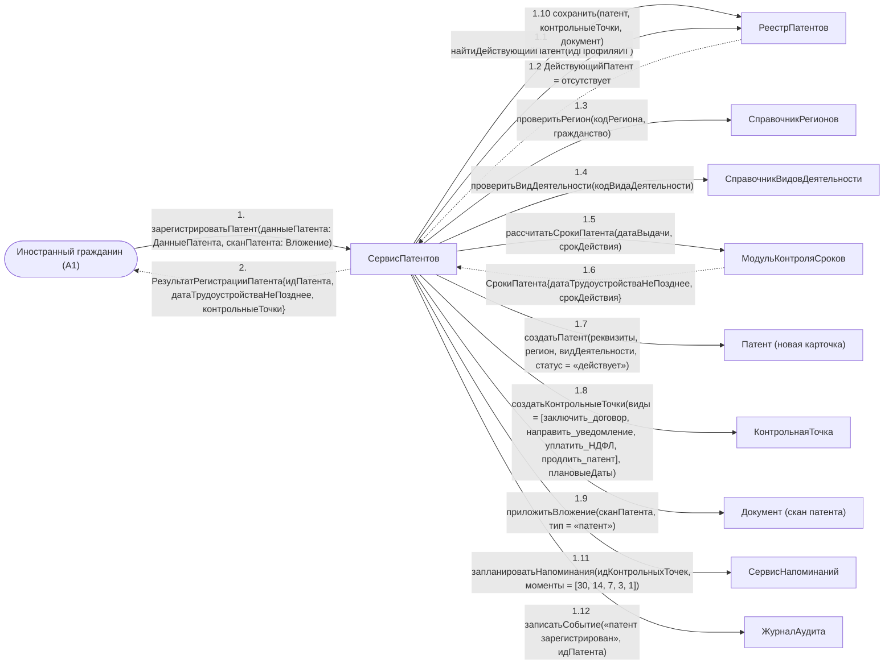

# Операция `зарегистрироватьПатент`

**Дисциплина:** Функциональное моделирование систем · **ТюмГУ**, 5 семестр · **Преподаватель:** Ткаченко И. Н.  
**Тема (раздел дорожной карты):** Тема 7. Действия после получения патента · **Команда:** Малышева Елена, Макеев Глеб, Мальгин Олег · **Автор работы:** Макеев Глеб Борисович  
**Дата:** 18.10.2026 · **Репозиторий:** <https://github.com/mflkee/fms-course>

> **Лабораторная 4, диаграмма коммуникаций** (взаимодействие объектов). Одна диаграмма — на одну системную операцию из лаб. 3. Объекты — экземпляры классов модели предметной области (лаб. 2) и концептуальные компоненты подсистемы; привязки к языку и фреймворку нет.

| | |
|---|---|
| **Системная операция** | `зарегистрироватьПатент(данныеПатента: ДанныеПатента, сканПатента: Вложение) : РезультатРегистрацииПатента` |
| **Прецедент** | П01 — [П01. Учёт выданного патента и постановка сроков под контроль](../../lab1-usecases/usecases/01-uchet-vydannogo-patenta.md) |
| **Диаграмма последовательностей (лаб. 3)** | [01-p01-osnovnoy](../../lab3-sequence-diagrams/diagrams/01-p01-osnovnoy.md) |
| **Инварианты лаб. 2** | **ИНВ-4**, **ИНВ-6**, **ИНВ-9** |
| **Файлы** | [`01-zaregistrirovat-patent.puml`](01-zaregistrirovat-patent.puml) · [`01-zaregistrirovat-patent.png`](01-zaregistrirovat-patent.png) |

**Назначение операции:** зарегистрировать выданный патент: проверить реквизиты по справочникам, рассчитать сроки от даты выдачи, создать карточку патента и комплект контрольных точек.

## 1. Объекты

| Объект | Тип | Соответствие модели лаб. 2 |
|---|---|---|
| `Иностранный гражданин (A1)` | актор | актор A1; профиль ИГ хранится как `ИностранныйГражданин` / `ПользовательИГ` |
| `СервисПатентов` | компонент | концептуальный компонент-координатор; собственного класса в лаб. 2 не имеет, работает с `Патент`, `Регион`, `ВидДеятельности` |
| `РеестрПатентов` | хранилище | хранилище учётных сущностей: `Патент`, `КонтрольнаяТочка`, `Документ` |
| `СправочникРегионов` | справочник | класс `Регион` (стоимость патента, допустимые виды деятельности, дата актуальности) |
| `СправочникВидовДеятельности` | справочник | класс `ВидДеятельности` (перечень профессий, допустимых для патента) |
| `МодульКонтроляСроков` | компонент | концептуальный компонент; работает с `КонтрольнаяТочка` и `Напоминание` |
| `СервисНапоминаний` | компонент | концептуальный компонент; создаёт объекты `Напоминание` |
| `Патент (новая карточка)` | сущность | класс `Патент` |
| `КонтрольнаяТочка` | сущность | класс `КонтрольнаяТочка` (композиция с `Патент`, кратность `2..*`) |
| `Документ (скан патента)` | сущность | класс `Документ` (атрибут `тип` = «патент») |
| `ЖурналАудита` | компонент | журнал аудита; сущностью предметной области лаб. 2 не является (технический компонент) |

## 2. Диаграмма коммуникаций

PlantUML-исходник (диаграмма объектов с нумерованными стрелками): [`01-zaregistrirovat-patent.puml`](01-zaregistrirovat-patent.puml); растровый рендер: [`01-zaregistrirovat-patent.png`](01-zaregistrirovat-patent.png).

## 3. Сообщения

| № | Сообщение | Отправитель | Получатель | Назначение |
|---|---|---|---|---|
| **1** | `зарегистрироватьПатент(данныеПатента: ДанныеПатента, сканПатента: Вложение)` | Иностранный гражданин (A1) | СервисПатентов | Точка входа: системную операцию вызывает ИГ (основной исполнитель П01). |
| **1.1** | `найтиДействующийПатент(идПрофиляИГ)` | СервисПатентов | РеестрПатентов | Проверка дублей: у ИГ не должно быть другого действующего патента (ИНВ-6). |
| **1.2** *(возврат)* | `ДействующийПатент = отсутствует` | РеестрПатентов | СервисПатентов | Подтверждение отсутствия действующего патента; иначе операция вернёт предупреждение о дубле. |
| **1.3** | `проверитьРегион(кодРегиона, гражданство)` | СервисПатентов | СправочникРегионов | Регион должен существовать в справочнике, а гражданство — допускаться для этого региона. |
| **1.4** | `проверитьВидДеятельности(кодВидаДеятельности)` | СервисПатентов | СправочникВидовДеятельности | Профессия в патенте должна присутствовать в перечне допустимых (ИНВ-4). |
| **1.5** | `рассчитатьСрокиПатента(датаВыдачи, срокДействия)` | СервисПатентов | МодульКонтроляСроков | Расчёт даты «трудоустроиться не позднее» = дата выдачи + 2 месяца — от даты выдачи, а не от даты ввода в систему. |
| **1.6** *(возврат)* | `СрокиПатента{датаТрудоустройстваНеПозднее, срокДействия}` | МодульКонтроляСроков | СервисПатентов | Результат расчёта, который будет сохранён в контрольных точках. |
| **1.7** | `создатьПатент(реквизиты, регион, видДеятельности, статус = «действует»)` | СервисПатентов | Патент (новая карточка) | Создание карточки патента — центральной сущности темы. |
| **1.8** | `создатьКонтрольныеТочки(виды = [заключить_договор, направить_уведомление, уплатить_НДФЛ, продлить_патент], плановыеДаты)` | СервисПатентов | КонтрольнаяТочка | Комплект контрольных точек; без патента точки не существуют (композиция, ИНВ-9). |
| **1.9** | `приложитьВложение(сканПатента, тип = «патент»)` | СервисПатентов | Документ (скан патента) | Скан патента — доказательство, хранится бессрочно. |
| **1.10** | `сохранить(патент, контрольныеТочки, документ)` | СервисПатентов | РеестрПатентов | Запись выполняется одной транзакцией: либо созданы и патент, и точки, и вложение, либо ничего. |
| **1.11** | `запланироватьНапоминания(идКонтрольныхТочек, моменты = [30, 14, 7, 3, 1])` | СервисПатентов | СервисНапоминаний | Переход к прецеденту П04: планирование напоминаний по созданным точкам. |
| **1.12** | `записатьСобытие(«патент зарегистрирован», идПатента)` | СервисПатентов | ЖурналАудита | Запись в журнал аудита: кто и когда учёл патент. |
| **2** *(возврат)* | `РезультатРегистрацииПатента{идПатента, датаТрудоустройстваНеПозднее, контрольныеТочки}` | СервисПатентов | Иностранный гражданин (A1) | Возврат результата ИГ: остаток срока и дальнейшие шаги. |

## 4. Решения и примечания

- Все сообщения, кроме 1 и 2, — внутренние вызовы подсистемы: в SSD лаб. 3 они не видны, потому что там подсистема представлена одной линией жизни.
- Операция транзакционна: при провале любой проверки (1.1, 1.3, 1.4) карточка не создаётся, а ИГ возвращается список ошибок и черновик (альтернатива 2а П01).
- Расчёт сроков вынесен в `МодульКонтроляСроков`, а не выполняется внутри `СервисаПатентов`: тот же модуль используется прецедентом П04, поэтому правило «2 месяца с даты выдачи» описано в одном месте.

Назад: [README лаб. 4](../README.md) · [спецификация операций лаб. 3](../../lab3-sequence-diagrams/operations.md) · [прецедент](../../lab1-usecases/usecases/01-uchet-vydannogo-patenta.md)
