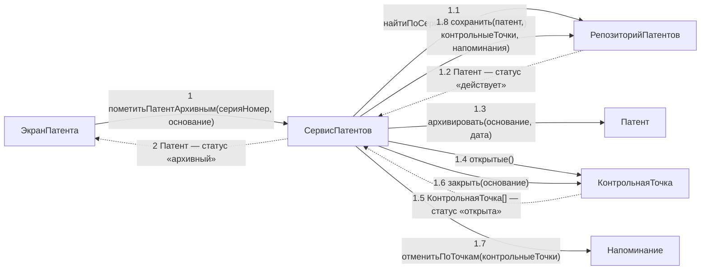

# Операция `пометитьПатентАрхивным`

**Дисциплина:** Функциональное моделирование систем · **ТюмГУ**, 5 семестр · **Преподаватель:** Ткаченко И. Н.  
**Тема (раздел дорожной карты):** Тема 7. Действия после получения патента · **Команда:** Малышева Елена, Макеев Глеб, Мальгин Олег · **Автор работы:** Макеев Глеб Борисович  
**Дата:** 18.10.2026 · **Репозиторий:** <https://github.com/mflkee/fms-course>

> **Лабораторная 4, диаграмма коммуникаций.** Одна диаграмма — одна системная операция из лаб. 3.
> Объекты — только классы проектирования [`DESIGN.md` §6](../../DESIGN.md): границы (`Экран*`),
> управление (`Сервис*`), сущности (§5), хранилища (`Репозиторий*`), шлюзы (`Шлюз*`).

| | |
|---|---|
| **Системная операция** | `пометитьПатентАрхивным(серияНомер: НомерДокумента, основание: Основание) : Патент` |
| **Прецедент** | П01 — [Учёт выданного патента](../../lab1-usecases/usecases/01-uchet-vydannogo-patenta.md) |
| **Диаграмма последовательностей (лаб. 3)** | [02-p01-alternativa-dubl](../../lab3-sequence-diagrams/diagrams/02-p01-alternativa-dubl.md) — повторный ввод патента |
| **Инварианты ([DESIGN.md §5](../../DESIGN.md))** | ИНВ-5, ИНВ-6 |
| **Объектов / сообщений** | 6 / 10 |
| **Файлы** | [`02-pometit-patent-arhivnym.puml`](02-pometit-patent-arhivnym.puml) · [`02-pometit-patent-arhivnym.png`](02-pometit-patent-arhivnym.png) |

**Назначение операции:** перевести ранее учтённый патент в архивный статус, сохранив историю: закрыть его контрольные точки и прекратить напоминания по ним.

## 1. Объекты

| Объект | Слой | Соответствие DESIGN.md |
|---|---|---|
| `ЭкранПатента` | граница (`boundary`) | `ЭкранПатента` — подтверждение основания архивирования |
| `СервисПатентов` | управление (`control`) | `СервисПатентов` — сценарий архивирования |
| `РепозиторийПатентов` | хранилище (`repository`) | `РепозиторийПатентов` — выборка и сохранение патента с точками |
| `Патент` | сущность (`entity`, DESIGN §5) | `Патент` — переводится в статус «архивный» |
| `КонтрольнаяТочка` | сущность (`entity`, DESIGN §5) | `КонтрольнаяТочка` — открытые точки закрываются |
| `Напоминание` | сущность (`entity`, DESIGN §5) | `Напоминание` — отменяется по закрытым точкам |

## 2. Диаграмма коммуникаций

PlantUML-исходник (диаграмма объектов с нумерованными стрелками): [`02-pometit-patent-arhivnym.puml`](02-pometit-patent-arhivnym.puml); растровый рендер: [`02-pometit-patent-arhivnym.png`](02-pometit-patent-arhivnym.png).

## 3. Сообщения

| № | Сообщение | Отправитель | Получатель | Назначение |
|---|---|---|---|---|
| **1** | `пометитьПатентАрхивным(серияНомер, основание)` | ЭкранПатента | СервисПатентов | Точка входа: ИГ подтверждает утрату силы прежнего патента. |
| **1.1** | `найтиПоСерияНомер(серияНомер)` | СервисПатентов | РепозиторийПатентов | Нужен именно действующий патент (ИНВ-5). |
| **1.2** *(возврат)* | `Патент — статус «действует»` | РепозиторийПатентов | СервисПатентов | Если патент не найден или уже архивный — ошибка состояния, изменений нет. |
| **1.3** | `архивировать(основание, дата)` | СервисПатентов | Патент | Статус «архивный», основание и дата изменения сохраняются в карточке. |
| **1.4** | `открытые()` | СервисПатентов | КонтрольнаяТочка | Выборка незакрытых контрольных точек патента. |
| **1.5** *(возврат)* | `КонтрольнаяТочка[] — статус «открыта»` | КонтрольнаяТочка | СервисПатентов | Список точек, которые надо закрыть. |
| **1.6** | `закрыть(основание)` | СервисПатентов | КонтрольнаяТочка | Все открытые точки получают статус «отменена» с основанием. |
| **1.7** | `отменитьПоТочкам(контрольныеТочки)` | СервисПатентов | Напоминание | Напоминания по закрытым точкам больше не отправляются. |
| **1.8** | `сохранить(патент, контрольныеТочки, напоминания)` | СервисПатентов | РепозиторийПатентов | История сохраняется: карточка и вложения не удаляются. |
| **2** *(возврат)* | `Патент — статус «архивный»` | СервисПатентов | ЭкранПатента | Возврат карточки с новым статусом. |

## 4. Решения и примечания

- Архивирование — не удаление: карточка, вложения и закрытые точки остаются в хранилище.
- Операция восстанавливает ИНВ-5: после архивирования прежнего патента у ИГ остаётся не более одного действующего.
- Отмена регистрации самим ИГ (без сохранения) — не вызов этой операции: состояние подсистемы не меняется.
- Напоминания не удаляются, а отменяются: так видно, что они были запланированы и почему не отправлены.

Назад: [README лаб. 4](../README.md) · [DESIGN.md §3, §6](../../DESIGN.md) · [прецедент](../../lab1-usecases/usecases/01-uchet-vydannogo-patenta.md)
