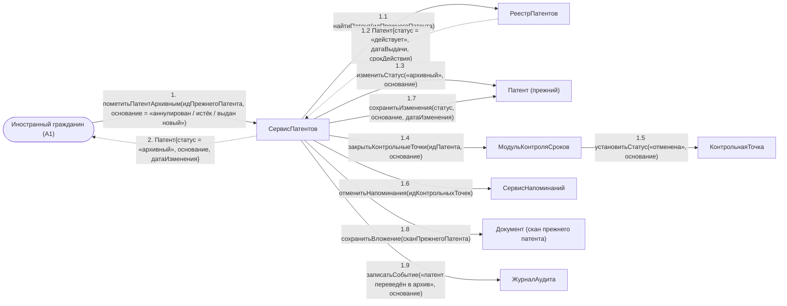

# Операция `пометитьПатентАрхивным`

**Дисциплина:** Функциональное моделирование систем · **ТюмГУ**, 5 семестр · **Преподаватель:** Ткаченко И. Н.  
**Тема (раздел дорожной карты):** Тема 7. Действия после получения патента · **Команда:** Малышева Елена, Макеев Глеб, Мальгин Олег · **Автор работы:** Макеев Глеб Борисович  
**Дата:** 18.10.2026 · **Репозиторий:** <https://github.com/mflkee/fms-course>

> **Лабораторная 4, диаграмма коммуникаций** (взаимодействие объектов). Одна диаграмма — на одну системную операцию из лаб. 3. Объекты — экземпляры классов модели предметной области (лаб. 2) и концептуальные компоненты подсистемы; привязки к языку и фреймворку нет.

| | |
|---|---|
| **Системная операция** | `пометитьПатентАрхивным(идПатента: UUID, основание: String) : Патент` |
| **Прецедент** | П01 — [П01. Учёт выданного патента и постановка сроков под контроль](../../lab1-usecases/usecases/01-uchet-vydannogo-patenta.md) |
| **Диаграмма последовательностей (лаб. 3)** | [02-p01-alternativa-dubl](../../lab3-sequence-diagrams/diagrams/02-p01-alternativa-dubl.md) |
| **Инварианты лаб. 2** | **ИНВ-6**, **ИНВ-9** |
| **Файлы** | [`02-pometit-patent-arhivnym.puml`](02-pometit-patent-arhivnym.puml) · [`02-pometit-patent-arhivnym.png`](02-pometit-patent-arhivnym.png) |

**Назначение операции:** перевести ранее учтённый патент в архивный статус: не удалять, а сохранить как историю, закрыв его контрольные точки и напоминания.

## 1. Объекты

| Объект | Тип | Соответствие модели лаб. 2 |
|---|---|---|
| `Иностранный гражданин (A1)` | актор | актор A1 — инициатор: подтверждает, что прежний патент утратил силу |
| `СервисПатентов` | компонент | компонент регистрации и учёта патентов |
| `РеестрПатентов` | хранилище | хранилище `Патент`, `КонтрольнаяТочка`, `Документ` |
| `Патент (прежний)` | сущность | класс `Патент` (меняется атрибут `статус`) |
| `МодульКонтроляСроков` | компонент | компонент, закрывающий контрольные точки |
| `КонтрольнаяТочка` | сущность | класс `КонтрольнаяТочка` (статус «отменена») |
| `СервисНапоминаний` | компонент | компонент, прекращающий напоминания |
| `Документ (скан прежнего патента)` | сущность | класс `Документ`: скан прежнего патента остаётся в деле |
| `ЖурналАудита` | компонент | журнал аудита |

## 2. Диаграмма коммуникаций

PlantUML-исходник (диаграмма объектов с нумерованными стрелками): [`02-pometit-patent-arhivnym.puml`](02-pometit-patent-arhivnym.puml); растровый рендер: [`02-pometit-patent-arhivnym.png`](02-pometit-patent-arhivnym.png).

## 3. Сообщения

| № | Сообщение | Отправитель | Получатель | Назначение |
|---|---|---|---|---|
| **1** | `пометитьПатентАрхивным(идПрежнегоПатента, основание = «аннулирован / истёк / выдан новый»)` | Иностранный гражданин (A1) | СервисПатентов | Точка входа: ИГ подтвердил, что прежний патент утратил силу. |
| **1.1** | `найтиПатент(идПрежнегоПатента)` | СервисПатентов | РеестрПатентов | Проверка существования и текущего статуса. |
| **1.2** *(возврат)* | `Патент{статус = «действует», датаВыдачи, срокДействия}` | РеестрПатентов | СервисПатентов | Прежний патент найден и действительно действует — иначе архивировать нечего. |
| **1.3** | `изменитьСтатус(«архивный», основание)` | СервисПатентов | Патент (прежний) | Смена статуса вместо удаления: карточка нужна как история и как доказательство. |
| **1.4** | `закрытьКонтрольныеТочки(идПатента, основание)` | СервисПатентов | МодульКонтроляСроков | Все открытые точки по прежнему патенту закрываются — иначе система продолжила бы требовать исполнения по недействующему патенту. |
| **1.5** | `установитьСтатус(«отменена», основание)` | МодульКонтроляСроков | КонтрольнаяТочка | Каждая точка получает статус «отменена» с указанием основания. |
| **1.6** | `отменитьНапоминания(идКонтрольныхТочек)` | СервисПатентов | СервисНапоминаний | Напоминания по отменённым точкам больше не отправляются (ИНВ-9). |
| **1.7** | `сохранитьИзменения(статус, основание, датаИзменения)` | СервисПатентов | Патент (прежний) | Изменение статуса фиксируется с датой. |
| **1.8** | `сохранитьВложение(сканПрежнегоПатента)` | СервисПатентов | Документ (скан прежнего патента) | Файл скана остаётся в деле ИГ бессрочно. |
| **1.9** | `записатьСобытие(«патент переведён в архив», основание)` | СервисПатентов | ЖурналАудита | Аудит: важно, кто и по какому основанию закрыл действующий патент. |
| **2** *(возврат)* | `Патент{статус = «архивный», основание, датаИзменения}` | СервисПатентов | Иностранный гражданин (A1) | Возврат: прежний патент больше не считается действующим, ИНВ-6 восстановлен. |

## 4. Решения и примечания

- Эта операция вызывается не только из альтернативы 1а П01: тот же контракт используется при аннулировании патента решением МВД (альтернатива *б П01) — меняется только основание.
- Объект `PAT` — это уже существующий экземпляр `Патент`, а не новый: в лаб. 4 важно различать создание объекта (сообщение 1.7 на диаграмме 1) и изменение состояния существующего.
- Удаление патента в модели отсутствует намеренно: доказательства пребывания и работы хранятся бессрочно (ИНВ-8 для уведомлений, тот же принцип — для патентов).

Назад: [README лаб. 4](../README.md) · [спецификация операций лаб. 3](../../lab3-sequence-diagrams/operations.md) · [прецедент](../../lab1-usecases/usecases/01-uchet-vydannogo-patenta.md)
