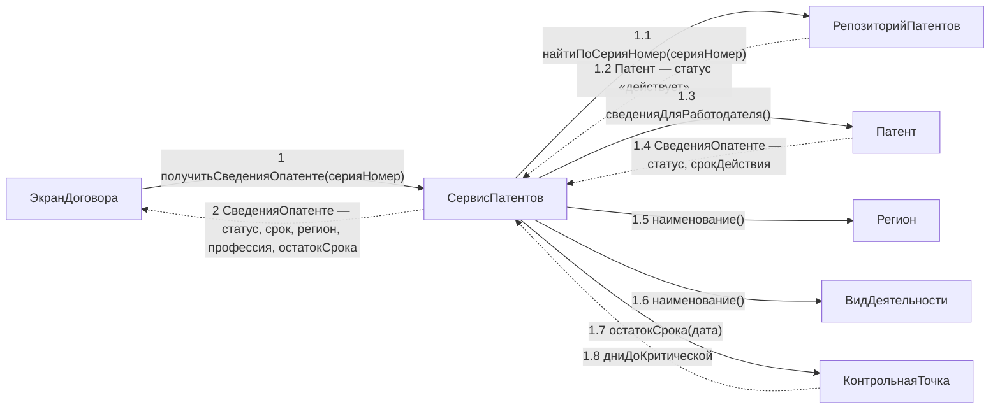

# Операция `получитьСведенияОпатенте`

**Дисциплина:** Функциональное моделирование систем · **ТюмГУ**, 5 семестр · **Преподаватель:** Ткаченко И. Н.  
**Тема (раздел дорожной карты):** Тема 7. Действия после получения патента · **Команда:** Малышева Елена, Макеев Глеб, Мальгин Олег · **Автор работы:** Макеев Глеб Борисович  
**Дата:** 18.10.2026 · **Репозиторий:** <https://github.com/mflkee/fms-course>

> **Лабораторная 4, диаграмма коммуникаций.** Одна диаграмма — одна системная операция из лаб. 3.
> Объекты — только классы проектирования [`DESIGN.md` §6](../../DESIGN.md): границы (`Экран*`),
> управление (`Сервис*`), сущности (§5), хранилища (`Репозиторий*`), шлюзы (`Шлюз*`).

| | |
|---|---|
| **Системная операция** | `получитьСведенияОпатенте(серияНомер: НомерДокумента) : СведенияОпатенте` |
| **Прецедент** | П02 — [Заключение договора (7.1)](../../lab1-usecases/usecases/02-trudovoy-dogovor.md) |
| **Диаграмма последовательностей (лаб. 3)** | [03-p02-osnovnoy](../../lab3-sequence-diagrams/diagrams/03-p02-osnovnoy.md) — проверка патента работодателем перед договором |
| **Инварианты ([DESIGN.md §5](../../DESIGN.md))** | ИНВ-4, ИНВ-5 |
| **Объектов / сообщений** | 7 / 10 |
| **Файлы** | [`03-poluchit-svedeniya-o-patente.puml`](03-poluchit-svedeniya-o-patente.puml) · [`03-poluchit-svedeniya-o-patente.png`](03-poluchit-svedeniya-o-patente.png) |

**Назначение операции:** выдать работодателю сведения о патенте кандидата (статус, срок, регион, профессии, остаток срока трудоустройства) для проверки права на работу. Операция только читает данные.

## 1. Объекты

| Объект | Слой | Соответствие DESIGN.md |
|---|---|---|
| `ЭкранДоговора` | граница (`boundary`) | `ЭкранДоговора` — запрос сведений о патенте кандидата |
| `СервисПатентов` | управление (`control`) | `СервисПатентов` — сборка ответа без изменения данных |
| `РепозиторийПатентов` | хранилище (`repository`) | `РепозиторийПатентов` — чтение патента |
| `Патент` | сущность (`entity`, DESIGN §5) | `Патент` — статус, срок действия, регион |
| `Регион` | сущность (`entity`, DESIGN §5) | `Регион` — наименование региона |
| `ВидДеятельности` | сущность (`entity`, DESIGN §5) | `ВидДеятельности` — профессия патента (ИНВ-4) |
| `КонтрольнаяТочка` | сущность (`entity`, DESIGN §5) | `КонтрольнаяТочка` — остаток срока трудоустройства |

## 2. Диаграмма коммуникаций

PlantUML-исходник (диаграмма объектов с нумерованными стрелками): [`03-poluchit-svedeniya-o-patente.puml`](03-poluchit-svedeniya-o-patente.puml); растровый рендер: [`03-poluchit-svedeniya-o-patente.png`](03-poluchit-svedeniya-o-patente.png).

## 3. Сообщения

| № | Сообщение | Отправитель | Получатель | Назначение |
|---|---|---|---|---|
| **1** | `получитьСведенияОпатенте(серияНомер)` | ЭкранДоговора | СервисПатентов | Точка входа: работодатель проверяет патент кандидата. |
| **1.1** | `найтиПоСерияНомер(серияНомер)` | СервисПатентов | РепозиторийПатентов | Поиск только по реквизитам патента, без персональных данных ИГ. |
| **1.2** *(возврат)* | `Патент — статус «действует»` | РепозиторийПатентов | СервисПатентов | Если патент не найден — ответ «патент не найден». |
| **1.3** | `сведенияДляРаботодателя()` | СервисПатентов | Патент | Статус и срок действия патента. |
| **1.4** *(возврат)* | `СведенияОпатенте — статус, срокДействия` | Патент | СервисПатентов | Только сведения, необходимые для решения о договоре. |
| **1.5** | `наименование()` | СервисПатентов | Регион | Регион выдачи патента. |
| **1.6** | `наименование()` | СервисПатентов | ВидДеятельности | Профессия из перечня патента (ИНВ-4). |
| **1.7** | `остатокСрока(дата)` | СервисПатентов | КонтрольнаяТочка | Сколько дней осталось до «трудоустроиться не позднее». |
| **1.8** *(возврат)* | `дниДоКритической` | КонтрольнаяТочка | СервисПатентов | Признак просрочки и остаток срока. |
| **2** *(возврат)* | `СведенияОпатенте — статус, срок, регион, профессия, остатокСрока` | СервисПатентов | ЭкранДоговора | Ответ экрану договора; ни одна сущность не изменена. |

## 4. Решения и примечания

- Операция на чтение: постусловие — ни одна учётная сущность не изменена.
- В ответ не входят персональные данные ИГ сверх необходимого: работодателю нужны только реквизиты патента и срок.
- Остаток срока берётся из контрольной точки «заключить_договор», а не считается на экране: правило живёт в модели.

Назад: [README лаб. 4](../README.md) · [DESIGN.md §3, §6](../../DESIGN.md) · [прецедент](../../lab1-usecases/usecases/02-trudovoy-dogovor.md)
