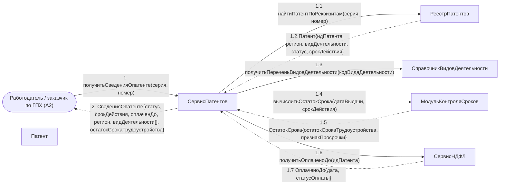

# Операция `получитьСведенияОпатенте`

**Дисциплина:** Функциональное моделирование систем · **ТюмГУ**, 5 семестр · **Преподаватель:** Ткаченко И. Н.  
**Тема (раздел дорожной карты):** Тема 7. Действия после получения патента · **Команда:** Малышева Елена, Макеев Глеб, Мальгин Олег · **Автор работы:** Макеев Глеб Борисович  
**Дата:** 18.10.2026 · **Репозиторий:** <https://github.com/mflkee/fms-course>

> **Лабораторная 4, диаграмма коммуникаций** (взаимодействие объектов). Одна диаграмма — на одну системную операцию из лаб. 3. Объекты — экземпляры классов модели предметной области (лаб. 2) и концептуальные компоненты подсистемы; привязки к языку и фреймворку нет.

| | |
|---|---|
| **Системная операция** | `получитьСведенияОпатенте(серия: String, номер: String) : СведенияОпатенте` |
| **Прецедент** | П02 — [П02. Трудоустройство: заключение трудового договора или договора ГПХ](../../lab1-usecases/usecases/02-trudovoy-dogovor.md) |
| **Диаграмма последовательностей (лаб. 3)** | [04-p02-osnovnoy](../../lab3-sequence-diagrams/diagrams/04-p02-osnovnoy.md) |
| **Инварианты лаб. 2** | **ИНВ-4**, **ИНВ-6** |
| **Файлы** | [`03-poluchit-svedeniya-o-patente.puml`](03-poluchit-svedeniya-o-patente.puml) · [`03-poluchit-svedeniya-o-patente.png`](03-poluchit-svedeniya-o-patente.png) |

**Назначение операции:** выдать работодателю сведения о патенте кандидата (тип, срок действия, регион, профессия) — без персональных данных и без сумм платежей.

## 1. Объекты

| Объект | Тип | Соответствие модели лаб. 2 |
|---|---|---|
| `Работодатель / заказчик по ГПХ (A2)` | актор | актор A2; проверяет право ИГ на работу |
| `СервисПатентов` | компонент | компонент регистрации и учёта патентов — владелец операции-запроса |
| `РеестрПатентов` | хранилище | хранилище `Патент` |
| `СправочникВидовДеятельности` | справочник | класс `ВидДеятельности` (перечень профессий патента) |
| `МодульКонтроляСроков` | компонент | компонент, вычисляющий остаток срока |
| `СервисНДФЛ` | компонент | компонент учёта платежей НДФЛ — источник сведений «оплачен до» |
| `Патент` | сущность | класс `Патент` |

## 2. Диаграмма коммуникаций

PlantUML-исходник (диаграмма объектов с нумерованными стрелками): [`03-poluchit-svedeniya-o-patente.puml`](03-poluchit-svedeniya-o-patente.puml); растровый рендер: [`03-poluchit-svedeniya-o-patente.png`](03-poluchit-svedeniya-o-patente.png).

## 3. Сообщения

| № | Сообщение | Отправитель | Получатель | Назначение |
|---|---|---|---|---|
| **1** | `получитьСведенияОпатенте(серия, номер)` | Работодатель / заказчик по ГПХ (A2) | СервисПатентов | Точка входа: работодатель проверяет право ИГ на работу (шаг 2 сценария П02). |
| **1.1** | `найтиПатентПоРеквизитам(серия, номер)` | СервисПатентов | РеестрПатентов | Поиск по реквизитам, а не по ИГ: работодатель не знает идентификаторов системы. |
| **1.2** *(возврат)* | `Патент{идПатента, регион, видДеятельности, статус, срокДействия}` | РеестрПатентов | СервисПатентов | Найденная карточка патента. |
| **1.3** | `получитьПереченьВидовДеятельности(кодВидаДеятельности)` | СервисПатентов | СправочникВидовДеятельности | Расшифровка профессии патента для сопоставления с должностью по договору (ИНВ-4). |
| **1.4** | `вычислитьОстатокСрока(датаВыдачи, срокДействия)` | СервисПатентов | МодульКонтроляСроков | Остаток срока трудоустройства и признак просрочки отдаются работодателю сразу — он должен видеть риск (требование П02 «система не должна позволять тихо пропустить срок»). |
| **1.5** *(возврат)* | `ОстатокСрока{остатокСрокаТрудоустройства, признакПросрочки}` | МодульКонтроляСроков | СервисПатентов | Результат. |
| **1.6** | `получитьОплаченоДо(идПатента)` | СервисПатентов | СервисНДФЛ | Работодателю нужен только факт «патент оплачен до даты», а не суммы платежей. |
| **1.7** *(возврат)* | `ОплаченоДо{дата, статусОплаты}` | СервисНДФЛ | СервисПатентов | Ответ сервиса НДФЛ. |
| **2** *(возврат)* | `СведенияОпатенте{статус, срокДействия, оплаченДо, регион, видДеятельности[], остатокСрокаТрудоустройства}` | СервисПатентов | Работодатель / заказчик по ГПХ (A2) | Ответ работодателю. Персональные данные ИГ и суммы платежей в ответ не входят. |

## 4. Решения и примечания

- Единственная операция модели, работающая только на чтение: она не меняет ни одну учётную сущность, поэтому в её диаграмме нет объектов, изменяющих состояние.
- Операция используется и в П06 (проверка условий при смене работодателя) — тем же контрактом, поэтому отдельной операции для П06 не вводится.
- Ограничение выдачи данных (только сведения о патенте) сформулировано в специальных требованиях П05 о разграничении доступа: работодатель не должен видеть суммы платежей ИГ.

Назад: [README лаб. 4](../README.md) · [спецификация операций лаб. 3](../../lab3-sequence-diagrams/operations.md) · [прецедент](../../lab1-usecases/usecases/02-trudovoy-dogovor.md)
