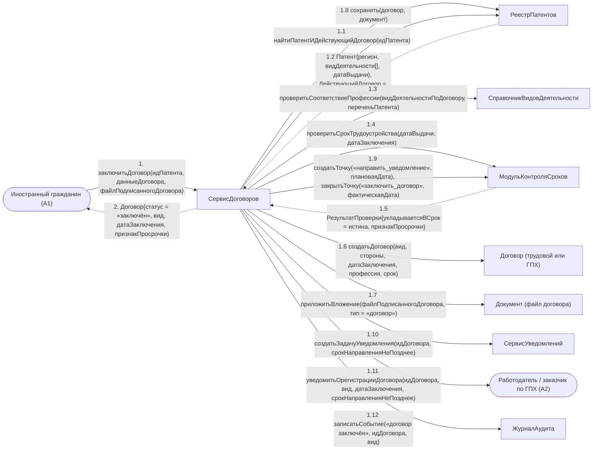

# Операция `заключитьДоговор`

**Дисциплина:** Функциональное моделирование систем · **ТюмГУ**, 5 семестр · **Преподаватель:** Ткаченко И. Н.  
**Тема (раздел дорожной карты):** Тема 7. Действия после получения патента · **Команда:** Малышева Елена, Макеев Глеб, Мальгин Олег · **Автор работы:** Макеев Глеб Борисович  
**Дата:** 18.10.2026 · **Репозиторий:** <https://github.com/mflkee/fms-course>

> **Лабораторная 4, диаграмма коммуникаций** (взаимодействие объектов). Одна диаграмма — на одну системную операцию из лаб. 3. Объекты — экземпляры классов модели предметной области (лаб. 2) и концептуальные компоненты подсистемы; привязки к языку и фреймворку нет.

| | |
|---|---|
| **Системная операция** | `заключитьДоговор(идПатента: UUID, данныеДоговора: ДанныеДоговора, файлПодписанногоДоговора: Вложение) : Договор` |
| **Прецедент** | П02 — [П02. Трудоустройство: заключение трудового договора или договора ГПХ](../../lab1-usecases/usecases/02-trudovoy-dogovor.md) |
| **Диаграмма последовательностей (лаб. 3)** | [04-p02-osnovnoy](../../lab3-sequence-diagrams/diagrams/04-p02-osnovnoy.md) |
| **Инварианты лаб. 2** | **ИНВ-1**, **ИНВ-3**, **ИНВ-4** |
| **Файлы** | [`04-zaklyuchit-dogovor.puml`](04-zaklyuchit-dogovor.puml) · [`04-zaklyuchit-dogovor.png`](04-zaklyuchit-dogovor.png) |

**Назначение операции:** зарегистрировать трудовой договор или договор ГПХ по патенту: проверить профессию и срок, сохранить подписанный файл и создать задачу уведомления МВД.

## 1. Объекты

| Объект | Тип | Соответствие модели лаб. 2 |
|---|---|---|
| `Иностранный гражданин (A1)` | актор | актор A1 — основной исполнитель П02, регистрирует договор |
| `Работодатель / заказчик по ГПХ (A2)` | актор | актор A2 — вторая сторона, получает уведомление о регистрации |
| `СервисДоговоров` | компонент | концептуальный компонент; работает с абстрактным классом `Договор` и его подклассами `ТрудовойДоговор` / `ДоговорГПХ` |
| `РеестрПатентов` | хранилище | хранилище `Патент`, `Договор`, `Документ` |
| `СправочникВидовДеятельности` | справочник | класс `ВидДеятельности` — используется для проверки ИНВ-4 |
| `МодульКонтроляСроков` | компонент | компонент; создаёт и закрывает `КонтрольнаяТочка` |
| `Договор (трудовой или ГПХ)` | сущность | класс `Договор` (подкласс по атрибуту `вид`) |
| `Документ (файл договора)` | сущность | класс `Документ` (тип «договор») |
| `СервисУведомлений` | компонент | концептуальный компонент подготовки и отправки уведомлений (П03) |
| `ЖурналАудита` | компонент | журнал аудита |

## 2. Диаграмма коммуникаций

PlantUML-исходник (диаграмма объектов с нумерованными стрелками): [`04-zaklyuchit-dogovor.puml`](04-zaklyuchit-dogovor.puml); растровый рендер: [`04-zaklyuchit-dogovor.png`](04-zaklyuchit-dogovor.png).

## 3. Сообщения

| № | Сообщение | Отправитель | Получатель | Назначение |
|---|---|---|---|---|
| **1** | `заключитьДоговор(идПатента, данныеДоговора, файлПодписанногоДоговора)` | Иностранный гражданин (A1) | СервисДоговоров | Точка входа. Двустороннее подтверждение выполнено подписями в приложенном файле. |
| **1.1** | `найтиПатентИДействующийДоговор(идПатента)` | СервисДоговоров | РеестрПатентов | Одним обращением проверяются и патент, и отсутствие другого действующего договора (ИНВ-1). |
| **1.2** *(возврат)* | `Патент{регион, видДеятельности[], датаВыдачи}, ДействующийДоговор = отсутствует` | РеестрПатентов | СервисДоговоров | Если действующий договор есть, операция прерывается: сначала нужно закрыть прежний (П06). |
| **1.3** | `проверитьСоответствиеПрофессии(видДеятельностиПоДоговору, переченьПатента)` | СервисДоговоров | СправочникВидовДеятельности | Проверка ИНВ-4: работать по профессии, не указанной в патенте, нельзя. |
| **1.4** | `проверитьСрокТрудоустройства(датаВыдачи, датаЗаключения)` | СервисДоговоров | МодульКонтроляСроков | Проверка ИНВ-3: договор не позднее 2 месяцев с даты выдачи патента. |
| **1.5** *(возврат)* | `РезультатПроверки{укладываетсяВСрок = истина, признакПросрочки}` | МодульКонтроляСроков | СервисДоговоров | При просрочке операция не прерывается, но результат помечается признаком просрочки. |
| **1.6** | `создатьДоговор(вид, стороны, датаЗаключения, профессия, срок)` | СервисДоговоров | Договор (трудовой или ГПХ) | Создание объекта договора; вид («трудовой» / «ГПХ») определяет подкласс. |
| **1.7** | `приложитьВложение(файлПодписанногоДоговора, тип = «договор»)` | СервисДоговоров | Документ (файл договора) | Подписанный документ — обязательное вложение (кратность `1..*` в лаб. 2). |
| **1.8** | `сохранить(договор, документ)` | СервисДоговоров | РеестрПатентов | Запись договора и вложения одной транзакцией. |
| **1.9** | `создатьТочку(«направить_уведомление», плановаяДата); закрытьТочку(«заключить_договор», фактическаяДата)` | СервисДоговоров | МодульКонтроляСроков | Одна точка закрывается (договор заключён), другая создаётся (нужно уведомить МВД). |
| **1.10** | `создатьЗадачуУведомления(идДоговора, срокНаправленияНеПозднее)` | СервисДоговоров | СервисУведомлений | Передача управления прецеденту П03: задача уведомления МВД появляется сразу после регистрации договора. |
| **1.11** | `уведомитьОрегистрацииДоговора(идДоговора, вид, датаЗаключения, срокНаправленияНеПозднее)` | СервисДоговоров | Работодатель / заказчик по ГПХ (A2) | Вторая сторона получает уведомление о регистрации и о сроке уведомления МВД. |
| **1.12** | `записатьСобытие(«договор заключён», идДоговора, вид)` | СервисДоговоров | ЖурналАудита | Аудит регистрации договора. |
| **2** *(возврат)* | `Договор{статус = «заключён», вид, датаЗаключения, признакПросрочки}` | СервисДоговоров | Иностранный гражданин (A1) | Возврат результата ИГ. |

## 4. Решения и примечания

- Проверки ИНВ-1, ИНВ-3, ИНВ-4 распределены по трём объектам (хранилище, справочник, модуль сроков) — так каждый инвариант проверяется в одном месте, а не дублируется в сценариях.
- Ветви «профессия не соответствует патенту» и «срок истёк» различаются только реакцией на результат проверки: в первом случае операция прерывается (альтернатива 4а П02), во втором — продолжается с признаком просрочки (альтернатива 2а П02).
- Объект `SU` (СервисУведомлений) появляется здесь только одним сообщением: регистрация договора создаёт задачу, а сама отправка уведомления — отдельная системная операция (диаграмма 6).

Назад: [README лаб. 4](../README.md) · [спецификация операций лаб. 3](../../lab3-sequence-diagrams/operations.md) · [прецедент](../../lab1-usecases/usecases/02-trudovoy-dogovor.md)
