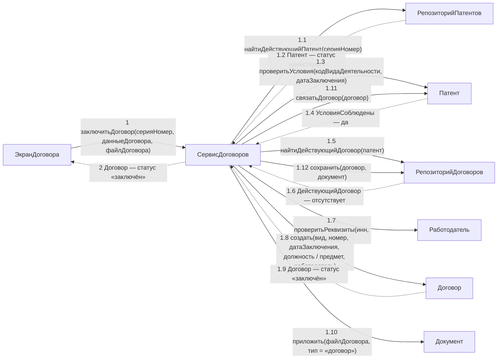

# Операция `заключитьДоговор`

**Дисциплина:** Функциональное моделирование систем · **ТюмГУ**, 5 семестр · **Преподаватель:** Ткаченко И. Н.  
**Тема (раздел дорожной карты):** Тема 7. Действия после получения патента · **Команда:** Малышева Елена, Макеев Глеб · **Автор работы:** Макеев Глеб Борисович  
**Дата:** 18.10.2026 · **Репозиторий:** <https://github.com/mflkee/fms-course>

> **Лабораторная 4, диаграмма коммуникаций.** Одна диаграмма — одна системная операция из лаб. 3.
> Объекты — только классы проектирования [`DESIGN.md` §6](../../DESIGN.md): границы (`Экран*`),
> управление (`Сервис*`), сущности (§5), хранилища (`Репозиторий*`), шлюзы (`Шлюз*`).

| | |
|---|---|
| **Системная операция** | `заключитьДоговор(серияНомер: НомерДокумента, данныеДоговора: ДанныеДоговора, файлДоговора: Файл) : Договор` |
| **Прецедент** | П02 — [Заключение договора (7.1)](../../lab1-usecases/usecases/02-trudovoy-dogovor.md) |
| **Диаграмма последовательностей (лаб. 3)** | [03-p02-osnovnoy](../../lab3-sequence-diagrams/diagrams/03-p02-osnovnoy.md) — заключение трудового договора или ГПХ |
| **Инварианты ([DESIGN.md §5](../../DESIGN.md))** | ИНВ-1, ИНВ-3, ИНВ-4 |
| **Объектов / сообщений** | 8 / 14 |
| **Файлы** | [`04-zaklyuchit-dogovor.puml`](04-zaklyuchit-dogovor.puml) · [`04-zaklyuchit-dogovor.png`](04-zaklyuchit-dogovor.png) |

**Назначение операции:** зарегистрировать трудовой договор или договор ГПХ по патенту: проверить профессию, срок и отсутствие другого действующего договора, сохранить подписанный файл и связать договор с патентом.

## 1. Объекты

| Объект | Слой | Соответствие DESIGN.md |
|---|---|---|
| `ЭкранДоговора` | граница (`boundary`) | `ЭкранДоговора` — ввод условий договора и файла |
| `СервисДоговоров` | управление (`control`) | `СервисДоговоров` — сценарий заключения, проверки ИНВ-1/3/4 |
| `РепозиторийПатентов` | хранилище (`repository`) | `РепозиторийПатентов` — чтение патента |
| `РепозиторийДоговоров` | хранилище (`repository`) | `РепозиторийДоговоров` — поиск действующего договора и запись нового |
| `Патент` | сущность (`entity`, DESIGN §5) | `Патент` — допускает профессию и срок |
| `Работодатель` | сущность (`entity`, DESIGN §5) | `Работодатель` — сторона договора |
| `Договор` | сущность (`entity`, DESIGN §5) | `Договор` — создаётся `ТрудовойДоговор` или `ДоговорГПХ` по виду |
| `Документ` | сущность (`entity`, DESIGN §5) | `Документ` — подписанный файл договора |

## 2. Диаграмма коммуникаций

PlantUML-исходник (диаграмма объектов с нумерованными стрелками): [`04-zaklyuchit-dogovor.puml`](04-zaklyuchit-dogovor.puml); растровый рендер: [`04-zaklyuchit-dogovor.png`](04-zaklyuchit-dogovor.png).

## 3. Сообщения

| № | Сообщение | Отправитель | Получатель | Назначение |
|---|---|---|---|---|
| **1** | `заключитьДоговор(серияНомер, данныеДоговора, файлДоговора)` | ЭкранДоговора | СервисДоговоров | Точка входа: ИГ заключает договор по своему патенту. |
| **1.1** | `найтиДействующийПатент(серияНомер)` | СервисДоговоров | РепозиторийПатентов | Договор заключается только по действующему патенту. |
| **1.2** *(возврат)* | `Патент — статус «действует»` | РепозиторийПатентов | СервисДоговоров | Карточка патента с регионом и профессией. |
| **1.3** | `проверитьУсловия(кодВидаДеятельности, датаЗаключения)` | СервисДоговоров | Патент | Профессия соответствует патенту (ИНВ-4), договор не позднее 2 месяцев с даты выдачи (ИНВ-3). |
| **1.4** *(возврат)* | `УсловияСоблюдены — да` | Патент | СервисДоговоров | При нарушении операция возвращает ошибку и договор не создаётся. |
| **1.5** | `найтиДействующийДоговор(патент)` | СервисДоговоров | РепозиторийДоговоров | ИНВ-1: на патент допускается только один действующий договор. |
| **1.6** *(возврат)* | `ДействующийДоговор — отсутствует` | РепозиторийДоговоров | СервисДоговоров | Иначе предлагается сначала отменить прежний договор. |
| **1.7** | `проверитьРеквизиты(инн, огрн)` | СервисДоговоров | Работодатель | Реквизиты работодателя должны быть заполнены. |
| **1.8** | `создать(вид, номер, датаЗаключения, должность / предмет, работодатель)` | СервисДоговоров | Договор | `Договор` абстрактный: создаётся `ТрудовойДоговор` (должность, режим) или `ДоговорГПХ` (предмет, срок работ). |
| **1.9** *(возврат)* | `Договор — статус «заключён»` | Договор | СервисДоговоров | Ссылка на созданный договор. |
| **1.10** | `приложить(файлДоговора, тип = «договор»)` | СервисДоговоров | Документ | Подписанный файл — доказательство для уведомления МВД. |
| **1.11** | `связатьДоговор(договор)` | СервисДоговоров | Патент | Связь `Патент 1 --> 0..1 Договор`. |
| **1.12** | `сохранить(договор, документ)` | СервисДоговоров | РепозиторийДоговоров | Запись договора и вложения одной транзакцией. |
| **2** *(возврат)* | `Договор — статус «заключён»` | СервисДоговоров | ЭкранДоговора | Возврат договора на экран; следующий шаг — уведомление МВД. |

## 4. Решения и примечания

- `Договор` — абстрактный класс DESIGN §5; на диаграмме он один, потому что обе ветви (трудовой и ГПХ) проходят одинаковый сценарий и различаются только атрибутами подкласса.
- Все три проверки (ИНВ-1, ИНВ-3, ИНВ-4) выполняются до создания договора: частично сохранённого договора быть не может.
- Операция не отправляет уведомление МВД: это отдельная операция `направитьУведомлениеМВД` (П03).
- Работодатель не создаётся этой операцией: он выбирается из уже учтённых (реквизиты проверяются, но карточка не дублируется).

Назад: [README лаб. 4](../README.md) · [DESIGN.md §3, §6](../../DESIGN.md) · [прецедент](../../lab1-usecases/usecases/02-trudovoy-dogovor.md)
