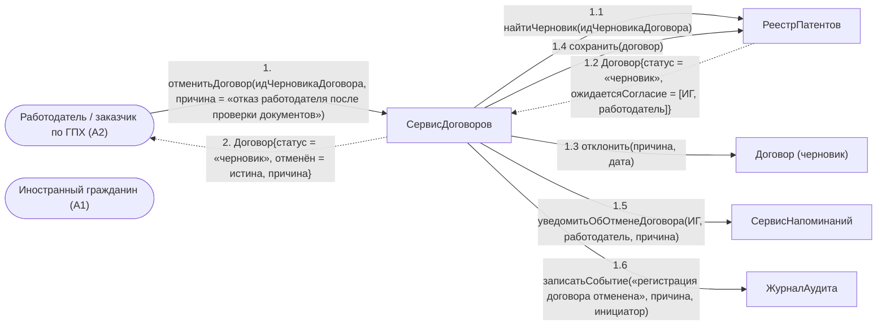

# Операция `отменитьДоговор`

**Дисциплина:** Функциональное моделирование систем · **ТюмГУ**, 5 семестр · **Преподаватель:** Ткаченко И. Н.  
**Тема (раздел дорожной карты):** Тема 7. Действия после получения патента · **Команда:** Малышева Елена, Макеев Глеб, Мальгин Олег · **Автор работы:** Макеев Глеб Борисович  
**Дата:** 18.10.2026 · **Репозиторий:** <https://github.com/mflkee/fms-course>

> **Лабораторная 4, диаграмма коммуникаций** (взаимодействие объектов). Одна диаграмма — на одну системную операцию из лаб. 3. Объекты — экземпляры классов модели предметной области (лаб. 2) и концептуальные компоненты подсистемы; привязки к языку и фреймворку нет.

| | |
|---|---|
| **Системная операция** | `отменитьДоговор(идДоговора: UUID, причина: String) : Договор` |
| **Прецедент** | П02 — [П02. Трудоустройство: заключение трудового договора или договора ГПХ](../../lab1-usecases/usecases/02-trudovoy-dogovor.md) |
| **Диаграмма последовательностей (лаб. 3)** | [05-p02-alternativa-otkaz-rabotodatelya](../../lab3-sequence-diagrams/diagrams/05-p02-alternativa-otkaz-rabotodatelya.md) |
| **Инварианты лаб. 2** | **ИНВ-1**, **ИНВ-3** |
| **Файлы** | [`05-otmenit-dogovor.puml`](05-otmenit-dogovor.puml) · [`05-otmenit-dogovor.png`](05-otmenit-dogovor.png) |

**Назначение операции:** отменить регистрацию договора, который не был заключён (черновик): сохранить попытку как неуспешную, не создавая действующих отношений.

## 1. Объекты

| Объект | Тип | Соответствие модели лаб. 2 |
|---|---|---|
| `Работодатель / заказчик по ГПХ (A2)` | актор | актор A2 — инициатор отказа |
| `Иностранный гражданин (A1)` | актор | актор A1 — вторая сторона, уведомляется об отмене |
| `СервисДоговоров` | компонент | компонент заключения и прекращения договоров |
| `РеестрПатентов` | хранилище | хранилище `Договор` |
| `Договор (черновик)` | сущность | класс `Договор` со статусом `черновик` |
| `СервисНапоминаний` | компонент | компонент, уведомляющий стороны (каналы напоминаний/уведомлений) |
| `ЖурналАудита` | компонент | журнал аудита |

## 2. Диаграмма коммуникаций

PlantUML-исходник (диаграмма объектов с нумерованными стрелками): [`05-otmenit-dogovor.puml`](05-otmenit-dogovor.puml); растровый рендер: [`05-otmenit-dogovor.png`](05-otmenit-dogovor.png).

## 3. Сообщения

| № | Сообщение | Отправитель | Получатель | Назначение |
|---|---|---|---|---|
| **1** | `отменитьДоговор(идЧерновикаДоговора, причина = «отказ работодателя после проверки документов»)` | Работодатель / заказчик по ГПХ (A2) | СервисДоговоров | Точка входа: работодатель отказался от сделки до подписания. |
| **1.1** | `найтиЧерновик(идЧерновикаДоговора)` | СервисДоговоров | РеестрПатентов | Проверяется, что договор существует и находится именно в статусе «черновик». |
| **1.2** *(возврат)* | `Договор{статус = «черновик», ожидаетсяСогласие = [ИГ, работодатель]}` | РеестрПатентов | СервисДоговоров | Отменять можно только незаключённый договор: для действующего применяется `прекратитьДоговор` (П06). |
| **1.3** | `отклонить(причина, дата)` | СервисДоговоров | Договор (черновик) | Черновик помечается отклонённым; попытка трудоустройства сохраняется в истории. |
| **1.4** | `сохранить(договор)` | СервисДоговоров | РеестрПатентов | Запись изменения состояния. |
| **1.5** | `уведомитьОбОтменеДоговора(ИГ, работодатель, причина)` | СервисДоговоров | СервисНапоминаний | Обе стороны уведомляются; ИГ возвращается к поиску работы. |
| **1.6** | `записатьСобытие(«регистрация договора отменена», причина, инициатор)` | СервисДоговоров | ЖурналАудита | Аудит: важно сохранить, кто и почему отказался от сделки. |
| **2** *(возврат)* | `Договор{статус = «черновик», отменён = истина, причина}` | СервисДоговоров | Работодатель / заказчик по ГПХ (A2) | Возврат результата инициатору. |

## 4. Решения и примечания

- Контрольная точка «заключить договор» остаётся открытой: её состояние изменяет не эта операция, а контроль сроков (П04). Так сохраняется правило «срок считается от даты выдачи патента».
- Действующий договор отменить нельзя — это осознанная граница между двумя операциями. Попытка отменить заключённый договор должна приводить к ошибке состояния, а не к молчаливому закрытию отношений.

Назад: [README лаб. 4](../README.md) · [спецификация операций лаб. 3](../../lab3-sequence-diagrams/operations.md) · [прецедент](../../lab1-usecases/usecases/02-trudovoy-dogovor.md)
