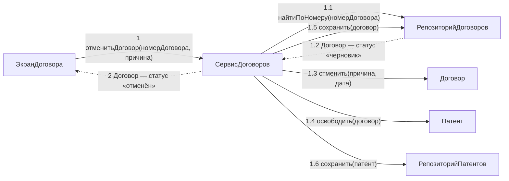

# Операция `отменитьДоговор`

**Дисциплина:** Функциональное моделирование систем · **ТюмГУ**, 5 семестр · **Преподаватель:** Ткаченко И. Н.  
**Тема (раздел дорожной карты):** Тема 7. Действия после получения патента · **Команда:** Малышева Елена, Макеев Глеб · **Автор работы:** Макеев Глеб Борисович  
**Дата:** 18.10.2026 · **Репозиторий:** <https://github.com/mflkee/fms-course>

> **Лабораторная 4, диаграмма коммуникаций.** Одна диаграмма — одна системная операция из лаб. 3.
> Объекты — только классы проектирования [`DESIGN.md` §6](../../DESIGN.md): границы (`Экран*`),
> управление (`Сервис*`), сущности (§5), хранилища (`Репозиторий*`), шлюзы (`Шлюз*`).

| | |
|---|---|
| **Системная операция** | `отменитьДоговор(номерДоговора: НомерДокумента, причина: Основание) : Договор` |
| **Прецедент** | П02 — [Заключение договора (7.1)](../../lab1-usecases/usecases/02-trudovoy-dogovor.md) |
| **Диаграмма последовательностей (лаб. 3)** | [04-p02-alternativa-otkaz](../../lab3-sequence-diagrams/diagrams/04-p02-alternativa-otkaz.md) — отказ от заключения договора |
| **Инварианты ([DESIGN.md §5](../../DESIGN.md))** | ИНВ-1 |
| **Объектов / сообщений** | 6 / 8 |
| **Файлы** | [`05-otmenit-dogovor.puml`](05-otmenit-dogovor.puml) · [`05-otmenit-dogovor.png`](05-otmenit-dogovor.png) |

**Назначение операции:** отменить незаключённый (черновой) договор и освободить патент, чтобы по нему можно было заключить другой договор.

## 1. Объекты

| Объект | Слой | Соответствие DESIGN.md |
|---|---|---|
| `ЭкранДоговора` | граница (`boundary`) | `ЭкранДоговора` — отказ от договора с указанием причины |
| `СервисДоговоров` | управление (`control`) | `СервисДоговоров` — сценарий отмены |
| `РепозиторийДоговоров` | хранилище (`repository`) | `РепозиторийДоговоров` — выборка и сохранение договора |
| `РепозиторийПатентов` | хранилище (`repository`) | `РепозиторийПатентов` — сохранение освобождённого патента |
| `Договор` | сущность (`entity`, DESIGN §5) | `Договор` — переводится в статус «отменён» |
| `Патент` | сущность (`entity`, DESIGN §5) | `Патент` — освобождается от связи с договором |

## 2. Диаграмма коммуникаций

PlantUML-исходник (диаграмма объектов с нумерованными стрелками): [`05-otmenit-dogovor.puml`](05-otmenit-dogovor.puml); растровый рендер: [`05-otmenit-dogovor.png`](05-otmenit-dogovor.png).

## 3. Сообщения

| № | Сообщение | Отправитель | Получатель | Назначение |
|---|---|---|---|---|
| **1** | `отменитьДоговор(номерДоговора, причина)` | ЭкранДоговора | СервисДоговоров | Точка входа: ИГ отказывается от заключения договора. |
| **1.1** | `найтиПоНомеру(номерДоговора)` | СервисДоговоров | РепозиторийДоговоров | Отменить можно только черновик: заключённый договор прекращается, а не отменяется. |
| **1.2** *(возврат)* | `Договор — статус «черновик»` | РепозиторийДоговоров | СервисДоговоров | Если договор уже заключён — ошибка состояния. |
| **1.3** | `отменить(причина, дата)` | СервисДоговоров | Договор | Статус «отменён», причина и дата фиксируются. |
| **1.4** | `освободить(договор)` | СервисДоговоров | Патент | Патент снова без действующего договора (ИНВ-1). |
| **1.5** | `сохранить(договор)` | СервисДоговоров | РепозиторийДоговоров | Отменённый договор остаётся в истории. |
| **1.6** | `сохранить(патент)` | СервисДоговоров | РепозиторийПатентов | Обновлённая связь патента с договором. |
| **2** *(возврат)* | `Договор — статус «отменён»` | СервисДоговоров | ЭкранДоговора | Возврат договора; срок трудоустройства продолжает идти. |

## 4. Решения и примечания

- Отмена не удаляет договор: карточка остаётся в истории со статусом «отменён».
- После отмены патент свободен, поэтому ИНВ-1 снова выполняется и можно заключить другой договор.
- Срок «трудоустроиться не позднее» не сдвигается: отмена договора не продлевает срок патента.
- Прекращение уже заключённого договора в системе не предусмотрено — границы подсистемы (DESIGN §1).

Назад: [README лаб. 4](../README.md) · [DESIGN.md §3, §6](../../DESIGN.md) · [прецедент](../../lab1-usecases/usecases/02-trudovoy-dogovor.md)
