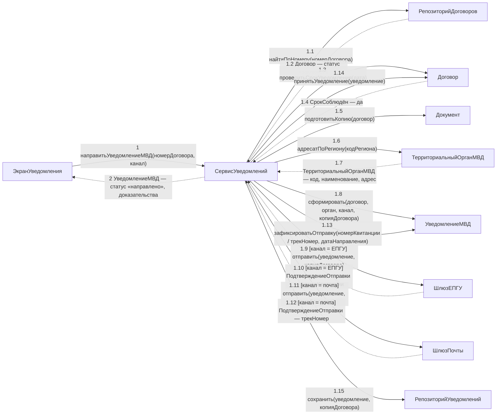

# Операция `направитьУведомлениеМВД`

**Дисциплина:** Функциональное моделирование систем · **ТюмГУ**, 5 семестр · **Преподаватель:** Ткаченко И. Н.  
**Тема (раздел дорожной карты):** Тема 7. Действия после получения патента · **Команда:** Малышева Елена, Макеев Глеб, Мальгин Олег · **Автор работы:** Макеев Глеб Борисович  
**Дата:** 18.10.2026 · **Репозиторий:** <https://github.com/mflkee/fms-course>

> **Лабораторная 4, диаграмма коммуникаций.** Одна диаграмма — одна системная операция из лаб. 3.
> Объекты — только классы проектирования [`DESIGN.md` §6](../../DESIGN.md): границы (`Экран*`),
> управление (`Сервис*`), сущности (§5), хранилища (`Репозиторий*`), шлюзы (`Шлюз*`).

| | |
|---|---|
| **Системная операция** | `направитьУведомлениеМВД(номерДоговора: НомерДокумента, канал: КаналУведомления) : УведомлениеМВД` |
| **Прецедент** | П03 — [Уведомление МВД (7.2)](../../lab1-usecases/usecases/03-uvedomlenie-mvd.md) |
| **Диаграмма последовательностей (лаб. 3)** | [05-p03-osnovnoy](../../lab3-sequence-diagrams/diagrams/05-p03-osnovnoy.md), [06-p03-alternativa-pochta](../../lab3-sequence-diagrams/diagrams/06-p03-alternativa-pochta.md) — ЕПГУ и почта |
| **Инварианты ([DESIGN.md §5](../../DESIGN.md))** | ИНВ-2, ИНВ-7 |
| **Объектов / сообщений** | 10 / 17 |
| **Файлы** | [`06-napravit-uvedomlenie-mvd.puml`](06-napravit-uvedomlenie-mvd.puml) · [`06-napravit-uvedomlenie-mvd.png`](06-napravit-uvedomlenie-mvd.png) |

**Назначение операции:** сформировать уведомление МВД о заключении договора, отправить его через ЕПГУ или Почту России и сохранить доказательства отправки (квитанцию или трек-номер).

## 1. Объекты

| Объект | Слой | Соответствие DESIGN.md |
|---|---|---|
| `ЭкранУведомления` | граница (`boundary`) | `ЭкранУведомления` — выбор канала и подтверждение отправки |
| `СервисУведомлений` | управление (`control`) | `СервисУведомлений` — сценарий подготовки и отправки |
| `РепозиторийДоговоров` | хранилище (`repository`) | `РепозиторийДоговоров` — чтение договора |
| `РепозиторийУведомлений` | хранилище (`repository`) | `РепозиторийУведомлений` — запись уведомления и доказательств |
| `Договор` | сущность (`entity`, DESIGN §5) | `Договор` — предмет уведомления, проверка срока (ИНВ-2) |
| `Документ` | сущность (`entity`, DESIGN §5) | `Документ` — копия договора |
| `ТерриториальныйОрганМВД` | сущность (`entity`, DESIGN §5) | `ТерриториальныйОрганМВД` — адресат по региону |
| `УведомлениеМВД` | сущность (`entity`, DESIGN §5) | `УведомлениеМВД` — создаётся и получает доказательства |
| `ШлюзЕПГУ` | шлюз (`gateway`) | `ШлюзЕПГУ` — канал ЕПГУ |
| `ШлюзПочты` | шлюз (`gateway`) | `ШлюзПочты` — канал «почта» |

## 2. Диаграмма коммуникаций

PlantUML-исходник (диаграмма объектов с нумерованными стрелками): [`06-napravit-uvedomlenie-mvd.puml`](06-napravit-uvedomlenie-mvd.puml); растровый рендер: [`06-napravit-uvedomlenie-mvd.png`](06-napravit-uvedomlenie-mvd.png).

## 3. Сообщения

| № | Сообщение | Отправитель | Получатель | Назначение |
|---|---|---|---|---|
| **1** | `направитьУведомлениеМВД(номерДоговора, канал)` | ЭкранУведомления | СервисУведомлений | Точка входа: работодатель отправляет уведомление по заключённому договору. |
| **1.1** | `найтиПоНомеру(номерДоговора)` | СервисУведомлений | РепозиторийДоговоров | Уведомление строится только по заключённому договору. |
| **1.2** *(возврат)* | `Договор — статус «заключён»` | РепозиторийДоговоров | СервисУведомлений | Договор — источник данных для уведомления. |
| **1.3** | `проверитьСрокУведомления(дата)` | СервисУведомлений | Договор | ИНВ-2: уведомление не ранее договора и не позднее 2 месяцев с его даты. |
| **1.4** *(возврат)* | `СрокСоблюдён — да` | Договор | СервисУведомлений | При нарушении срока уведомление всё равно формируется, но помечается как просроченное. |
| **1.5** | `подготовитьКопию(договор)` | СервисУведомлений | Документ | Копия договора — обязательное приложение к уведомлению. |
| **1.6** | `адресатПоРегиону(кодРегиона)` | СервисУведомлений | ТерриториальныйОрганМВД | Территориальный орган МВД определяется регионом патента. |
| **1.7** *(возврат)* | `ТерриториальныйОрганМВД — код, наименование, адрес` | ТерриториальныйОрганМВД | СервисУведомлений | Реквизиты адресата для уведомления. |
| **1.8** | `сформировать(договор, орган, канал, копияДоговора)` | СервисУведомлений | УведомлениеМВД | Уведомление создаётся со статусом «подготовлено». |
| **1.9** | `[канал = ЕПГУ] отправить(уведомление, копияДоговора)` | СервисУведомлений | ШлюзЕПГУ | Отправка через ЕПГУ; протокол обмена не детализируется. |
| **1.10** *(возврат)* | `[канал = ЕПГУ] ПодтверждениеОтправки — номерКвитанции` | ШлюзЕПГУ | СервисУведомлений | Квитанция — доказательство отправки. |
| **1.11** | `[канал = почта] отправить(уведомление, копияДоговора)` | СервисУведомлений | ШлюзПочты | Альтернативный канал: заказное письмо с описью вложения. |
| **1.12** *(возврат)* | `[канал = почта] ПодтверждениеОтправки — трекНомер` | ШлюзПочты | СервисУведомлений | Трек-номер — доказательство отправки. |
| **1.13** | `зафиксироватьОтправку(номерКвитанции / трекНомер, датаНаправления)` | СервисУведомлений | УведомлениеМВД | Уведомление получает статус «направлено» и доказательства. |
| **1.14** | `принятьУведомление(уведомление)` | СервисУведомлений | Договор | Договор получает статус «уведомление_направлено»; связь `Договор 1 --> 0..1 УведомлениеМВД`. |
| **1.15** | `сохранить(уведомление, копияДоговора)` | СервисУведомлений | РепозиторийУведомлений | Уведомление и копия договора сохраняются вместе. |
| **2** *(возврат)* | `УведомлениеМВД — статус «направлено», доказательства` | СервисУведомлений | ЭкранУведомления | Возврат уведомления с квитанцией или трек-номером. |

## 4. Решения и примечания

- Два шлюза на одной диаграмме — это альтернатива по каналу: сообщения 1.9–1.10 выполняются только для ЕПГУ, 1.11–1.12 — только для почты (страж `[канал = …]`).
- `ТерриториальныйОрганМВД` — сущность, а не шлюз: это адресат, а не канал передачи. Канал — `ШлюзЕПГУ` или `ШлюзПочты`.
- Система не отслеживает статус рассмотрения уведомления: она фиксирует только факт отправки и доказательства (DESIGN §0, п. 5).
- Смена работодателя требует нового уведомления (ИНВ-7) — это новая карточка `УведомлениеМВД`, а не правка прежней.

Назад: [README лаб. 4](../README.md) · [DESIGN.md §3, §6](../../DESIGN.md) · [прецедент](../../lab1-usecases/usecases/03-uvedomlenie-mvd.md)
