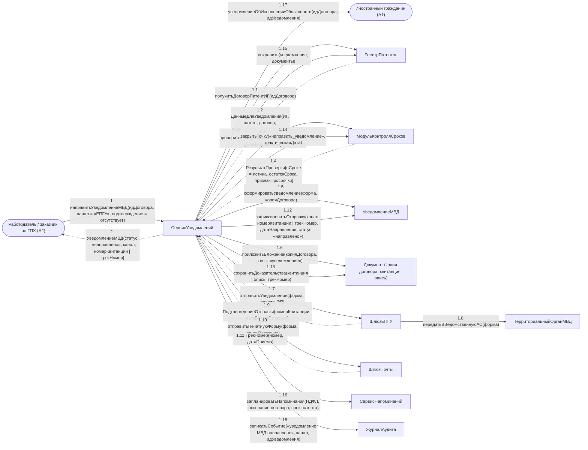

# Операция `направитьУведомлениеМВД`

**Дисциплина:** Функциональное моделирование систем · **ТюмГУ**, 5 семестр · **Преподаватель:** Ткаченко И. Н.  
**Тема (раздел дорожной карты):** Тема 7. Действия после получения патента · **Команда:** Малышева Елена, Макеев Глеб, Мальгин Олег · **Автор работы:** Макеев Глеб Борисович  
**Дата:** 18.10.2026 · **Репозиторий:** <https://github.com/mflkee/fms-course>

> **Лабораторная 4, диаграмма коммуникаций** (взаимодействие объектов). Одна диаграмма — на одну системную операцию из лаб. 3. Объекты — экземпляры классов модели предметной области (лаб. 2) и концептуальные компоненты подсистемы; привязки к языку и фреймворку нет.

| | |
|---|---|
| **Системная операция** | `направитьУведомлениеМВД(идДоговора: UUID, канал: КаналУведомления, подтверждение: ПодтверждениеОтправки) : УведомлениеМВД` |
| **Прецедент** | П03 — [П03. Уведомление МВД об осуществлении трудовой деятельности](../../lab1-usecases/usecases/03-uvedomlenie-mvd.md) |
| **Диаграмма последовательностей (лаб. 3)** | [07-p03-osnovnoy](../../lab3-sequence-diagrams/diagrams/07-p03-osnovnoy.md) |
| **Инварианты лаб. 2** | **ИНВ-2**, **ИНВ-8** |
| **Файлы** | [`06-napravit-uvedomlenie-mvd.puml`](06-napravit-uvedomlenie-mvd.puml) · [`06-napravit-uvedomlenie-mvd.png`](06-napravit-uvedomlenie-mvd.png) |

**Назначение операции:** сформировать уведомление МВД об осуществлении трудовой деятельности из данных договора и патента, отправить его выбранным каналом и сохранить доказательства отправки.

## 1. Объекты

| Объект | Тип | Соответствие модели лаб. 2 |
|---|---|---|
| `Работодатель / заказчик по ГПХ (A2)` | актор | актор A2 — основной исполнитель П03 (обязанность п. 7.2) |
| `Иностранный гражданин (A1)` | актор | актор A1 — уведомляется об исполнении обязанности |
| `СервисУведомлений` | компонент | концептуальный компонент подготовки и отправки уведомлений |
| `РеестрПатентов` | хранилище | хранилище `Договор`, `Патент`, `УведомлениеМВД`, `Документ` |
| `МодульКонтроляСроков` | компонент | компонент, контролирующий срок уведомления (ИНВ-2) |
| `УведомлениеМВД` | сущность | класс `УведомлениеМВД` (канал, номер квитанции, трек-номер, статус) |
| `Документ (копия договора, квитанция, опись)` | сущность | класс `Документ` (тип «уведомление», «квитанция», «опись») |
| `ШлюзЕПГУ` | компонент | шлюз к ЕПГУ (внешняя система A4) |
| `ШлюзПочты` | компонент | шлюз к Почте России (внешняя система A5) |
| `ТерриториальныйОрганМВД` | сущность | класс `ТерриториальныйОрганМВД` — адресат уведомления |
| `СервисНапоминаний` | компонент | компонент напоминаний: планирует напоминания об НДФЛ и окончании договора |
| `ЖурналАудита` | компонент | журнал аудита |

## 2. Диаграмма коммуникаций

PlantUML-исходник (диаграмма объектов с нумерованными стрелками): [`06-napravit-uvedomlenie-mvd.puml`](06-napravit-uvedomlenie-mvd.puml); растровый рендер: [`06-napravit-uvedomlenie-mvd.png`](06-napravit-uvedomlenie-mvd.png).

## 3. Сообщения

| № | Сообщение | Отправитель | Получатель | Назначение |
|---|---|---|---|---|
| **1** | `направитьУведомлениеМВД(идДоговора, канал = «ЕПГУ», подтверждение = отсутствует)` | Работодатель / заказчик по ГПХ (A2) | СервисУведомлений | Точка входа: работодатель открывает задачу уведомления. Первый вызов — подготовка формы. |
| **1.1** | `получитьДоговорПатентИГ(идДоговора)` | СервисУведомлений | РеестрПатентов | Один набор данных для любого канала: профиль ИГ, карточка патента, договор, адресат. Это прямое следствие специального требования П03. |
| **1.2** *(возврат)* | `ДанныеДляУведомления{ИГ, патент, договор, ТерриториальныйОрганМВД}` | РеестрПатентов | СервисУведомлений | Данные получены. |
| **1.3** | `проверитьСрокУведомления(датаВыдачи, датаНаправления)` | СервисУведомлений | МодульКонтроляСроков | Проверка ИНВ-2: не ранее даты заключения договора и не позднее 2 месяцев с даты выдачи патента. |
| **1.4** *(возврат)* | `РезультатПроверки{вСроке = истина, остатокСрока, признакПросрочки}` | МодульКонтроляСроков | СервисУведомлений | Остаток срока показывается работодателю (шаг 1 сценария П03). |
| **1.5** | `сформироватьУведомление(форма, копияДоговора)` | СервисУведомлений | УведомлениеМВД | Создаётся объект уведомления; копия договора обязательна. |
| **1.6** | `приложитьВложение(копияДоговора, тип = «уведомление»)` | СервисУведомлений | Документ (копия договора, квитанция, опись) | Копия договора — обязательное вложение. |
| **1.7** | `отправитьУведомление(форма, подписьЭП)` | СервисУведомлений | ШлюзЕПГУ | Основная ветвь: электронный канал ЕПГУ (работодатель подписал уведомление ЭП). |
| **1.8** | `передатьВВедомственнуюАС(форма)` | ШлюзЕПГУ | ТерриториальныйОрганМВД | ЕПГУ передаёт уведомление в ведомственную систему территориального органа МВД. Приём — за границей подсистемы. |
| **1.9** *(возврат)* | `ПодтверждениеОтправки{номерКвитанции, датаВремяОтправки}` | ШлюзЕПГУ | СервисУведомлений | Квитанция — доказательство исполнения обязанности. |
| **1.10** | `отправитьПечатнуюФорму(форма, описьВложения)` | СервисУведомлений | ШлюзПочты | Альтернативная ветвь: почтовый канал. Печатная форма и опись формируются из тех же данных; письмо отправляет работодатель вне системы. |
| **1.11** *(возврат)* | `ТрекНомер{номер, датаПриёма}` | ШлюзПочты | СервисУведомлений | Работодатель вносит трек-номер; подсистема начинает контроль вручения. |
| **1.12** | `зафиксироватьОтправку(канал, номерКвитанции | трекНомер, датаНаправления, статус = «направлено»)` | СервисУведомлений | УведомлениеМВД | Реквизиты отправки сохраняются в уведомлении; канал определяет, какой реквизит заполняется. |
| **1.13** | `сохранитьДоказательства(квитанция | опись, трекНомер)` | СервисУведомлений | Документ (копия договора, квитанция, опись) | Доказательства хранятся бессрочно (ИНВ-8). |
| **1.14** | `закрытьТочку(«направить_уведомление», фактическаяДата)` | СервисУведомлений | МодульКонтроляСроков | Контрольная точка «направить уведомление МВД» закрывается. |
| **1.15** | `сохранить(уведомление, документы)` | СервисУведомлений | РеестрПатентов | Запись уведомления и доказательств. |
| **1.16** | `запланироватьНапоминания(НДФЛ, окончание договора, срок патента)` | СервисУведомлений | СервисНапоминаний | Передача управления прецедентам П05 и П04. |
| **1.17** | `уведомлениеОбИсполненииОбязанности(идДоговора, идУведомления)` | СервисУведомлений | Иностранный гражданин (A1) | ИГ должен видеть, что обязанность исполнена: неподача уведомления — основание для аннулирования патента. |
| **1.18** | `записатьСобытие(«уведомление МВД направлено», канал, идУведомления)` | СервисУведомлений | ЖурналАудита | Аудит отправки. |
| **2** *(возврат)* | `УведомлениеМВД{статус = «направлено», канал, номерКвитанции | трекНомер}` | СервисУведомлений | Работодатель / заказчик по ГПХ (A2) | Возврат результата работодателю. |

## 4. Решения и примечания

- Одна операция обслуживает оба канала (сообщения 1.7–1.9 для ЕПГУ и 1.10–1.11 для почты): это и есть требование П03 «формирование уведомления работает для обоих каналов из одного набора данных».
- Шлюзы (GE, GP) — концептуальные компоненты, моделирующие внешние системы A4 и A5: привязки к конкретному протоколу (СМЭВ, REST, бумажный документ) в модели нет.
- Доказательства отправки сохраняются до записи уведомления (1.13 → 1.15): порядок важен, чтобы не сохранить уведомление без его доказательств.

Назад: [README лаб. 4](../README.md) · [спецификация операций лаб. 3](../../lab3-sequence-diagrams/operations.md) · [прецедент](../../lab1-usecases/usecases/03-uvedomlenie-mvd.md)
