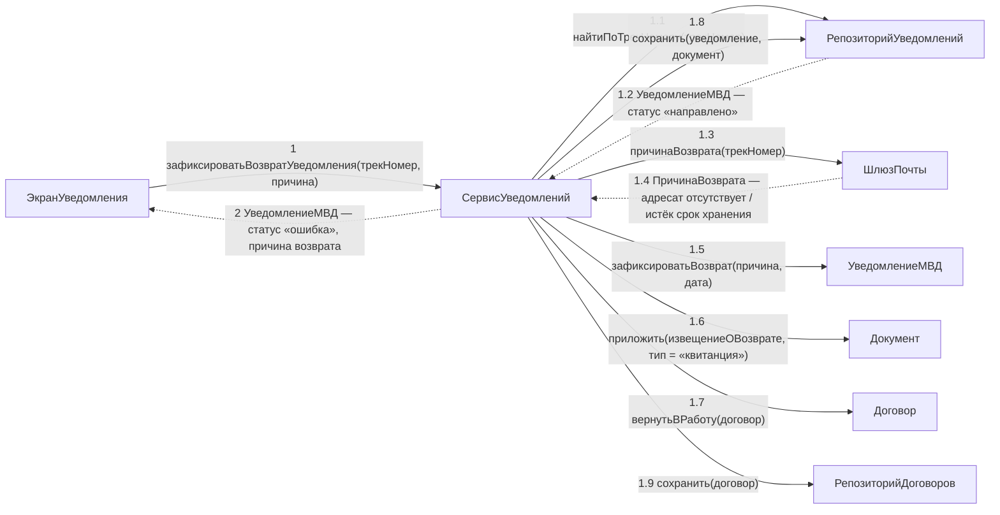

# Операция `зафиксироватьВозвратУведомления`

**Дисциплина:** Функциональное моделирование систем · **ТюмГУ**, 5 семестр · **Преподаватель:** Ткаченко И. Н.  
**Тема (раздел дорожной карты):** Тема 7. Действия после получения патента · **Команда:** Малышева Елена, Макеев Глеб, Мальгин Олег · **Автор работы:** Макеев Глеб Борисович  
**Дата:** 18.10.2026 · **Репозиторий:** <https://github.com/mflkee/fms-course>

> **Лабораторная 4, диаграмма коммуникаций.** Одна диаграмма — одна системная операция из лаб. 3.
> Объекты — только классы проектирования [`DESIGN.md` §6](../../DESIGN.md): границы (`Экран*`),
> управление (`Сервис*`), сущности (§5), хранилища (`Репозиторий*`), шлюзы (`Шлюз*`).

| | |
|---|---|
| **Системная операция** | `зафиксироватьВозвратУведомления(трекНомер: ТрекНомер, причина: Основание) : УведомлениеМВД` |
| **Прецедент** | П03 — [Уведомление МВД (7.2)](../../lab1-usecases/usecases/03-uvedomlenie-mvd.md) |
| **Диаграмма последовательностей (лаб. 3)** | [06-p03-alternativa-pochta](../../lab3-sequence-diagrams/diagrams/06-p03-alternativa-pochta.md) — возврат отправления |
| **Инварианты ([DESIGN.md §5](../../DESIGN.md))** | ИНВ-2 |
| **Объектов / сообщений** | 8 / 11 |
| **Файлы** | [`07-zafiksirovat-vozvrat-uvedomleniya.puml`](07-zafiksirovat-vozvrat-uvedomleniya.puml) · [`07-zafiksirovat-vozvrat-uvedomleniya.png`](07-zafiksirovat-vozvrat-uvedomleniya.png) |

**Назначение операции:** зарегистрировать неудачную отправку: письмо вернулось, уведомление не доставлено. Фиксируется причина возврата, доказательство и то, что договор снова без направленного уведомления.

## 1. Объекты

| Объект | Слой | Соответствие DESIGN.md |
|---|---|---|
| `ЭкранУведомления` | граница (`boundary`) | `ЭкранУведомления` — регистрация возврата и причины |
| `СервисУведомлений` | управление (`control`) | `СервисУведомлений` — сценарий фиксации возврата |
| `РепозиторийУведомлений` | хранилище (`repository`) | `РепозиторийУведомлений` — поиск и сохранение уведомления |
| `РепозиторийДоговоров` | хранилище (`repository`) | `РепозиторийДоговоров` — сохранение статуса договора |
| `УведомлениеМВД` | сущность (`entity`, DESIGN §5) | `УведомлениеМВД` — статус «ошибка», причина возврата |
| `Договор` | сущность (`entity`, DESIGN §5) | `Договор` — возвращается в статус «заключён» |
| `Документ` | сущность (`entity`, DESIGN §5) | `Документ` — извещение о возврате |
| `ШлюзПочты` | шлюз (`gateway`) | `ШлюзПочты` — причина возврата по трек-номеру |

## 2. Диаграмма коммуникаций

PlantUML-исходник (диаграмма объектов с нумерованными стрелками): [`07-zafiksirovat-vozvrat-uvedomleniya.puml`](07-zafiksirovat-vozvrat-uvedomleniya.puml); растровый рендер: [`07-zafiksirovat-vozvrat-uvedomleniya.png`](07-zafiksirovat-vozvrat-uvedomleniya.png).

## 3. Сообщения

| № | Сообщение | Отправитель | Получатель | Назначение |
|---|---|---|---|---|
| **1** | `зафиксироватьВозвратУведомления(трекНомер, причина)` | ЭкранУведомления | СервисУведомлений | Точка входа: работодатель вносит вернувшееся отправление. |
| **1.1** | `найтиПоТрекНомеру(трекНомер)` | СервисУведомлений | РепозиторийУведомлений | Возврат относится к ранее отправленному уведомлению. |
| **1.2** *(возврат)* | `УведомлениеМВД — статус «направлено»` | РепозиторийУведомлений | СервисУведомлений | Если уведомление уже доставлено — ошибка состояния. |
| **1.3** | `причинаВозврата(трекНомер)` | СервисУведомлений | ШлюзПочты | Уточнение причины по данным почты. |
| **1.4** *(возврат)* | `ПричинаВозврата — адресат отсутствует / истёк срок хранения` | ШлюзПочты | СервисУведомлений | Причина сохраняется в уведомлении. |
| **1.5** | `зафиксироватьВозврат(причина, дата)` | СервисУведомлений | УведомлениеМВД | Статус уведомления — «ошибка»; факт возврата зафиксирован. |
| **1.6** | `приложить(извещениеОВозврате, тип = «квитанция»)` | СервисУведомлений | Документ | Извещение — доказательство неудачной отправки. |
| **1.7** | `вернутьВРаботу(договор)` | СервисУведомлений | Договор | Договор снова в статусе «заключён»: уведомление не направлено (ИНВ-2). |
| **1.8** | `сохранить(уведомление, документ)` | СервисУведомлений | РепозиторийУведомлений | Возврат сохраняется в истории уведомлений. |
| **1.9** | `сохранить(договор)` | СервисУведомлений | РепозиторийДоговоров | Обновлённый статус договора. |
| **2** *(возврат)* | `УведомлениеМВД — статус «ошибка», причина возврата` | СервисУведомлений | ЭкранУведомления | Возврат результата; нужна повторная отправка другим каналом. |

## 4. Решения и примечания

- Операция не отправляет уведомление заново: повторная отправка — это новый вызов `направитьУведомлениеМВД`, возможно другим каналом.
- Возврат не отменяет договор: договор остаётся заключённым, но обязанность уведомить МВД не исполнена (ИНВ-2).
- Прежняя карточка уведомления не перезаписывается: история отправок и возвратов сохраняется.
- Система не проверяет фактическое получение письма МВД — фиксируется только возврат отправления.

Назад: [README лаб. 4](../README.md) · [DESIGN.md §3, §6](../../DESIGN.md) · [прецедент](../../lab1-usecases/usecases/03-uvedomlenie-mvd.md)
