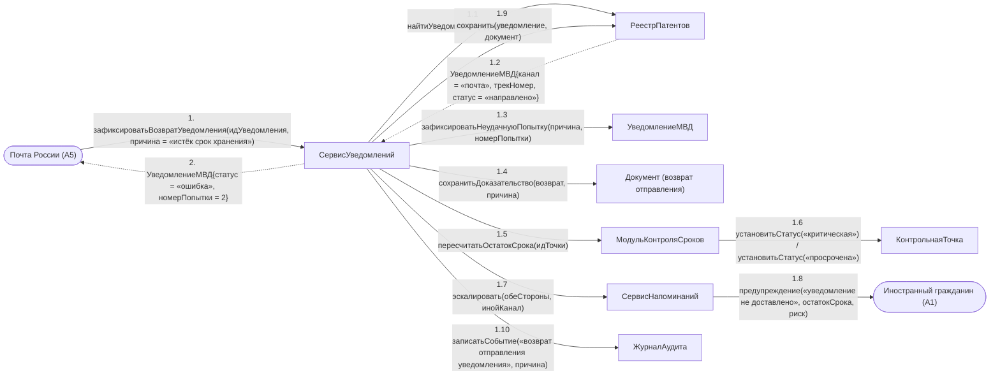

# Операция `зафиксироватьВозвратУведомления`

**Дисциплина:** Функциональное моделирование систем · **ТюмГУ**, 5 семестр · **Преподаватель:** Ткаченко И. Н.  
**Тема (раздел дорожной карты):** Тема 7. Действия после получения патента · **Команда:** Малышева Елена, Макеев Глеб, Мальгин Олег · **Автор работы:** Макеев Глеб Борисович  
**Дата:** 18.10.2026 · **Репозиторий:** <https://github.com/mflkee/fms-course>

> **Лабораторная 4, диаграмма коммуникаций** (взаимодействие объектов). Одна диаграмма — на одну системную операцию из лаб. 3. Объекты — экземпляры классов модели предметной области (лаб. 2) и концептуальные компоненты подсистемы; привязки к языку и фреймворку нет.

| | |
|---|---|
| **Системная операция** | `зафиксироватьВозвратУведомления(идУведомления: UUID, причина: String) : УведомлениеМВД` |
| **Прецедент** | П03 — [П03. Уведомление МВД об осуществлении трудовой деятельности](../../lab1-usecases/usecases/03-uvedomlenie-mvd.md) |
| **Диаграмма последовательностей (лаб. 3)** | [09-p03-alternativa-vozvrat-otpravleniya](../../lab3-sequence-diagrams/diagrams/09-p03-alternativa-vozvrat-otpravleniya.md) |
| **Инварианты лаб. 2** | **ИНВ-2**, **ИНВ-8** |
| **Файлы** | [`07-zafiksirovat-vozvrat-uvedomleniya.puml`](07-zafiksirovat-vozvrat-uvedomleniya.puml) · [`07-zafiksirovat-vozvrat-uvedomleniya.png`](07-zafiksirovat-vozvrat-uvedomleniya.png) |

**Назначение операции:** зарегистрировать неудачную отправку уведомления или возврат почтового отправления и оставить задачу открытой до успешной повторной отправки.

## 1. Объекты

| Объект | Тип | Соответствие модели лаб. 2 |
|---|---|---|
| `Почта России (A5)` | актор | актор A5 — источник сведений о возврате отправления |
| `СервисУведомлений` | компонент | компонент подготовки и отправки уведомлений |
| `РеестрПатентов` | хранилище | хранилище `УведомлениеМВД`, `Документ`, `КонтрольнаяТочка` |
| `УведомлениеМВД` | сущность | класс `УведомлениеМВД` (статус `ошибка`) |
| `Документ (возврат отправления)` | сущность | класс `Документ` — доказательство неудачной попытки |
| `МодульКонтроляСроков` | компонент | компонент контроля сроков |
| `КонтрольнаяТочка` | сущность | класс `КонтрольнаяТочка` (статус «критическая» или «просрочена») |
| `СервисНапоминаний` | компонент | компонент напоминаний: эскалация и предупреждения |
| `Иностранный гражданин (A1)` | актор | актор A1 — получатель предупреждения о риске |
| `ЖурналАудита` | компонент | журнал аудита |

## 2. Диаграмма коммуникаций

PlantUML-исходник (диаграмма объектов с нумерованными стрелками): [`07-zafiksirovat-vozvrat-uvedomleniya.puml`](07-zafiksirovat-vozvrat-uvedomleniya.puml); растровый рендер: [`07-zafiksirovat-vozvrat-uvedomleniya.png`](07-zafiksirovat-vozvrat-uvedomleniya.png).

## 3. Сообщения

| № | Сообщение | Отправитель | Получатель | Назначение |
|---|---|---|---|---|
| **1** | `зафиксироватьВозвратУведомления(идУведомления, причина = «истёк срок хранения»)` | Почта России (A5) | СервисУведомлений | Точка входа: сведения о возврате приходят от Почты России; при сбое ЕПГУ инициатором выступает работодатель. |
| **1.1** | `найтиУведомление(идУведомления)` | СервисУведомлений | РеестрПатентов | Поиск записи уведомления. |
| **1.2** *(возврат)* | `УведомлениеМВД{канал = «почта», трекНомер, статус = «направлено»}` | РеестрПатентов | СервисУведомлений | Уведомление найдено; оно считалось отправленным, но не доставлено. |
| **1.3** | `зафиксироватьНеудачнуюПопытку(причина, номерПопытки)` | СервисУведомлений | УведомлениеМВД | Статус меняется на «ошибка», счётчик попыток увеличивается — обязанность не считается исполненной. |
| **1.4** | `сохранитьДоказательство(возврат, причина)` | СервисУведомлений | Документ (возврат отправления) | Доказательство неудачной попытки сохраняется бессрочно (ИНВ-8): оно защищает работодателя при споре о сроке. |
| **1.5** | `пересчитатьОстатокСрока(идТочки)` | СервисУведомлений | МодульКонтроляСроков | Пересчёт остатка срока уведомления. |
| **1.6** | `установитьСтатус(«критическая») / установитьСтатус(«просрочена»)` | МодульКонтроляСроков | КонтрольнаяТочка | Точка становится критической, а по истечении срока — просроченной. |
| **1.7** | `эскалировать(обеСтороны, инойКанал)` | СервисУведомлений | СервисНапоминаний | Повышение уровня критичности: предупреждения идут по другому каналу. |
| **1.8** | `предупреждение(«уведомление не доставлено», остатокСрока, риск)` | СервисНапоминаний | Иностранный гражданин (A1) | ИГ предупреждён: неподача уведомления — основание для аннулирования патента. |
| **1.9** | `сохранить(уведомление, документ)` | СервисУведомлений | РеестрПатентов | Запись неудачной попытки и её доказательства. |
| **1.10** | `записатьСобытие(«возврат отправления уведомления», причина)` | СервисУведомлений | ЖурналАудита | Аудит: факт возврата юридически значим. |
| **2** *(возврат)* | `УведомлениеМВД{статус = «ошибка», номерПопытки = 2}` | СервисУведомлений | Почта России (A5) | Возврат результата; задача уведомления остаётся открытой для повторной отправки. |

## 4. Решения и примечания

- Повторная отправка выполняется тем же контрактом операции `направитьУведомлениеМВД` (диаграмма 6), поэтому отдельной операции «повторить отправку» нет: повтор — это второй вызов.
- Ветвь «при повторной неудаче» приводит не к новой операции, а к переводу контрольной точки в статус «просрочена» (сообщение 1.6): факт нарушения фиксируется средствами П04.
- Список объектов содержит и актора-гражданина, хотя операция его не инициирует: ИГ получает предупреждение, потому что риск аннулирования патента ложится на него.

Назад: [README лаб. 4](../README.md) · [спецификация операций лаб. 3](../../lab3-sequence-diagrams/operations.md) · [прецедент](../../lab1-usecases/usecases/03-uvedomlenie-mvd.md)
