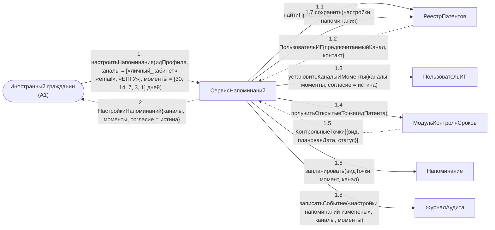

# Операция `настроитьНапоминания`

**Дисциплина:** Функциональное моделирование систем · **ТюмГУ**, 5 семестр · **Преподаватель:** Ткаченко И. Н.  
**Тема (раздел дорожной карты):** Тема 7. Действия после получения патента · **Команда:** Малышева Елена, Макеев Глеб, Мальгин Олег · **Автор работы:** Макеев Глеб Борисович  
**Дата:** 18.10.2026 · **Репозиторий:** <https://github.com/mflkee/fms-course>

> **Лабораторная 4, диаграмма коммуникаций** (взаимодействие объектов). Одна диаграмма — на одну системную операцию из лаб. 3. Объекты — экземпляры классов модели предметной области (лаб. 2) и концептуальные компоненты подсистемы; привязки к языку и фреймворку нет.

| | |
|---|---|
| **Системная операция** | `настроитьНапоминания(идПрофиля: UUID, каналы: КаналУведомления[], моменты: Integer[]) : НастройкиНапоминаний` |
| **Прецедент** | П04 — [П04. Контроль срока трудоустройства и напоминания](../../lab1-usecases/usecases/04-kontrol-sroka-trudoustroystva.md) |
| **Диаграмма последовательностей (лаб. 3)** | [10-p04-osnovnoy](../../lab3-sequence-diagrams/diagrams/10-p04-osnovnoy.md) |
| **Инварианты лаб. 2** | **ИНВ-9** |
| **Файлы** | [`08-nastroit-napominaniya.puml`](08-nastroit-napominaniya.puml) · [`08-nastroit-napominaniya.png`](08-nastroit-napominaniya.png) |

**Назначение операции:** сохранить согласие ИГ на напоминания, каналы связи и моменты предупреждений, а также запланировать напоминания по открытым контрольным точкам.

## 1. Объекты

| Объект | Тип | Соответствие модели лаб. 2 |
|---|---|---|
| `Иностранный гражданин (A1)` | актор | актор A1 — даёт согласие и выбирает каналы |
| `СервисНапоминаний` | компонент | концептуальный компонент формирования и доставки напоминаний |
| `РеестрПатентов` | хранилище | хранилище `ПользовательИГ`, `Напоминание`, `КонтрольнаяТочка` |
| `ПользовательИГ` | сущность | класс `ПользовательИГ` (подкласс `Пользователь`, атрибут `предпочитаемыйКанал`) |
| `МодульКонтроляСроков` | компонент | компонент, отдающий перечень открытых контрольных точек |
| `Напоминание` | сущность | класс `Напоминание` (дата отправки, канал, текст, статус) |
| `ЖурналАудита` | компонент | журнал аудита |

## 2. Диаграмма коммуникаций

PlantUML-исходник (диаграмма объектов с нумерованными стрелками): [`08-nastroit-napominaniya.puml`](08-nastroit-napominaniya.puml); растровый рендер: [`08-nastroit-napominaniya.png`](08-nastroit-napominaniya.png).

## 3. Сообщения

| № | Сообщение | Отправитель | Получатель | Назначение |
|---|---|---|---|---|
| **1** | `настроитьНапоминания(идПрофиля, каналы = [«личный_кабинет», «email», «ЕПГУ»], моменты = [30, 14, 7, 3, 1] дней)` | Иностранный гражданин (A1) | СервисНапоминаний | Точка входа: ИГ подтверждает согласие на напоминания (шаг 1 сценария П04). |
| **1.1** | `найтиПрофиль(идПрофиля)` | СервисНапоминаний | РеестрПатентов | Поиск учётной записи ИГ. |
| **1.2** *(возврат)* | `ПользовательИГ{предпочитаемыйКанал, контакт}` | РеестрПатентов | СервисНапоминаний | Профиль найден; указанные контакты используются для доставки. |
| **1.3** | `установитьКаналыИМоменты(каналы, моменты, согласие = истина)` | СервисНапоминаний | ПользовательИГ | Настройки сохраняются в профиле ИГ — они общие для всех его контрольных точек. |
| **1.4** | `получитьОткрытыеТочки(идПатента)` | СервисНапоминаний | МодульКонтроляСроков | Напоминания планируются только по открытым точкам: по выполненным и отменённым — нельзя (ИНВ-9). |
| **1.5** *(возврат)* | `КонтрольныеТочки[{вид, плановаяДата, статус}]` | МодульКонтроляСроков | СервисНапоминаний | Перечень открытых точек с плановыми датами. |
| **1.6** | `запланировать(видТочки, момент, канал)` | СервисНапоминаний | Напоминание | Создаются объекты `Напоминание` — по одному на каждый момент каждой точки. |
| **1.7** | `сохранить(настройки, напоминания)` | СервисНапоминаний | РеестрПатентов | Запись настроек и плана напоминаний. |
| **1.8** | `записатьСобытие(«настройки напоминаний изменены», каналы, моменты)` | СервисНапоминаний | ЖурналАудита | Аудит изменения настроек. |
| **2** *(возврат)* | `НастройкиНапоминаний{каналы, моменты, согласие = истина}` | СервисНапоминаний | Иностранный гражданин (A1) | Возврат результата ИГ. |

## 4. Решения и примечания

- Операция меняет профиль пользователя и план напоминаний, но не сроки: пересчёт сроков — отдельная операция `пересчитатьСрокиПатента` (диаграмма 9), инициируемая планировщиком.
- Моменты [30, 14, 7, 3, 1] дней взяты из сценария П04 лаб. 1 и вынесены в параметр операции: конкретные значения — настройка подсистемы, а не свойство модели.

Назад: [README лаб. 4](../README.md) · [спецификация операций лаб. 3](../../lab3-sequence-diagrams/operations.md) · [прецедент](../../lab1-usecases/usecases/04-kontrol-sroka-trudoustroystva.md)
