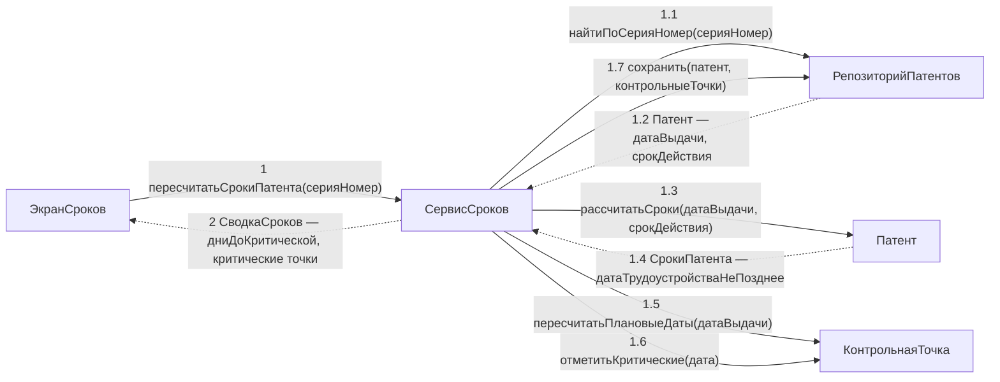

# Операция `пересчитатьСрокиПатента`

**Дисциплина:** Функциональное моделирование систем · **ТюмГУ**, 5 семестр · **Преподаватель:** Ткаченко И. Н.  
**Тема (раздел дорожной карты):** Тема 7. Действия после получения патента · **Команда:** Малышева Елена, Макеев Глеб · **Автор работы:** Макеев Глеб Борисович  
**Дата:** 18.10.2026 · **Репозиторий:** <https://github.com/mflkee/fms-course>

> **Лабораторная 4, диаграмма коммуникаций.** Одна диаграмма — одна системная операция из лаб. 3.
> Объекты — только классы проектирования [`DESIGN.md` §6](../../DESIGN.md): границы (`Экран*`),
> управление (`Сервис*`), сущности (§5), хранилища (`Репозиторий*`), шлюзы (`Шлюз*`).

| | |
|---|---|
| **Системная операция** | `пересчитатьСрокиПатента(серияНомер: НомерДокумента) : СводкаСроков` |
| **Прецедент** | П04 — [Контроль срока трудоустройства](../../lab1-usecases/usecases/04-kontrol-sroka-trudoustroystva.md) |
| **Диаграмма последовательностей (лаб. 3)** | [07-p04-osnovnoy](../../lab3-sequence-diagrams/diagrams/07-p04-osnovnoy.md) — пересчёт сроков и критических точек |
| **Инварианты ([DESIGN.md §5](../../DESIGN.md))** | ИНВ-2, ИНВ-3, ИНВ-6 |
| **Объектов / сообщений** | 5 / 9 |
| **Файлы** | [`08-pereschitat-sroki-patenta.puml`](08-pereschitat-sroki-patenta.puml) · [`08-pereschitat-sroki-patenta.png`](08-pereschitat-sroki-patenta.png) |

**Назначение операции:** пересчитать сроки патента от даты выдачи, обновить плановые даты контрольных точек и отметить критические, чтобы напоминания опирались на актуальные даты.

## 1. Объекты

| Объект | Слой | Соответствие DESIGN.md |
|---|---|---|
| `ЭкранСроков` | граница (`boundary`) | `ЭкранСроков` — запрос сводки сроков |
| `СервисСроков` | управление (`control`) | `СервисСроков` — сценарий пересчёта |
| `РепозиторийПатентов` | хранилище (`repository`) | `РепозиторийПатентов` — чтение патента и точек, запись результата |
| `Патент` | сущность (`entity`, DESIGN §5) | `Патент` — дата выдачи и срок действия |
| `КонтрольнаяТочка` | сущность (`entity`, DESIGN §5) | `КонтрольнаяТочка` — плановые даты и критичность |

## 2. Диаграмма коммуникаций

PlantUML-исходник (диаграмма объектов с нумерованными стрелками): [`08-pereschitat-sroki-patenta.puml`](08-pereschitat-sroki-patenta.puml); растровый рендер: [`08-pereschitat-sroki-patenta.png`](08-pereschitat-sroki-patenta.png).

## 3. Сообщения

| № | Сообщение | Отправитель | Получатель | Назначение |
|---|---|---|---|---|
| **1** | `пересчитатьСрокиПатента(серияНомер)` | ЭкранСроков | СервисСроков | Точка входа: ИГ открывает сводку сроков по патенту. |
| **1.1** | `найтиПоСерияНомер(серияНомер)` | СервисСроков | РепозиторийПатентов | Пересчёт всегда идёт от данных карточки, а не от даты ввода. |
| **1.2** *(возврат)* | `Патент — датаВыдачи, срокДействия` | РепозиторийПатентов | СервисСроков | Исходные данные для расчёта. |
| **1.3** | `рассчитатьСроки(датаВыдачи, срокДействия)` | СервисСроков | Патент | Дата «трудоустроиться не позднее» = дата выдачи + 2 месяца (ИНВ-3). |
| **1.4** *(возврат)* | `СрокиПатента — датаТрудоустройстваНеПозднее` | Патент | СервисСроков | Результат расчёта. |
| **1.5** | `пересчитатьПлановыеДаты(датаВыдачи)` | СервисСроков | КонтрольнаяТочка | Плановые даты всех точек патента (ИНВ-6: точки — композиция патента). |
| **1.6** | `отметитьКритические(дата)` | СервисСроков | КонтрольнаяТочка | Точки, до которых осталось меньше порога, получают статус «критическая». |
| **1.7** | `сохранить(патент, контрольныеТочки)` | СервисСроков | РепозиторийПатентов | Новые плановые даты сохраняются, чтобы напоминания шли по ним. |
| **2** *(возврат)* | `СводкаСроков — дниДоКритической, критические точки` | СервисСроков | ЭкранСроков | Возврат сводки на экран сроков. |

## 4. Решения и примечания

- Правило «2 месяца с даты выдачи» описано в `Патент.рассчитатьСроки` и вызывается только из `СервисСроков` — дублирования нет.
- Пересчёт идемпотентен: повторный вызов при тех же данных даёт те же даты и не создаёт новых точек.
- Пересчёт не отправляет напоминаний: доставка — свойство `Напоминание`, настройка — операция `настроитьНапоминания`.
- Операция не меняет статус патента: истечение срока — не архивирование, архивный статус ставит `пометитьПатентАрхивным`.

Назад: [README лаб. 4](../README.md) · [DESIGN.md §3, §6](../../DESIGN.md) · [прецедент](../../lab1-usecases/usecases/04-kontrol-sroka-trudoustroystva.md)
