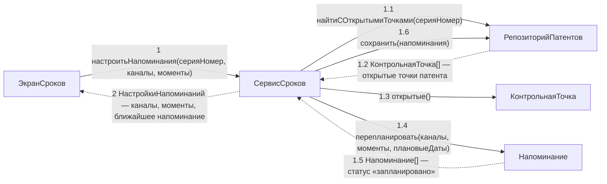

# Операция `настроитьНапоминания`

**Дисциплина:** Функциональное моделирование систем · **ТюмГУ**, 5 семестр · **Преподаватель:** Ткаченко И. Н.  
**Тема (раздел дорожной карты):** Тема 7. Действия после получения патента · **Команда:** Малышева Елена, Макеев Глеб · **Автор работы:** Макеев Глеб Борисович  
**Дата:** 18.10.2026 · **Репозиторий:** <https://github.com/mflkee/fms-course>

> **Лабораторная 4, диаграмма коммуникаций.** Одна диаграмма — одна системная операция из лаб. 3.
> Объекты — только классы проектирования [`DESIGN.md` §6](../../DESIGN.md): границы (`Экран*`),
> управление (`Сервис*`), сущности (§5), хранилища (`Репозиторий*`), шлюзы (`Шлюз*`).

| | |
|---|---|
| **Системная операция** | `настроитьНапоминания(серияНомер: НомерДокумента, каналы: КаналУведомления[], моменты: Дни[]) : НастройкиНапоминаний` |
| **Прецедент** | П04 — [Контроль срока трудоустройства](../../lab1-usecases/usecases/04-kontrol-sroka-trudoustroystva.md) |
| **Диаграмма последовательностей (лаб. 3)** | [07-p04-osnovnoy](../../lab3-sequence-diagrams/diagrams/07-p04-osnovnoy.md) — напоминания за 14/7/1 день |
| **Инварианты ([DESIGN.md §5](../../DESIGN.md))** | ИНВ-6 |
| **Объектов / сообщений** | 5 / 8 |
| **Файлы** | [`09-nastroit-napominaniya.puml`](09-nastroit-napominaniya.puml) · [`09-nastroit-napominaniya.png`](09-nastroit-napominaniya.png) |

**Назначение операции:** сохранить выбранные каналы и моменты напоминаний и перепланировать напоминания по открытым контрольным точкам патента.

## 1. Объекты

| Объект | Слой | Соответствие DESIGN.md |
|---|---|---|
| `ЭкранСроков` | граница (`boundary`) | `ЭкранСроков` — выбор каналов и моментов напоминаний |
| `СервисСроков` | управление (`control`) | `СервисСроков` — сценарий настройки напоминаний |
| `РепозиторийПатентов` | хранилище (`repository`) | `РепозиторийПатентов` — чтение точек и запись напоминаний |
| `КонтрольнаяТочка` | сущность (`entity`, DESIGN §5) | `КонтрольнаяТочка` — открытые точки с плановыми датами |
| `Напоминание` | сущность (`entity`, DESIGN §5) | `Напоминание` — перепланируется под новые моменты |

## 2. Диаграмма коммуникаций

PlantUML-исходник (диаграмма объектов с нумерованными стрелками): [`09-nastroit-napominaniya.puml`](09-nastroit-napominaniya.puml); растровый рендер: [`09-nastroit-napominaniya.png`](09-nastroit-napominaniya.png).

## 3. Сообщения

| № | Сообщение | Отправитель | Получатель | Назначение |
|---|---|---|---|---|
| **1** | `настроитьНапоминания(серияНомер, каналы, моменты)` | ЭкранСроков | СервисСроков | Точка входа: ИГ настраивает напоминания по своему патенту. |
| **1.1** | `найтиСОткрытымиТочками(серияНомер)` | СервисСроков | РепозиторийПатентов | Настройка применяется только к действующему патенту. |
| **1.2** *(возврат)* | `КонтрольнаяТочка[] — открытые точки патента` | РепозиторийПатентов | СервисСроков | Точки, по которым ещё есть срок. |
| **1.3** | `открытые()` | СервисСроков | КонтрольнаяТочка | Отбор точек со статусом «открыта» или «критическая». |
| **1.4** | `перепланировать(каналы, моменты, плановыеДаты)` | СервисСроков | Напоминание | По каждой точке создаются или сдвигаются напоминания (например, за 14, 7 и 1 день). |
| **1.5** *(возврат)* | `Напоминание[] — статус «запланировано»` | Напоминание | СервисСроков | Набор напоминаний, готовый к сохранению. |
| **1.6** | `сохранить(напоминания)` | СервисСроков | РепозиторийПатентов | Напоминания хранятся вместе с точками (композиция, ИНВ-6). |
| **2** *(возврат)* | `НастройкиНапоминаний — каналы, моменты, ближайшее напоминание` | СервисСроков | ЭкранСроков | Подтверждение настроек на экране сроков. |

## 4. Решения и примечания

- Собственного класса «настройки» в модели нет: настройка выражается состоянием напоминаний, привязанных к точкам.
- Повторная настройка заменяет план, а не дублирует напоминания: операция идемпотентна по набору (точка, момент, канал).
- Напоминание — сущность, а не сервис: систему не нужно наделять отдельным «отправщиком», доставка описывается состоянием `Напоминание`.
- Настройка не пересчитывает сроки: это отдельная операция `пересчитатьСрокиПатента`.

Назад: [README лаб. 4](../README.md) · [DESIGN.md §3, §6](../../DESIGN.md) · [прецедент](../../lab1-usecases/usecases/04-kontrol-sroka-trudoustroystva.md)
