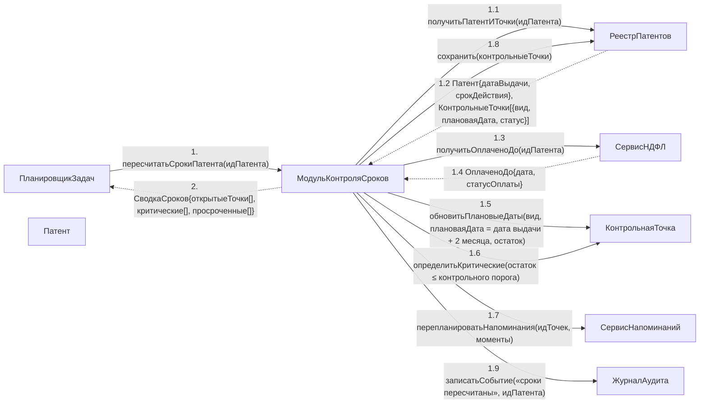

# Операция `пересчитатьСрокиПатента`

**Дисциплина:** Функциональное моделирование систем · **ТюмГУ**, 5 семестр · **Преподаватель:** Ткаченко И. Н.  
**Тема (раздел дорожной карты):** Тема 7. Действия после получения патента · **Команда:** Малышева Елена, Макеев Глеб, Мальгин Олег · **Автор работы:** Макеев Глеб Борисович  
**Дата:** 18.10.2026 · **Репозиторий:** <https://github.com/mflkee/fms-course>

> **Лабораторная 4, диаграмма коммуникаций** (взаимодействие объектов). Одна диаграмма — на одну системную операцию из лаб. 3. Объекты — экземпляры классов модели предметной области (лаб. 2) и концептуальные компоненты подсистемы; привязки к языку и фреймворку нет.

| | |
|---|---|
| **Системная операция** | `пересчитатьСрокиПатента(идПатента: UUID) : СводкаСроков` |
| **Прецедент** | П04 — [П04. Контроль срока трудоустройства и напоминания](../../lab1-usecases/usecases/04-kontrol-sroka-trudoustroystva.md) |
| **Диаграмма последовательностей (лаб. 3)** | [10-p04-osnovnoy](../../lab3-sequence-diagrams/diagrams/10-p04-osnovnoy.md) |
| **Инварианты лаб. 2** | **ИНВ-2**, **ИНВ-3**, **ИНВ-9** |
| **Файлы** | [`09-pereschitat-sroki-patenta.puml`](09-pereschitat-sroki-patenta.puml) · [`09-pereschitat-sroki-patenta.png`](09-pereschitat-sroki-patenta.png) |

**Назначение операции:** пересчитать все сроки по патенту от даты выдачи, обновить плановые даты и критичность контрольных точек и перепланировать напоминания.

## 1. Объекты

| Объект | Тип | Соответствие модели лаб. 2 |
|---|---|---|
| `ПланировщикЗадач` | компонент | внутренний триггер (планировщик). Актором лаб. 1 не является: время не имеет собственной цели, ради которой оно «пользуется» системой |
| `МодульКонтроляСроков` | компонент | компонент — владелец операции; правило «2 месяца с даты выдачи патента» реализовано здесь |
| `РеестрПатентов` | хранилище | хранилище `Патент`, `КонтрольнаяТочка`, `ПлатёжНДФЛ` |
| `Патент` | сущность | класс `Патент` (источник даты выдачи) |
| `КонтрольнаяТочка` | сущность | класс `КонтрольнаяТочка` (плановая дата, критичность, статус) |
| `СервисНДФЛ` | компонент | компонент учёта платежей — источник данных для точки «уплатить НДФЛ» |
| `СервисНапоминаний` | компонент | компонент, перепланирующий напоминания |
| `ЖурналАудита` | компонент | журнал аудита |

## 2. Диаграмма коммуникаций

PlantUML-исходник (диаграмма объектов с нумерованными стрелками): [`09-pereschitat-sroki-patenta.puml`](09-pereschitat-sroki-patenta.puml); растровый рендер: [`09-pereschitat-sroki-patenta.png`](09-pereschitat-sroki-patenta.png).

## 3. Сообщения

| № | Сообщение | Отправитель | Получатель | Назначение |
|---|---|---|---|---|
| **1** | `пересчитатьСрокиПатента(идПатента)` | ПланировщикЗадач | МодульКонтроляСроков | Точка входа — плановая проверка (либо пересчёт изнутри операций П01, П02, П06). |
| **1.1** | `получитьПатентИТочки(идПатента)` | МодульКонтроляСроков | РеестрПатентов | Получение патента и всех его контрольных точек. |
| **1.2** *(возврат)* | `Патент{датаВыдачи, срокДействия}, КонтрольныеТочки[{вид, плановаяДата, статус}]` | РеестрПатентов | МодульКонтроляСроков | Данные для расчёта. Ключ расчёта — дата выдачи патента. |
| **1.3** | `получитьОплаченоДо(идПатента)` | МодульКонтроляСроков | СервисНДФЛ | Для точки «уплатить НДФЛ» нужно знать границу оплаченного периода. |
| **1.4** *(возврат)* | `ОплаченоДо{дата, статусОплаты}` | СервисНДФЛ | МодульКонтроляСроков | Ответ сервиса НДФЛ. |
| **1.5** | `обновитьПлановыеДаты(вид, плановаяДата = дата выдачи + 2 месяца, остаток)` | МодульКонтроляСроков | КонтрольнаяТочка | ИНВ-3 — для точки «заключить договор», ИНВ-2 — для точки «направить уведомление». |
| **1.6** | `определитьКритические(остаток ≤ контрольного порога)` | МодульКонтроляСроков | КонтрольнаяТочка | Точки с малым остатком становятся критическими; просроченные — просроченными. |
| **1.7** | `перепланироватьНапоминания(идТочек, моменты)` | МодульКонтроляСроков | СервисНапоминаний | Напоминания по закрытым и отменённым точкам снимаются (ИНВ-9). |
| **1.8** | `сохранить(контрольныеТочки)` | МодульКонтроляСроков | РеестрПатентов | Запись изменённых точек одной транзакцией. |
| **1.9** | `записатьСобытие(«сроки пересчитаны», идПатента)` | МодульКонтроляСроков | ЖурналАудита | Протоколирование изменений сроков — требование П04 «все изменения сроков и факты напоминаний протоколируются». |
| **2** *(возврат)* | `СводкаСроков{открытыеТочки[], критические[], просроченные[]}` | МодульКонтроляСроков | ПланировщикЗадач | Возврат сводки; при просрочке следующим шагом применяется `зафиксироватьНарушениеСрока` (диаграмма 10). |

## 4. Решения и примечания

- Объект `PL` (ПланировщикЗадач) — концептуальный компонент, которым в модели обозначен внутренний триггер. Он не является актором: в лаб. 1 время намеренно не выделено в действующих лиц.
- Операция вызывается и из П01/П02/П06 — как часть других операций. Это видно в SSD лаб. 3: там пересчёт показан самообращением системы.
- Правило «2 месяца с даты выдачи патента» сосредоточено в одном компоненте — это защита от расхождений между прецедентами П01, П02, П03, П04, П06.

Назад: [README лаб. 4](../README.md) · [спецификация операций лаб. 3](../../lab3-sequence-diagrams/operations.md) · [прецедент](../../lab1-usecases/usecases/04-kontrol-sroka-trudoustroystva.md)
