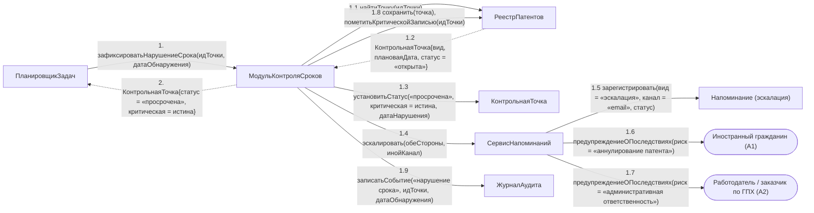

# Операция `зафиксироватьНарушениеСрока`

**Дисциплина:** Функциональное моделирование систем · **ТюмГУ**, 5 семестр · **Преподаватель:** Ткаченко И. Н.  
**Тема (раздел дорожной карты):** Тема 7. Действия после получения патента · **Команда:** Малышева Елена, Макеев Глеб, Мальгин Олег · **Автор работы:** Макеев Глеб Борисович  
**Дата:** 18.10.2026 · **Репозиторий:** <https://github.com/mflkee/fms-course>

> **Лабораторная 4, диаграмма коммуникаций** (взаимодействие объектов). Одна диаграмма — на одну системную операцию из лаб. 3. Объекты — экземпляры классов модели предметной области (лаб. 2) и концептуальные компоненты подсистемы; привязки к языку и фреймворку нет.

| | |
|---|---|
| **Системная операция** | `зафиксироватьНарушениеСрока(идТочки: UUID, датаОбнаружения: Date) : КонтрольнаяТочка` |
| **Прецедент** | П04 — [П04. Контроль срока трудоустройства и напоминания](../../lab1-usecases/usecases/04-kontrol-sroka-trudoustroystva.md) |
| **Диаграмма последовательностей (лаб. 3)** | [11-p04-alternativa-prosrochka-napominanie](../../lab3-sequence-diagrams/diagrams/11-p04-alternativa-prosrochka-napominanie.md) |
| **Инварианты лаб. 2** | **ИНВ-2**, **ИНВ-3** |
| **Файлы** | [`10-zafiksirovat-narushenie-sroka.puml`](10-zafiksirovat-narushenie-sroka.puml) · [`10-zafiksirovat-narushenie-sroka.png`](10-zafiksirovat-narushenie-sroka.png) |

**Назначение операции:** зафиксировать факт нарушения срока как юридически значимое событие: перевести точку в статус «просрочена», эскалировать предупреждение и сделать запись критической для реестра.

## 1. Объекты

| Объект | Тип | Соответствие модели лаб. 2 |
|---|---|---|
| `ПланировщикЗадач` | компонент | внутренний триггер (планировщик) — инициатор операции |
| `МодульКонтроляСроков` | компонент | компонент — владелец операции |
| `РеестрПатентов` | хранилище | хранилище `КонтрольнаяТочка`, `Патент` |
| `КонтрольнаяТочка` | сущность | класс `КонтрольнаяТочка` (статус «просрочена», признак `критическая` = истина) |
| `СервисНапоминаний` | компонент | компонент эскалации предупреждений |
| `Напоминание (эскалация)` | сущность | класс `Напоминание` — фиксируется факт эскалации |
| `Иностранный гражданин (A1)` | актор | актор A1 — уведомляется о риске аннулирования патента |
| `Работодатель / заказчик по ГПХ (A2)` | актор | актор A2 — уведомляется об административной ответственности |
| `ЖурналАудита` | компонент | журнал аудита |

## 2. Диаграмма коммуникаций

PlantUML-исходник (диаграмма объектов с нумерованными стрелками): [`10-zafiksirovat-narushenie-sroka.puml`](10-zafiksirovat-narushenie-sroka.puml); растровый рендер: [`10-zafiksirovat-narushenie-sroka.png`](10-zafiksirovat-narushenie-sroka.png).

## 3. Сообщения

| № | Сообщение | Отправитель | Получатель | Назначение |
|---|---|---|---|---|
| **1** | `зафиксироватьНарушениеСрока(идТочки, датаОбнаружения)` | ПланировщикЗадач | МодульКонтроляСроков | Точка входа: планировщик обнаружил, что точка не закрыта, а срок истёк. |
| **1.1** | `найтиТочку(идТочки)` | МодульКонтроляСроков | РеестрПатентов | Поиск контрольной точки. |
| **1.2** *(возврат)* | `КонтрольнаяТочка{вид, плановаяДата, статус = «открыта»}` | РеестрПатентов | МодульКонтроляСроков | Точка найдена и действительно не закрыта. |
| **1.3** | `установитьСтатус(«просрочена», критическая = истина, датаНарушения)` | МодульКонтроляСроков | КонтрольнаяТочка | Факт нарушения фиксируется в самой точке: отметка о просрочке сохраняется, даже если действие будет выполнено позже. |
| **1.4** | `эскалировать(обеСтороны, инойКанал)` | МодульКонтроляСроков | СервисНапоминаний | Эскалация: повторное предупреждение по другому каналу с повышенным уровнем критичности. |
| **1.5** | `зарегистрировать(вид = «эскалация», канал = «email», статус)` | СервисНапоминаний | Напоминание (эскалация) | Факт эскалации сохраняется в истории напоминаний. |
| **1.6** | `предупреждениеОПоследствиях(риск = «аннулирование патента»)` | СервисНапоминаний | Иностранный гражданин (A1) | ИГ уведомляется о риске потери патента. |
| **1.7** | `предупреждениеОПоследствиях(риск = «административная ответственность»)` | СервисНапоминаний | Работодатель / заказчик по ГПХ (A2) | Работодатель уведомляется об ответственности за непредставление уведомления. |
| **1.8** | `сохранить(точка); пометитьКритическойЗаписью(идТочки)` | МодульКонтроляСроков | РеестрПатентов | Запись становится критической — она видна администратору в реестре без дополнительной фильтрации (альтернатива *а П07). |
| **1.9** | `записатьСобытие(«нарушение срока», идТочки, датаОбнаружения)` | МодульКонтроляСроков | ЖурналАудита | Аудит нарушения. |
| **2** *(возврат)* | `КонтрольнаяТочка{статус = «просрочена», критическая = истина}` | МодульКонтроляСроков | ПланировщикЗадач | Возврат результата планировщику. |

## 4. Решения и примечания

- Отдельного класса «Инцидент» в модели нет: в лаб. 2 такой сущности не появилось, и её роль выполняет просроченная критическая контрольная точка. Если преподаватель потребует отдельную сущность «Инцидент», её нужно добавить в лаб. 2, а здесь — заменить сообщение 1.8.
- Эскалация «обеим сторонам» оправдана двумя разными рисками: у ИГ — аннулирование патента, у работодателя — административная ответственность. Это разные сообщения (1.6 и 1.7), а не одно.

Назад: [README лаб. 4](../README.md) · [спецификация операций лаб. 3](../../lab3-sequence-diagrams/operations.md) · [прецедент](../../lab1-usecases/usecases/04-kontrol-sroka-trudoustroystva.md)
