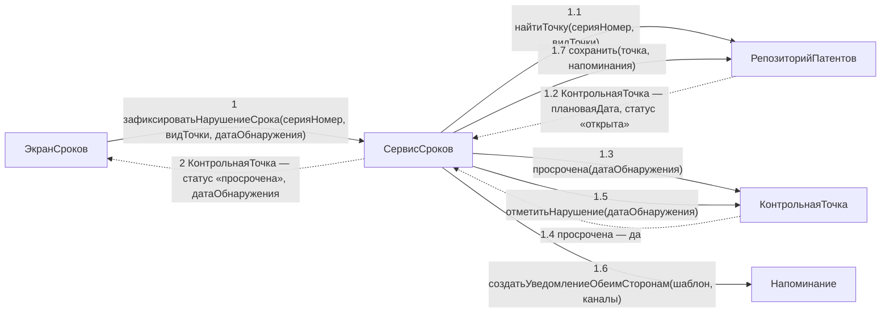

# Операция `зафиксироватьНарушениеСрока`

**Дисциплина:** Функциональное моделирование систем · **ТюмГУ**, 5 семестр · **Преподаватель:** Ткаченко И. Н.  
**Тема (раздел дорожной карты):** Тема 7. Действия после получения патента · **Команда:** Малышева Елена, Макеев Глеб, Мальгин Олег · **Автор работы:** Макеев Глеб Борисович  
**Дата:** 18.10.2026 · **Репозиторий:** <https://github.com/mflkee/fms-course>

> **Лабораторная 4, диаграмма коммуникаций.** Одна диаграмма — одна системная операция из лаб. 3.
> Объекты — только классы проектирования [`DESIGN.md` §6](../../DESIGN.md): границы (`Экран*`),
> управление (`Сервис*`), сущности (§5), хранилища (`Репозиторий*`), шлюзы (`Шлюз*`).

| | |
|---|---|
| **Системная операция** | `зафиксироватьНарушениеСрока(серияНомер: НомерДокумента, видТочки: ВидТочки, датаОбнаружения: Дата) : КонтрольнаяТочка` |
| **Прецедент** | П04 — [Контроль срока трудоустройства](../../lab1-usecases/usecases/04-kontrol-sroka-trudoustroystva.md) |
| **Диаграмма последовательностей (лаб. 3)** | [08-p04-alternativa-prosrochka](../../lab3-sequence-diagrams/diagrams/08-p04-alternativa-prosrochka.md) — срок истёк |
| **Инварианты ([DESIGN.md §5](../../DESIGN.md))** | ИНВ-2, ИНВ-3 |
| **Объектов / сообщений** | 5 / 9 |
| **Файлы** | [`10-zafiksirovat-narushenie-sroka.puml`](10-zafiksirovat-narushenie-sroka.puml) · [`10-zafiksirovat-narushenie-sroka.png`](10-zafiksirovat-narushenie-sroka.png) |

**Назначение операции:** зафиксировать просрочку контрольной точки как юридически значимое событие: отметить точку нарушенной и поставить напоминания-уведомления обеим сторонам.

## 1. Объекты

| Объект | Слой | Соответствие DESIGN.md |
|---|---|---|
| `ЭкранСроков` | граница (`boundary`) | `ЭкранСроков` — регистрация обнаруженной просрочки |
| `СервисСроков` | управление (`control`) | `СервисСроков` — сценарий фиксации нарушения |
| `РепозиторийПатентов` | хранилище (`repository`) | `РепозиторийПатентов` — поиск точки и сохранение |
| `КонтрольнаяТочка` | сущность (`entity`, DESIGN §5) | `КонтрольнаяТочка` — статус «просрочена» |
| `Напоминание` | сущность (`entity`, DESIGN §5) | `Напоминание` — уведомление обеим сторонам |

## 2. Диаграмма коммуникаций

PlantUML-исходник (диаграмма объектов с нумерованными стрелками): [`10-zafiksirovat-narushenie-sroka.puml`](10-zafiksirovat-narushenie-sroka.puml); растровый рендер: [`10-zafiksirovat-narushenie-sroka.png`](10-zafiksirovat-narushenie-sroka.png).

## 3. Сообщения

| № | Сообщение | Отправитель | Получатель | Назначение |
|---|---|---|---|---|
| **1** | `зафиксироватьНарушениеСрока(серияНомер, видТочки, датаОбнаружения)` | ЭкранСроков | СервисСроков | Точка входа: ИГ сообщает, что срок по точке пропущен. |
| **1.1** | `найтиТочку(серияНомер, видТочки)` | СервисСроков | РепозиторийПатентов | Точка ищется в составе патента. |
| **1.2** *(возврат)* | `КонтрольнаяТочка — плановаяДата, статус «открыта»` | РепозиторийПатентов | СервисСроков | Если точка уже выполнена или отменена — ошибка состояния. |
| **1.3** | `просрочена(датаОбнаружения)` | СервисСроков | КонтрольнаяТочка | Проверка: фактическая дата позже плановой. |
| **1.4** *(возврат)* | `просрочена — да` | КонтрольнаяТочка | СервисСроков | Подтверждение нарушения; иначе фиксировать нечего. |
| **1.5** | `отметитьНарушение(датаОбнаружения)` | СервисСроков | КонтрольнаяТочка | Статус «просрочена», фактическая дата и признак критичности. |
| **1.6** | `создатьУведомлениеОбеимСторонам(шаблон, каналы)` | СервисСроков | Напоминание | Напоминания ИГ и работодателю о нарушении срока. |
| **1.7** | `сохранить(точка, напоминания)` | СервисСроков | РепозиторийПатентов | Нарушение и уведомления сохраняются вместе. |
| **2** *(возврат)* | `КонтрольнаяТочка — статус «просрочена», датаОбнаружения` | СервисСроков | ЭкранСроков | Возврат точки с зафиксированным нарушением. |

## 4. Решения и примечания

- Просрочка — состояние контрольной точки, а не отдельная сущность: новых классов не вводится.
- Нарушение фиксируется один раз; повторный вызов возвращает ошибку состояния, а не создаёт вторую запись.
- Уведомление обеих сторон выражается напоминаниями с разными адресатами; отдельных классов «сторона» в модели нет.
- Операция не прекращает патент и не расторгает договор: она только фиксирует нарушение срока (границы подсистемы).

Назад: [README лаб. 4](../README.md) · [DESIGN.md §3, §6](../../DESIGN.md) · [прецедент](../../lab1-usecases/usecases/04-kontrol-sroka-trudoustroystva.md)
