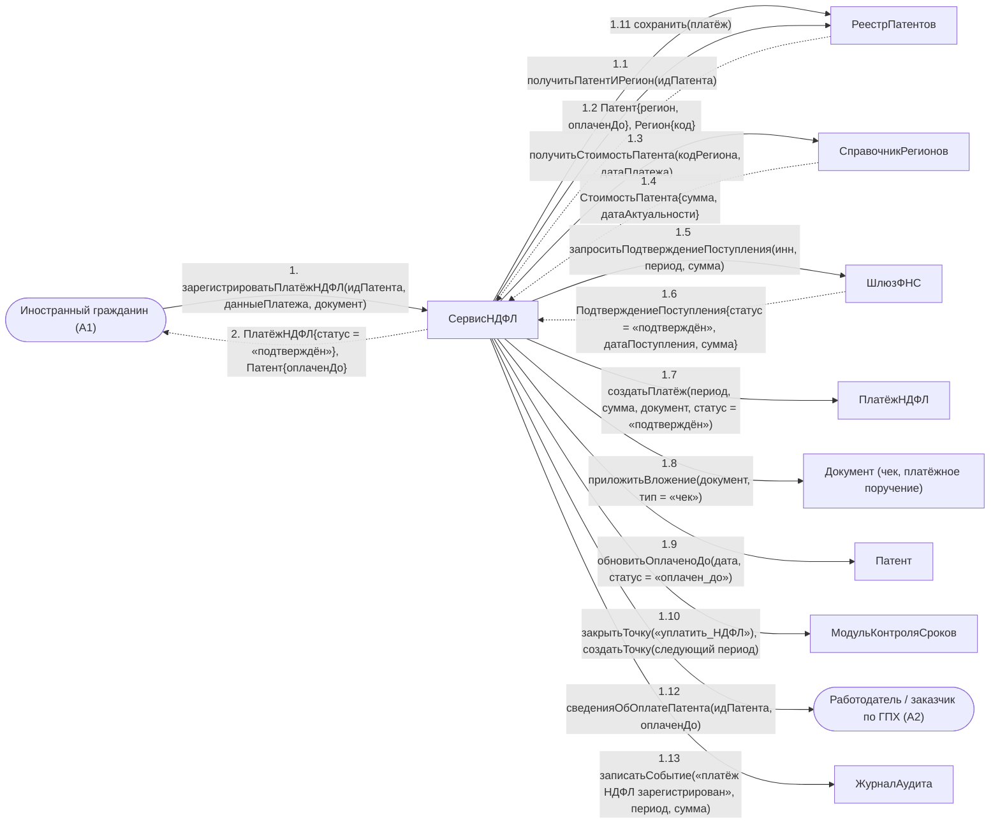

# Операция `зарегистрироватьПлатёжНДФЛ`

**Дисциплина:** Функциональное моделирование систем · **ТюмГУ**, 5 семестр · **Преподаватель:** Ткаченко И. Н.  
**Тема (раздел дорожной карты):** Тема 7. Действия после получения патента · **Команда:** Малышева Елена, Макеев Глеб, Мальгин Олег · **Автор работы:** Макеев Глеб Борисович  
**Дата:** 18.10.2026 · **Репозиторий:** <https://github.com/mflkee/fms-course>

> **Лабораторная 4, диаграмма коммуникаций** (взаимодействие объектов). Одна диаграмма — на одну системную операцию из лаб. 3. Объекты — экземпляры классов модели предметной области (лаб. 2) и концептуальные компоненты подсистемы; привязки к языку и фреймворку нет.

| | |
|---|---|
| **Системная операция** | `зарегистрироватьПлатёжНДФЛ(идПатента: UUID, данныеПлатежа: ДанныеПлатежа, документ: Вложение) : ПлатёжНДФЛ` |
| **Прецедент** | П05 — [П05. Учёт авансовых платежей НДФЛ и контроль срока действия патента](../../lab1-usecases/usecases/05-ndfl-i-prodlenie-patenta.md) |
| **Диаграмма последовательностей (лаб. 3)** | [13-p05-osnovnoy](../../lab3-sequence-diagrams/diagrams/13-p05-osnovnoy.md) |
| **Инварианты лаб. 2** | **ИНВ-5**, **ИНВ-7** |
| **Файлы** | [`11-zaregistrirovat-platezh-ndfl.puml`](11-zaregistrirovat-platezh-ndfl.puml) · [`11-zaregistrirovat-platezh-ndfl.png`](11-zaregistrirovat-platezh-ndfl.png) |

**Назначение операции:** зарегистрировать авансовый платёж НДФЛ за календарный период патента: проверить сумму по региону, подтвердить поступление и обновить срок оплаты патента.

## 1. Объекты

| Объект | Тип | Соответствие модели лаб. 2 |
|---|---|---|
| `Иностранный гражданин (A1)` | актор | актор A1 — плательщик |
| `Работодатель / заказчик по ГПХ (A2)` | актор | актор A2 — получает только факт «оплачен до даты», без сумм |
| `СервисНДФЛ` | компонент | концептуальный компонент учёта платежей и непрерывности оплаты |
| `РеестрПатентов` | хранилище | хранилище `Патент`, `ПлатёжНДФЛ`, `Документ` |
| `СправочникРегионов` | справочник | класс `Регион` (стоимость патента на дату платежа) — источник проверки ИНВ-7 |
| `Патент` | сущность | класс `Патент` (атрибут `оплаченДо`, статус `оплачен_до`) |
| `ПлатёжНДФЛ` | сущность | класс `ПлатёжНДФЛ` |
| `Документ (чек, платёжное поручение)` | сущность | класс `Документ` (тип «чек») |
| `ШлюзФНС` | компонент | шлюз к ФНС России (внешняя система A6) |
| `МодульКонтроляСроков` | компонент | компонент контроля сроков уплаты |
| `ЖурналАудита` | компонент | журнал аудита |

## 2. Диаграмма коммуникаций

PlantUML-исходник (диаграмма объектов с нумерованными стрелками): [`11-zaregistrirovat-platezh-ndfl.puml`](11-zaregistrirovat-platezh-ndfl.puml); растровый рендер: [`11-zaregistrirovat-platezh-ndfl.png`](11-zaregistrirovat-platezh-ndfl.png).

## 3. Сообщения

| № | Сообщение | Отправитель | Получатель | Назначение |
|---|---|---|---|---|
| **1** | `зарегистрироватьПлатёжНДФЛ(идПатента, данныеПлатежа, документ)` | Иностранный гражданин (A1) | СервисНДФЛ | Точка входа: ИГ вносит платёжный документ. |
| **1.1** | `получитьПатентИРегион(идПатента)` | СервисНДФЛ | РеестрПатентов | Получение патента и региона его выдачи. |
| **1.2** *(возврат)* | `Патент{регион, оплаченДо}, Регион{код}` | РеестрПатентов | СервисНДФЛ | Данные получены. |
| **1.3** | `получитьСтоимостьПатента(кодРегиона, датаПлатежа)` | СервисНДФЛ | СправочникРегионов | Проверка ИНВ-7: сумма должна соответствовать стоимости патента в регионе на дату платежа. |
| **1.4** *(возврат)* | `СтоимостьПатента{сумма, датаАктуальности}` | СправочникРегионов | СервисНДФЛ | Стоимость зависит от региона и не может считаться фиксированной. |
| **1.5** | `запроситьПодтверждениеПоступления(инн, период, сумма)` | СервисНДФЛ | ШлюзФНС | Обращение к ФНС за подтверждением поступления платежа. |
| **1.6** *(возврат)* | `ПодтверждениеПоступления{статус = «подтверждён», датаПоступления, сумма}` | ШлюзФНС | СервисНДФЛ | Платёж подтверждён администрирующим органом. |
| **1.7** | `создатьПлатёж(период, сумма, документ, статус = «подтверждён»)` | СервисНДФЛ | ПлатёжНДФЛ | Создание записи платежа, привязанной к патенту и календарному периоду. |
| **1.8** | `приложитьВложение(документ, тип = «чек»)` | СервисНДФЛ | Документ (чек, платёжное поручение) | Платёжный документ сохраняется как доказательство. |
| **1.9** | `обновитьОплаченоДо(дата, статус = «оплачен_до»)` | СервисНДФЛ | Патент | Атрибут `оплаченДо` — единственное, что видят другие прецеденты (П02, П03). |
| **1.10** | `закрытьТочку(«уплатить_НДФЛ»); создатьТочку(следующий период)` | СервисНДФЛ | МодульКонтроляСроков | Точка текущего периода закрыта, точка следующего периода создана. |
| **1.11** | `сохранить(платёж)` | СервисНДФЛ | РеестрПатентов | Запись платежа. |
| **1.12** | `сведенияОбОплатеПатента(идПатента, оплаченДо)` | СервисНДФЛ | Работодатель / заказчик по ГПХ (A2) | Работодатель получает только факт оплаты: суммы платежей ему не раскрываются. |
| **1.13** | `записатьСобытие(«платёж НДФЛ зарегистрирован», период, сумма)` | СервисНДФЛ | ЖурналАудита | Аудит платежа. |
| **2** *(возврат)* | `ПлатёжНДФЛ{статус = «подтверждён»}, Патент{оплаченДо}` | СервисНДФЛ | Иностранный гражданин (A1) | Возврат результата ИГ. |

## 4. Решения и примечания

- Сообщение 1.12 показано с ограничением: работодатель видит только `оплаченДо`. Это прямое следствие специального требования П05 о разграничении доступа.
- Продление патента не является отдельной операцией: новая карточка создаётся операцией `зарегистрироватьПатент` (диаграмма 1) и связывается с предыдущей — так сохраняется история.
- Непрерывность оплаты (ИНВ-5) проверяется не здесь, а в операции `зафиксироватьПрекращениеПатентаНеуплата` (диаграмма 13): регистрация платежа только фиксирует успешный факт.

Назад: [README лаб. 4](../README.md) · [спецификация операций лаб. 3](../../lab3-sequence-diagrams/operations.md) · [прецедент](../../lab1-usecases/usecases/05-ndfl-i-prodlenie-patenta.md)
