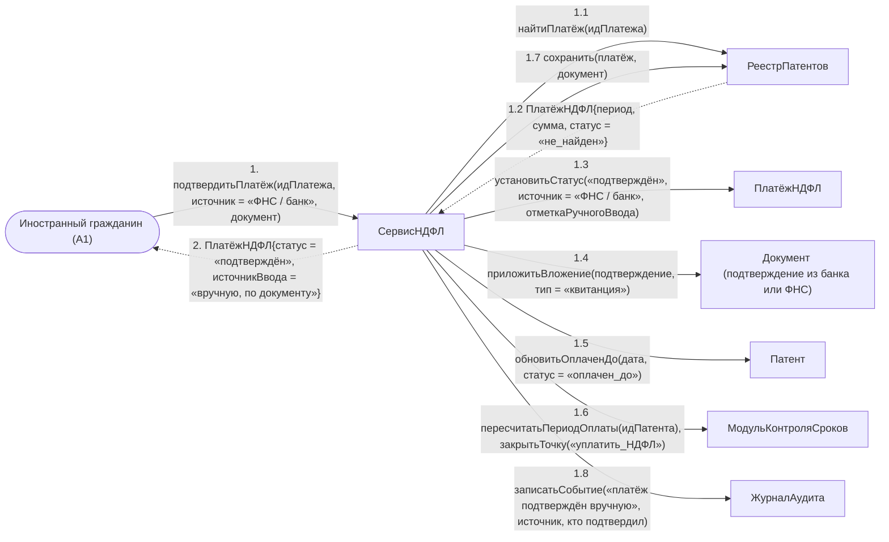

# Операция `подтвердитьПлатёж`

**Дисциплина:** Функциональное моделирование систем · **ТюмГУ**, 5 семестр · **Преподаватель:** Ткаченко И. Н.  
**Тема (раздел дорожной карты):** Тема 7. Действия после получения патента · **Команда:** Малышева Елена, Макеев Глеб, Мальгин Олег · **Автор работы:** Макеев Глеб Борисович  
**Дата:** 18.10.2026 · **Репозиторий:** <https://github.com/mflkee/fms-course>

> **Лабораторная 4, диаграмма коммуникаций** (взаимодействие объектов). Одна диаграмма — на одну системную операцию из лаб. 3. Объекты — экземпляры классов модели предметной области (лаб. 2) и концептуальные компоненты подсистемы; привязки к языку и фреймворку нет.

| | |
|---|---|
| **Системная операция** | `подтвердитьПлатёж(идПлатежа: UUID, источник: ИсточникПодтверждения, документ: Вложение) : ПлатёжНДФЛ` |
| **Прецедент** | П05 — [П05. Учёт авансовых платежей НДФЛ и контроль срока действия патента](../../lab1-usecases/usecases/05-ndfl-i-prodlenie-patenta.md) |
| **Диаграмма последовательностей (лаб. 3)** | [14-p05-alternativa-platezh-ne-najden](../../lab3-sequence-diagrams/diagrams/14-p05-alternativa-platezh-ne-najden.md) |
| **Инварианты лаб. 2** | **ИНВ-5**, **ИНВ-7** |
| **Файлы** | [`12-podtverdit-platezh.puml`](12-podtverdit-platezh.puml) · [`12-podtverdit-platezh.png`](12-podtverdit-platezh.png) |

**Назначение операции:** подтвердить платёж вручную по документу банка или ФНС, когда автоматическое подтверждение не получено, и восстановить учёт оплаченного периода.

## 1. Объекты

| Объект | Тип | Соответствие модели лаб. 2 |
|---|---|---|
| `Иностранный гражданин (A1)` | актор | актор A1 — приносит подтверждение платежа |
| `СервисНДФЛ` | компонент | компонент учёта платежей — владелец операции |
| `РеестрПатентов` | хранилище | хранилище `ПлатёжНДФЛ`, `Патент`, `Документ` |
| `ПлатёжНДФЛ` | сущность | класс `ПлатёжНДФЛ` (атрибуты `статус`, `документНомер`) |
| `Документ (подтверждение из банка или ФНС)` | сущность | класс `Документ` (тип «чек»/«квитанция») |
| `Патент` | сущность | класс `Патент` (атрибут `оплаченДо`) |
| `МодульКонтроляСроков` | компонент | компонент контроля сроков уплаты |
| `ЖурналАудита` | компонент | журнал аудита |

## 2. Диаграмма коммуникаций

PlantUML-исходник (диаграмма объектов с нумерованными стрелками): [`12-podtverdit-platezh.puml`](12-podtverdit-platezh.puml); растровый рендер: [`12-podtverdit-platezh.png`](12-podtverdit-platezh.png).

## 3. Сообщения

| № | Сообщение | Отправитель | Получатель | Назначение |
|---|---|---|---|---|
| **1** | `подтвердитьПлатёж(идПлатежа, источник = «ФНС / банк», документ)` | Иностранный гражданин (A1) | СервисНДФЛ | Точка входа: ИГ обращается в банк или ФНС и приносит подтверждение (шаг 2 альтернативы 3а П05). |
| **1.1** | `найтиПлатёж(идПлатежа)` | СервисНДФЛ | РеестрПатентов | Поиск записи платежа, по которой возник вопрос. |
| **1.2** *(возврат)* | `ПлатёжНДФЛ{период, сумма, статус = «не_найден»}` | РеестрПатентов | СервисНДФЛ | Платёж существует в подсистеме, но не подтверждён внешней сверкой. |
| **1.3** | `установитьСтатус(«подтверждён», источник = «ФНС / банк», отметкаРучногоВвода)` | СервисНДФЛ | ПлатёжНДФЛ | Ручной ввод обязательно помечается: он не должен выглядеть как автоматическое подтверждение. |
| **1.4** | `приложитьВложение(подтверждение, тип = «квитанция»)` | СервисНДФЛ | Документ (подтверждение из банка или ФНС) | Документ-основание сохраняется как доказательство. |
| **1.5** | `обновитьОплаченДо(дата, статус = «оплачен_до»)` | СервисНДФЛ | Патент | Оплаченный период восстанавливается; непрерывность оплаты сохранена (ИНВ-5). |
| **1.6** | `пересчитатьПериодОплаты(идПатента); закрытьТочку(«уплатить_НДФЛ»)` | СервисНДФЛ | МодульКонтроляСроков | Точка текущего периода закрывается; если период был непокрыт, снимается риск аннулирования. |
| **1.7** | `сохранить(платёж, документ)` | СервисНДФЛ | РеестрПатентов | Запись изменений. |
| **1.8** | `записатьСобытие(«платёж подтверждён вручную», источник, кто подтвердил)` | СервисНДФЛ | ЖурналАудита | Ручное подтверждение — место повышенного риска, поэтому аудит обязателен. |
| **2** *(возврат)* | `ПлатёжНДФЛ{статус = «подтверждён», источникВвода = «вручную, по документу»}` | СервисНДФЛ | Иностранный гражданин (A1) | Возврат результата. |

## 4. Решения и примечания

- Операция отделена от `зарегистрироватьПлатёжНДФЛ`, потому что у неё другой источник данных (внешнее подтверждение) и другая правовая природа (восстановление учёта по документу).
- Ветвь 3б (сумма меньше установленной) приводит к этой же операции только после доплаты: неполный платёж не может быть «подтверждён» — он должен быть доведён до стоимости патента в регионе (ИНВ-7).
- Отметка `отметкаРучногоВвода` — требование сценария П05 («платёж заносится вручную с отметкой об источнике»).

Назад: [README лаб. 4](../README.md) · [спецификация операций лаб. 3](../../lab3-sequence-diagrams/operations.md) · [прецедент](../../lab1-usecases/usecases/05-ndfl-i-prodlenie-patenta.md)
