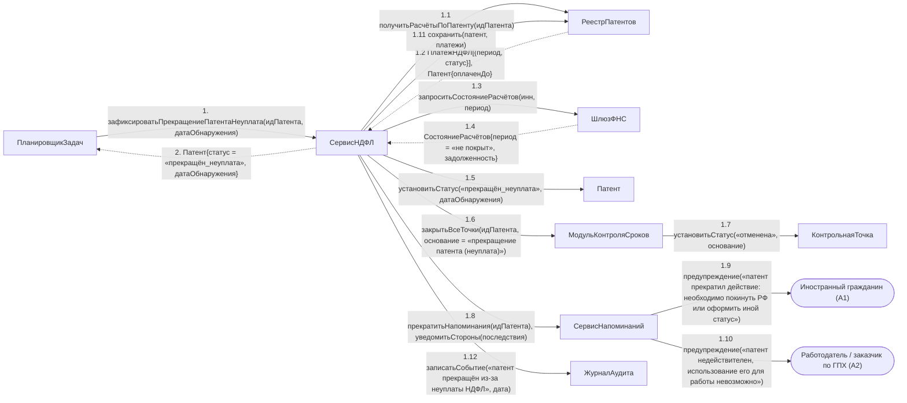

# Операция `зафиксироватьПрекращениеПатентаНеуплата`

**Дисциплина:** Функциональное моделирование систем · **ТюмГУ**, 5 семестр · **Преподаватель:** Ткаченко И. Н.  
**Тема (раздел дорожной карты):** Тема 7. Действия после получения патента · **Команда:** Малышева Елена, Макеев Глеб, Мальгин Олег · **Автор работы:** Макеев Глеб Борисович  
**Дата:** 18.10.2026 · **Репозиторий:** <https://github.com/mflkee/fms-course>

> **Лабораторная 4, диаграмма коммуникаций** (взаимодействие объектов). Одна диаграмма — на одну системную операцию из лаб. 3. Объекты — экземпляры классов модели предметной области (лаб. 2) и концептуальные компоненты подсистемы; привязки к языку и фреймворку нет.

| | |
|---|---|
| **Системная операция** | `зафиксироватьПрекращениеПатентаНеуплата(идПатента: UUID, датаОбнаружения: Date) : Патент` |
| **Прецедент** | П05 — [П05. Учёт авансовых платежей НДФЛ и контроль срока действия патента](../../lab1-usecases/usecases/05-ndfl-i-prodlenie-patenta.md) |
| **Диаграмма последовательностей (лаб. 3)** | [15-p05-alternativa-neoplata](../../lab3-sequence-diagrams/diagrams/15-p05-alternativa-neoplata.md) |
| **Инварианты лаб. 2** | **ИНВ-5**, **ИНВ-9** |
| **Файлы** | [`13-zafiksirovat-prekrashchenie-patenta-neuplata.puml`](13-zafiksirovat-prekrashchenie-patenta-neuplata.puml) · [`13-zafiksirovat-prekrashchenie-patenta-neuplata.png`](13-zafiksirovat-prekrashchenie-patenta-neuplata.png) |

**Назначение операции:** зафиксировать прекращение действия патента из-за неуплаты НДФЛ: закрыть все контрольные точки, прекратить напоминания и уведомить стороны и ФНС.

## 1. Объекты

| Объект | Тип | Соответствие модели лаб. 2 |
|---|---|---|
| `ПланировщикЗадач` | компонент | внутренний триггер (планировщик): оплаченный период закончился, платёж не поступил |
| `СервисНДФЛ` | компонент | компонент учёта платежей — владелец операции |
| `РеестрПатентов` | хранилище | хранилище `Патент`, `ПлатёжНДФЛ`, `КонтрольнаяТочка` |
| `ШлюзФНС` | компонент | шлюз к ФНС России (внешняя система A6) — подтверждение отсутствия платежа |
| `Патент` | сущность | класс `Патент` (статус `прекращён_неуплата`) |
| `МодульКонтроляСроков` | компонент | компонент, закрывающий контрольные точки |
| `КонтрольнаяТочка` | сущность | класс `КонтрольнаяТочка` (статус «отменена», основание «прекращение патента») |
| `СервисНапоминаний` | компонент | компонент прекращения напоминаний и уведомления сторон |
| `Иностранный гражданин (A1)` | актор | актор A1 — получает предупреждение о необходимости покинуть РФ или оформить иной статус |
| `Работодатель / заказчик по ГПХ (A2)` | актор | актор A2 — узнаёт, что работа по патенту невозможна |
| `ЖурналАудита` | компонент | журнал аудита |

## 2. Диаграмма коммуникаций

PlantUML-исходник (диаграмма объектов с нумерованными стрелками): [`13-zafiksirovat-prekrashchenie-patenta-neuplata.puml`](13-zafiksirovat-prekrashchenie-patenta-neuplata.puml); растровый рендер: [`13-zafiksirovat-prekrashchenie-patenta-neuplata.png`](13-zafiksirovat-prekrashchenie-patenta-neuplata.png).

## 3. Сообщения

| № | Сообщение | Отправитель | Получатель | Назначение |
|---|---|---|---|---|
| **1** | `зафиксироватьПрекращениеПатентаНеуплата(идПатента, датаОбнаружения)` | ПланировщикЗадач | СервисНДФЛ | Точка входа: планировщик обнаружил неоплату после истечения допустимого периода ожидания. |
| **1.1** | `получитьРасчётыПоПатенту(идПатента)` | СервисНДФЛ | РеестрПатентов | Получение платежей и текущего периода оплаты. |
| **1.2** *(возврат)* | `ПлатёжНДФЛ[{период, статус}], Патент{оплаченДо}` | РеестрПатентов | СервисНДФЛ | Видно, что период не покрыт. |
| **1.3** | `запроситьСостояниеРасчётов(инн, период)` | СервисНДФЛ | ШлюзФНС | Юридически значимое решение нельзя принимать только по отсутствию отметки в подсистеме: нужен ответ администрирующего органа. |
| **1.4** *(возврат)* | `СостояниеРасчётов{период = «не покрыт», задолженность}` | ШлюзФНС | СервисНДФЛ | ФНС подтверждает отсутствие платежа. |
| **1.5** | `установитьСтатус(«прекращён_неуплата», датаОбнаружения)` | СервисНДФЛ | Патент | Патент прекращает действие; `оплаченДо` сохраняется для истории (ИНВ-5: перерыв не восстанавливается задним числом). |
| **1.6** | `закрытьВсеТочки(идПатента, основание = «прекращение патента (неуплата)»)` | СервисНДФЛ | МодульКонтроляСроков | Все точки закрываются: обязанности по недействующему патенту больше не контролируются (ИНВ-9). |
| **1.7** | `установитьСтатус(«отменена», основание)` | МодульКонтроляСроков | КонтрольнаяТочка | Каждая точка получает основание отмены. |
| **1.8** | `прекратитьНапоминания(идПатента); уведомитьСтороны(последствия)` | СервисНДФЛ | СервисНапоминаний | Напоминания по патенту прекращаются, стороны получают предупреждения. |
| **1.9** | `предупреждение(«патент прекратил действие: необходимо покинуть РФ или оформить иной статус»)` | СервисНапоминаний | Иностранный гражданин (A1) | ИГ уведомляется о последствиях — это шаг 2 альтернативы 4а П05. |
| **1.10** | `предупреждение(«патент недействителен, использование его для работы невозможно»)` | СервисНапоминаний | Работодатель / заказчик по ГПХ (A2) | Работодатель уведомляется: договор требует пересмотра (переход к П06). |
| **1.11** | `сохранить(патент, платежи)` | СервисНДФЛ | РеестрПатентов | Запись изменений. |
| **1.12** | `записатьСобытие(«патент прекращён из-за неуплаты НДФЛ», дата)` | СервисНДФЛ | ЖурналАудита | Аудит: решение значимое и должно быть прослеживаемым. |
| **2** *(возврат)* | `Патент{статус = «прекращён_неуплата», датаОбнаружения}` | СервисНДФЛ | ПланировщикЗадач | Возврат результата планировщику. |

## 4. Решения и примечания

- Операция — единственная, переводящая патент в статус `прекращён_неуплата` (значение взято из перечня `СтатусПатента` в лаб. 2).
- Обращение к ФНС (1.3–1.4) принципиально: без подтверждения администрирующего органа прекращать действие патента нельзя.
- Дальнейшая судьба договора (прекращение, пересмотр) в этой диаграмме не детализирована: подсистема передаёт управление прецеденту П06 (сообщение 1.10).

Назад: [README лаб. 4](../README.md) · [спецификация операций лаб. 3](../../lab3-sequence-diagrams/operations.md) · [прецедент](../../lab1-usecases/usecases/05-ndfl-i-prodlenie-patenta.md)
