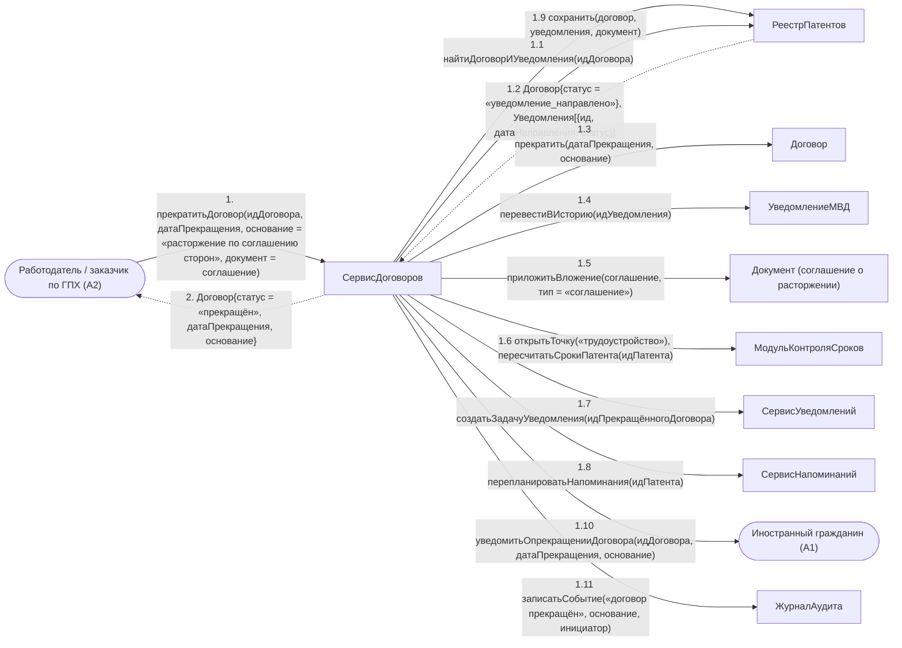

# Операция `прекратитьДоговор`

**Дисциплина:** Функциональное моделирование систем · **ТюмГУ**, 5 семестр · **Преподаватель:** Ткаченко И. Н.  
**Тема (раздел дорожной карты):** Тема 7. Действия после получения патента · **Команда:** Малышева Елена, Макеев Глеб, Мальгин Олег · **Автор работы:** Макеев Глеб Борисович  
**Дата:** 18.10.2026 · **Репозиторий:** <https://github.com/mflkee/fms-course>

> **Лабораторная 4, диаграмма коммуникаций** (взаимодействие объектов). Одна диаграмма — на одну системную операцию из лаб. 3. Объекты — экземпляры классов модели предметной области (лаб. 2) и концептуальные компоненты подсистемы; привязки к языку и фреймворку нет.

| | |
|---|---|
| **Системная операция** | `прекратитьДоговор(идДоговора: UUID, датаПрекращения: Date, основание: String, документ: Вложение) : Договор` |
| **Прецедент** | П06 — [П06. Прекращение договора, смена работодателя и повторное уведомление МВД](../../lab1-usecases/usecases/06-prekrashchenie-dogovora.md) |
| **Диаграмма последовательностей (лаб. 3)** | [16-p06-osnovnoy](../../lab3-sequence-diagrams/diagrams/16-p06-osnovnoy.md) |
| **Инварианты лаб. 2** | **ИНВ-1**, **ИНВ-8** |
| **Файлы** | [`14-prekratit-dogovor.puml`](14-prekratit-dogovor.puml) · [`14-prekratit-dogovor.png`](14-prekratit-dogovor.png) |

**Назначение операции:** закрыть действующий договор: зафиксировать дату и основание прекращения, перевести уведомления в историю и восстановить возможность нового трудоустройства.

## 1. Объекты

| Объект | Тип | Соответствие модели лаб. 2 |
|---|---|---|
| `Работодатель / заказчик по ГПХ (A2)` | актор | актор A2 — инициатор прекращения |
| `Иностранный гражданин (A1)` | актор | актор A1 — вторая сторона, уведомляется |
| `СервисДоговоров` | компонент | компонент заключения и прекращения договоров |
| `РеестрПатентов` | хранилище | хранилище `Договор`, `УведомлениеМВД`, `Документ`, `КонтрольнаяТочка` |
| `Договор` | сущность | класс `Договор` (статус `прекращён`) |
| `УведомлениеМВД` | сущность | класс `УведомлениеМВД` — переводится в историю, но не удаляется (ИНВ-8) |
| `Документ (соглашение о расторжении)` | сущность | класс `Документ` (тип «соглашение») |
| `МодульКонтроляСроков` | компонент | компонент контроля сроков: пересчитывает точки и открывает задачу трудоустройства |
| `СервисУведомлений` | компонент | компонент уведомлений: создаёт задачу уведомления МВД о прекращении или о новом договоре |
| `СервисНапоминаний` | компонент | компонент напоминаний |
| `ЖурналАудита` | компонент | журнал аудита |

## 2. Диаграмма коммуникаций

PlantUML-исходник (диаграмма объектов с нумерованными стрелками): [`14-prekratit-dogovor.puml`](14-prekratit-dogovor.puml); растровый рендер: [`14-prekratit-dogovor.png`](14-prekratit-dogovor.png).

## 3. Сообщения

| № | Сообщение | Отправитель | Получатель | Назначение |
|---|---|---|---|---|
| **1** | `прекратитьДоговор(идДоговора, датаПрекращения, основание = «расторжение по соглашению сторон», документ = соглашение)` | Работодатель / заказчик по ГПХ (A2) | СервисДоговоров | Точка входа: инициатор прекращения (работодатель или ИГ). |
| **1.1** | `найтиДоговорИУведомления(идДоговора)` | СервисДоговоров | РеестрПатентов | Получение договора и связанных с ним уведомлений. |
| **1.2** *(возврат)* | `Договор{статус = «уведомление_направлено»}, Уведомления[{ид, датаНаправления, статус}]` | РеестрПатентов | СервисДоговоров | Проверка корректности даты прекращения: не ранее даты заключения (альтернатива 2а П06). |
| **1.3** | `прекратить(датаПрекращения, основание)` | СервисДоговоров | Договор | Статус договора меняется на «прекращён»; ИНВ-1 восстановлен — можно заключить новый договор. |
| **1.4** | `перевестиВИсторию(идУведомления)` | СервисДоговоров | УведомлениеМВД | Уведомления не удаляются: они остаются доказательствами исполнения обязанности (ИНВ-8). |
| **1.5** | `приложитьВложение(соглашение, тип = «соглашение»)` | СервисДоговоров | Документ (соглашение о расторжении) | Документ-основание прекращения сохраняется. |
| **1.6** | `открытьТочку(«трудоустройство»); пересчитатьСрокиПатента(идПатента)` | СервисДоговоров | МодульКонтроляСроков | Если ИГ остался без работы, открывается задача трудоустройства и сроки пересчитываются (П04). |
| **1.7** | `создатьЗадачуУведомления(идПрекращённогоДоговора)` | СервисДоговоров | СервисУведомлений | Создаётся задача уведомления МВД о прекращении отношений или о новом договоре (П03). |
| **1.8** | `перепланироватьНапоминания(идПатента)` | СервисДоговоров | СервисНапоминаний | Напоминания по патенту пересобираются с учётом новых сроков. |
| **1.9** | `сохранить(договор, уведомления, документ)` | СервисДоговоров | РеестрПатентов | Запись изменений. |
| **1.10** | `уведомитьОпрекращенииДоговора(идДоговора, датаПрекращения, основание)` | СервисДоговоров | Иностранный гражданин (A1) | ИГ получает уведомление и знает свой остаток срока на новое трудоустройство. |
| **1.11** | `записатьСобытие(«договор прекращён», основание, инициатор)` | СервисДоговоров | ЖурналАудита | Аудит прекращения. |
| **2** *(возврат)* | `Договор{статус = «прекращён», датаПрекращения, основание}` | СервисДоговоров | Работодатель / заказчик по ГПХ (A2) | Возврат результата инициатору. |

## 4. Решения и примечания

- Операция восстанавливает ИНВ-1: пока договор действует, новый заключить нельзя (диаграмма 4, сообщение 1.2). Именно поэтому прекращение и заключение — разные операции с разными владельцами.
- Уведомления переводятся в историю, а не удаляются: доказательства отправки хранятся бессрочно (ИНВ-8). Это же правило действует для патентов и платежей.
- Сообщение 1.6 — связь с П04: без работы срок «2 месяца с даты выдачи патента» продолжает идти, и это главный риск сценария.

Назад: [README лаб. 4](../README.md) · [спецификация операций лаб. 3](../../lab3-sequence-diagrams/operations.md) · [прецедент](../../lab1-usecases/usecases/06-prekrashchenie-dogovora.md)
